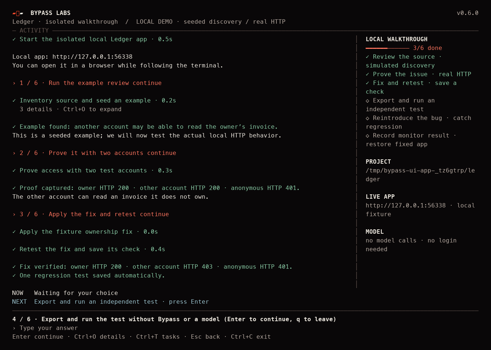

# Bypass for Muse

**Find an account-access bug. Verify the fix. Keep the test and security context for your next feature.**

Inside **Muse Code**, Muse plans the investigation and fixes; Bypass reads bounded source, executes approved HTTP tests, and preserves evidence. No separate model key or Docker is needed for the plugin. The **standalone CLI** uses your explicit provider API key and isolated Docker workers.

This is a working POC for missing authentication and cross-account access to configured JSON/HTML resources, plus bounded registration and email-verification checks. Source citations are hypotheses; actual HTTP controls establish confirmation. Passing these checks is not a complete security assessment.

## Start in Muse

Requires **Muse Code installed and signed in**.

**1. Run this from your application folder.**

macOS / Linux:

```bash
curl -fsSL https://bypasslabs.ai/install/muse | bash
```

Windows PowerShell:

```powershell
irm https://bypasslabs.ai/install/muse.ps1 | iex
```

This installs the full Muse plugin and CLI, includes Node, and sets up PATH. No GitHub clone, npm, Docker or separate model key is needed for the plugin. Rerun the same command to update or repair, then start a **new Muse session**. An already-open session keeps its loaded plugin. Native `muse plugins update bypass` only refreshes its local source; use the public installer to download a newer release.

**2. Answer `y` to “Enable Bypass and open Muse?”**

The installer explains Bypass's two permissions, records your choice through Muse, and opens a fresh Muse session in the same folder with setup already started. You do not need to navigate plugin menus or type a startup command. Muse may still ask you to sign in or trust the workspace if you have not done that before.

To return to setup in a later Muse session:

```text
/bypass:start
```

Bypass reuses the repository and app address you already supplied. If the address is missing, it asks **“What address do you open in your browser to use this app?”** Paste the URL, or say **“code only”** to start a code review. For an online app, it asks whether real users use it only if that is still unknown. It then shows the exact DNS TXT record to verify control and lets you choose allowed HTTP methods: **GET, HEAD, POST, PUT, PATCH, DELETE, OPTIONS, or custom**. The permission summary shows the app, paths, request limit and expiry. Choose POST when the review needs to create test resources or start jobs. Muse performs authorized setup and uses the returned IDs for access checks; saved access regressions do not recreate those jobs.

**Credentials are optional.** Source and anonymous checks can start without them. Muse investigates signup from source and, when authorized, Bypass tries creating up to two dedicated accounts and connects them privately. JSON signup and Firebase email/password are supported; retries reuse saved attempts instead of creating duplicate users.

For account-boundary tests, Muse derives routes/selectors and selects owned test IDs from an authorized collection. You can also import existing accounts from a private file. Firebase tokens refresh automatically in the same session. Missing accounts or data limit those tests; they do not block the rest of the review. Never paste secrets into chat. [Accounts, signup and supported limits](docs/ACCOUNTS.md).

Then ask, for example:

> Review this application, prove any account-access issue, help me fix it, and save a regression test.

<details>
<summary>Optional: install from inside Muse instead</summary>

Ask Muse:

```text
Read https://bypasslabs.ai/install/muse.md and install Bypass for Muse.
```

Muse runs the same installer. Agent-run or noninteractive installs leave permission review to you: `/plugins` → **Installed** → **Bypass** → **Runtime**, then start a new session and run `/bypass:start`. The terminal installer above handles that handoff after your confirmation. [Installation details and the optional npx skills route](docs/INSTALLATION_DESIGN.md).

</details>

**Account/privacy boundary:** Bypass uses the active Muse session and makes no independent model requests. The current MCP interface does not attest session billing, so Bypass cannot verify subscription usage. Confirm subscription mode in Muse; if the host shows API billing, switch to subscription mode. For confidential/personal code, turn Contributor mode off in Muse `/settings` and use Standard mode. Bypass does not change those settings. [Meta's requirements](https://dev.meta.ai/help/subscriptions/muse-code-contributor-mode).

## See the complete demo

Inside Muse:

```text
/bypass:demo
```

Muse creates an isolated public fixture, reads its actual source and finds the missing invoice ownership check. It chooses the approved probe; Bypass observes owner **200**, other account **200**, anonymous **401**. Muse interprets that evidence, applies the fixture fix and retests: owner **200**, other account **403**, anonymous **401**. Bypass saves a failing regression as soon as the issue is confirmed; after the fix, that same test passes and can be exported. Reintroducing the bug makes replay fail with **zero plugin model calls**. The fixture is restored and stopped; evidence remains available.

Muse drives every reasoning step. You do not copy JSON, configure a second model, or move to another terminal for the test loop. The fixture demo tests only its generated app. [Detailed walkthrough](docs/WALKTHROUGH.md).

## What you keep

- **Optional accounts:** start with source and anonymous checks; authorize dedicated signup tests or connect existing accounts when needed.
- **Observed proof:** cited source plus scoped HTTP controls; suspected, confirmed, blocked and not-run states stay distinct.
- **Reusable regressions:** confirmed bugs immediately become failing tests. Verify a fix, export to CI, and catch recurrence without AI or provider credentials.
- **Security context for coding:** `/bypass:build` retrieves cited application knowledge, prior investigations and saved behavior requirements before a new feature. Changed source marks knowledge stale; history is not current proof.
- **Local evidence and control:** evidence stays in `.bypass/`. Muse controls plugin reasoning/privacy; CLI users explicitly choose a provider or their own API-key-protected compatible endpoint.
- **Fewer setup steps:** source-derived endpoints, owned-resource discovery and batched review operations keep setup inside Muse.
- **One execution engine:** plugin and CLI share source grounding, account-boundary proof, evidence, retest, export and monitoring operations.

| In Muse | Purpose |
| --- | --- |
| `/bypass:start` | Resume missing setup |
| `/bypass:review` | Muse-directed investigation and fix verification |
| `/bypass:status` | Done / Now / Next and evidence |
| `/bypass:tests` | Replay, export and manage saved checks |
| `/bypass:build` / `/bypass:context` | Security context for feature work |
| `/bypass:monitor` | Saved-test schedules and local worker |
| `/bypass:help` | Discover tools, reports, CI and settings |

A monitor needs a running worker and an awake machine. A single tick is not an always-on service. [All operations and mode differences](docs/PLUGIN_COMMANDS.md).

## Standalone CLI

Install once (includes Node and PATH setup):

```bash
curl -fsSL https://bypasslabs.ai/install | bash
```

On Windows: `irm https://bypasslabs.ai/install.ps1 | iex`. On macOS/Linux, open a new terminal or use the activation command printed by the installer. Windows updates the current PowerShell session and user PATH.

AI review requires Docker and **your provider API key**. Coding-agent subscriptions and login tokens are never used. Repository setup, reports, memory and saved tests do not require an AI key.

```bash
bypass
```

Choose **Connect my application**, or **See the full local walkthrough** to see the proof → fix → regression journey without a model. The workspace shows completed actions, the current step and what comes next. Type `/` to browse commands; use **Ctrl+O** for activity details and **Ctrl+T** to show or hide the task panel. Smaller terminals use a compact layout. Set `NO_COLOR=1` to disable color or `BYPASS_PLAIN=1` for a scrolling, line-based interface.



*Captured from the local walkthrough: discovery is seeded, while HTTP proof, fix verification and regression replay are real. The task panel reflects completed steps.*

For your application, onboarding asks for repository → provider → API-key **environment-variable name** → model → optional running app. It never asks for a secret value. Load the variable privately using your shell or secret manager; do not put the value in a command argument or project file. `bypass onboard` also opens setup directly.

Example with `OPENAI_API_KEY` already loaded:

```bash
bypass init /path/to/app
bypass model add review --provider openai --secret-env OPENAI_API_KEY --project /path/to/app
bypass model use review --project /path/to/app
bypass model test review --project /path/to/app
bypass engine use docker --project /path/to/app
bypass scan --mode code --project /path/to/app
```

For live proof, complete the app/scope/account/resource steps in onboarding, then use `scan --mode combined`. Use `finding list`, `finding show <id>`, edit the app, and `retest <id>`. `test run --all` replays saved checks; `test export --all` creates independent Node tests. Run `bypass help` or launch `bypass` for the interactive workspace.

Presets: **Meta/Muse, OpenAI, Anthropic/Claude, Moonshot/Kimi, DeepSeek, custom**. Models remain configurable. No automatic provider, credential, model, protocol or billing fallback. [Provider examples, capability matrix and migration](docs/AI_MODES.md).

## Existing installations

Version 0.5 separates host reasoning from CLI API billing. Existing `muse-code`, `local` and `endpoint` profiles remain on disk but cannot run standalone AI. Create/select a new explicit API profile, or use the Muse plugin without any model setup. Targets, findings, memory and saved regressions are retained. Use the same Muse installer above to update and continue. Changed packages need renewed consent; disabled or rejected capabilities stay available for manual review in `/plugins`.

## Develop and verify

```bash
npm ci --ignore-scripts
npm run plugin:build
npm run check
npm test
BYPASS_DOCKER_TESTS=1 npm test
```

`npm run test:live` is an opt-in **actual Muse host** fixture test: it installs a temporary candidate plugin under a distinct ID, uses normal host approvals, exercises the full reasoning/test/fix loop, retains evidence, then removes the candidate. It uses the host account's allowance or billing; the test does not attest subscription billing. `node scripts/provider-smoke.mjs` tests only explicitly available provider API-key environment variables with synthetic prompts.

[Architecture](docs/ARCHITECTURE.md) · [Proposed vulnerability discovery pipeline](docs/VULNERABILITY_DISCOVERY.md)

[Architecture and provider limits](docs/AI_MODES.md) · [POC execution details](docs/REAL_POC.md) · [Job Radar setup](docs/JOB_RADAR.md) · [Verification results](docs/AI_VALIDATION.md)

[Installation design and comparison with Strix, Superpowers and Context7](docs/INSTALLATION_DESIGN.md)
