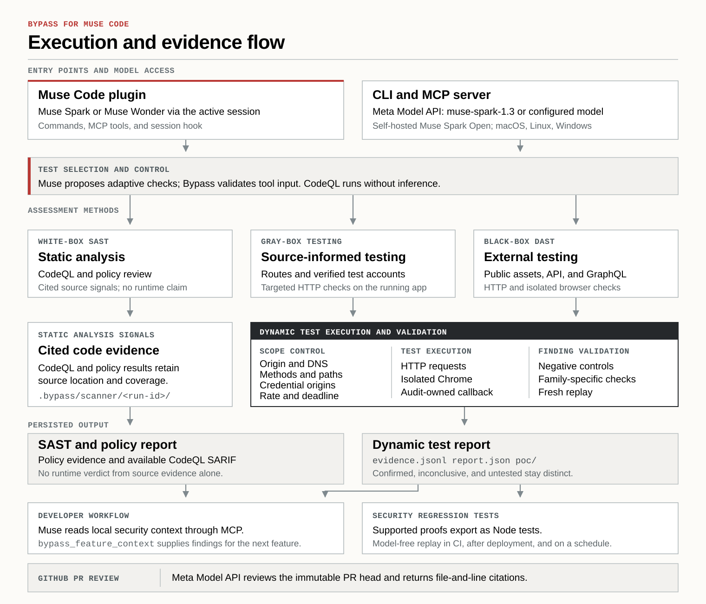
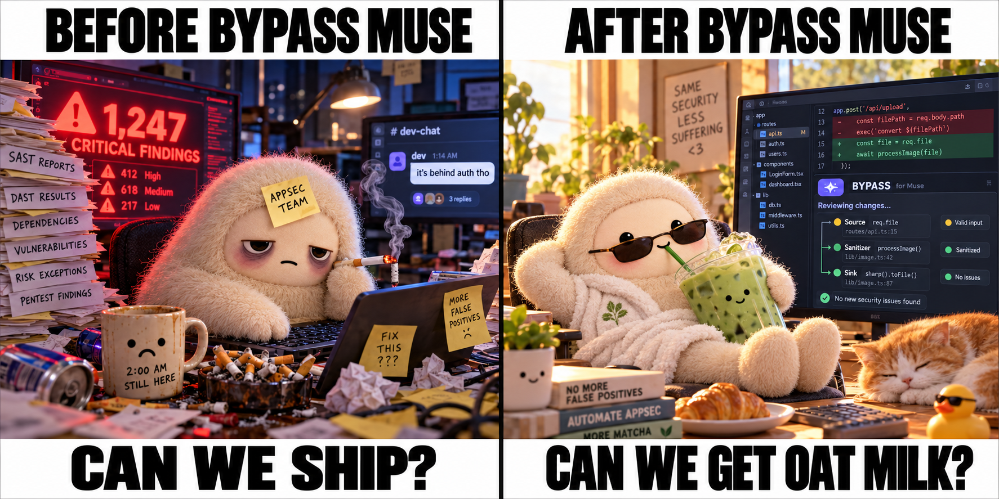
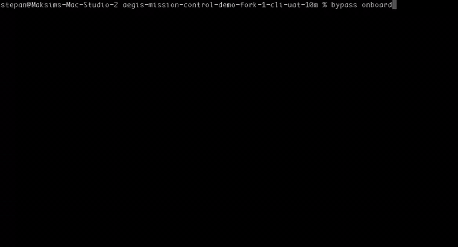

# Bypass: Muse Code Security Plugin and Standalone CLI

**Test code and running apps with the Muse Code plugin or the CLI powered by Meta Model API or local Muse models.**

Bypass adds application security testing to Muse Code and provides a standalone CLI. Muse guides source and running-app investigation; Bypass enforces approved scope, records evidence, and turns supported proofs into repeatable security tests.

Run Bypass as a native Muse Code plugin or standalone CLI on macOS, Linux, and Windows. The plugin uses the active Muse session; the CLI uses Meta Model API or a compatible endpoint for self-hosted Muse Spark Open or Muse Glimmer. Test a local app, preview, staging, or an authorized production deployment.

[Watch demo](#watch-the-demo) · [How it works](#how-bypass-works-with-muse) · [What judges can verify](#what-judges-can-verify) · [Quick start](#start-in-muse-code) · [White-box](#white-box-source-review) · [Black-box](#black-box-audit) · [CLI demo](#standalone-cli) · [GitHub agent](#github-security-agent) · [Docs](#documentation)

## Watch the demo

**Muse Code plugin + standalone CLI.** [Watch the full product demo on YouTube →](https://www.youtube.com/watch?v=xFGu4fIHubo)

## Choose your experience

| Experience | What you need | Install |
| --- | --- | --- |
| **Standalone CLI** | A Meta Model API key, or a local server running Muse Spark Open or Muse Glimmer. Muse Code is not required. | `curl -fsSL https://bypasslabs.ai/install \| bash` |
| **Muse Code plugin** | Muse Code installed, opened, and signed in first. | `curl -fsSL https://bypasslabs.ai/install/muse \| bash` |

Windows uses the matching `install.ps1` or `install/muse.ps1` URL. The standalone wizard lets you choose Meta Model API or a local Muse server before connecting your application.

## How Bypass works with Muse

Bypass is a native plugin for **[Muse Code](https://dev.meta.ai/docs/muse-code)**, Meta's coding agent. It adds security skills, slash commands, MCP tools, and saved security context to your existing coding session. Muse Code investigates and explains; Bypass runs scoped operations and keeps the evidence.

The standalone CLI and GitHub integration bring reviews and saved checks into terminal workflows and CI. Assessments report findings, recommend fixes, and create supported regression tests; editing application code requires a separate request.



The Muse plugin sends decisions through typed MCP tools; the CLI validates model responses against schemas. The shared runner checks origin, methods, paths, credential destinations, rate, and deadline before requests. CodeQL and policy output remain source signals. A confirmed runtime finding requires executed controls and fresh proof replay. Reports preserve incomplete coverage. [Execution modes](docs/AI_MODES.md) · [Black-box design and coverage](docs/BLACKBOX_AUDIT.md).

## Three testing perspectives, one workflow

| Perspective | What Bypass does | What the result means |
| --- | --- | --- |
| **White box** | Runs CodeQL SAST or policy discovery when selected, then lets Muse inspect bounded source and cite relevant lines. | Finds source signals, trust boundaries, and routes worth testing. Source evidence alone does not prove a live vulnerability. |
| **Gray box** | Uses source routes, API contracts, observed data, and approved test identities when available to choose targeted runtime checks. | Tests app-specific rules, including who may see a resource and which behavior must be denied. |
| **Black box** | Discovers public pages, scripts, source maps, API and GraphQL leads; probes the approved app through HTTP and, where needed, isolated Chrome. | Confirms supported issues from observed responses, negative controls, and fresh replay. It works without a repository. |

### Implemented test families

- **Identity and access:** missing authentication, cross-account object and list access, supported GraphQL object authorization, credentialed CORS, unsigned-JWT acceptance, and bounded public-session-token exposure and replay.
- **Browser and injection:** reflected and reviewed stored XSS, fragment-based DOM XSS, inert HTML injection, SQL boolean injection, bracketed `$eq` operator account bypass, arithmetic SSTI, command-output canaries, path traversal, XML external entities, and CRLF response-header injection.
- **Discovery and exposure:** open redirects, host-header redirect poisoning, local-target SSRF callbacks, public credential material, private keys and credential-shaped values in client assets, plus app/API route and GraphQL inventory.
- **Source review:** CodeQL SAST across supported languages and model-guided policy discovery for object access, privileged actions, outbound destinations, and filesystem boundaries.

These are bounded test shapes, not exhaustive coverage of each class. For example, SSRF proof uses an audit-owned local callback; stored-XSS proof uses reviewed local write/read routes; GraphQL authorization proof requires a supported list/item schema and two verified identities. A bracketed-operator bypass does not establish the backend database type. Reports name untested routes, classes, and missing prerequisites. [Executable coverage and limits](docs/BLACKBOX_AUDIT.md) · [Source scanner](scanner/README.md).

## Why this goes beyond a scan

**A source warning is a lead. A confirmed finding is a reproduced behavior. A fixed finding becomes a test.**



| The developer's question | Bypass's answer |
| --- | --- |
| Is this code pattern exploitable in this app? | Keep the source signal separate; test an approved running target before claiming live impact. |
| Did a response expose another user's data or merely return HTTP 200? | Compare verified identities, resource ownership, and denial controls. |
| Did the patch fix the issue without breaking intended access? | Replay the original proof and the authorized behavior controls. |
| Will the issue return after the next feature or deployment? | Save supported proofs as Node regressions; replay approved checks locally, in CI, after deployment, or on a configured schedule. |
| Will Muse remember the app's security rules while writing code? | Retrieve verified findings, saved checks, and source freshness through plugin context and typed tools. |

## Secure by default as the app changes

1. **Build and review.** Muse can retrieve source signals and saved security requirements before a change.
2. **Investigate.** Muse chooses source or running-app work; Bypass limits HTTP checks to the approved resources and identities.
3. **Fix and verify.** After the developer requests a fix, Muse can change the code and Bypass can replay the original proof and required controls.
4. **Keep checking.** Supported proofs become saved and exportable Node tests. Replay them locally, in CI, after a verified deployment, or on a configured daily or six-hour GitHub schedule without model calls.
5. **Build the next feature.** Muse receives relevant local security context. Stale citations and incomplete checks remain labeled.

The GitHub agent cites source concerns in PR reviews; approved live checks replay separately after verified deployment or on a configured schedule. PR concerns are report-only by default. [GitHub agent](docs/GITHUB_AGENT.md) · [Security context](docs/SECURITY_MEMORY.md).

## Meta models do work a scanner cannot pre-script

In the native plugin, the active Muse Code model reads bounded source and observed route facts, selects checks through typed MCP tools, interprets returned evidence, and decides the next step. That can be Muse Spark or Muse Wonder, depending on the developer's session. The plugin uses that session without a second model key.

The CLI and GitHub PR agent use Meta Model API; the CLI can also use a compatible local endpoint for Muse Spark Open or Muse Glimmer. Model decisions guide investigation, while CodeQL queries, scope enforcement, proof verification, reporting, and saved-test replay do not depend on model verdicts. [AI modes](docs/AI_MODES.md).

## What judges can verify

For the startup track, [Meta emphasizes](https://dev.meta.ai/events/global-hackathon) technical execution and whether a product holds up in production. This is a map to inspect Bypass, not Meta's official scoring rubric.

| Area | What to inspect | Where to look |
| --- | --- | --- |
| **Impact** | Security checks follow development from the Muse session through an approved running app, saved regressions, CI, deployment verification, and future features. The CLI and MCP surface extend the workflow beyond Muse. | [Product demo](https://www.youtube.com/watch?v=xFGu4fIHubo) · [Security context](docs/SECURITY_MEMORY.md) · [GitHub replay](docs/GITHUB_AGENT.md) |
| **Meta AI tooling** | The plugin uses the active Muse model through skills, commands, MCP tools, and a session hook. The CLI and GitHub agent use Meta Model API; a compatible local Muse Spark Open path is available. Model decisions guide investigation while proof remains independently checked. | [Plugin commands](docs/PLUGIN_COMMANDS.md) · [MCP implementation](src/mcp.mjs) · [AI modes](docs/AI_MODES.md) |
| **Technical depth** | CodeQL and policy discovery, cited source leads, scoped HTTP and browser checks, verified identities when supplied, evidence replay, coverage accounting, and model-free regression export. | [Scanner](scanner/README.md) · [Black-box evidence](docs/BLACKBOX_AUDIT.md) · [Audit evaluation](docs/AUDIT_EVALUATION.md) |
| **Demo** | A Muse investigation, live proof, fix, red/green replay, configured future check, and next-feature security context can be shown in one workflow. | [Full demo](https://www.youtube.com/watch?v=xFGu4fIHubo) · [First-audit walkthrough](docs/WALKTHROUGH.md) |

**Push the Frontier:** Muse can test the security of the app it is building, carry forward what it proved, and check whether the next change respects those rules. [Meta hackathon themes](https://dev.meta.ai/events/global-hackathon) · [Hackathon build record](HACKATHON.md).

<a id="start-in-muse"></a>

## Start in Muse Code

**Requires Muse Code installed, opened, and signed in first.** Install Muse Code from [Meta's official guide](https://dev.meta.ai/docs/muse-code), then run the Bypass plugin installer. You can select your application during setup; you do not need to start in its folder.

Source discovery needs Docker; running-app testing and saved regression replay do not. See the [scanner prerequisites](scanner/README.md#prerequisites) when you choose a source scan.

**1. Install the plugin.**

macOS / Linux:

```bash
curl -fsSL https://bypasslabs.ai/install/muse | bash
```

Windows PowerShell:

```powershell
irm https://bypasslabs.ai/install/muse.ps1 | iex
```

**2. Enable Bypass's permissions and open Muse Code.** Choose option `1` when prompted.


**3. Tell Muse Code what to review.**

Setup offers **Code only**, **Code + running app**, or **Running app only**. Supply a local source folder or Git URL for code; supply an app URL for live testing. 


To return later, use `/bypass:start`.

> **Try the Aegis demo:** Test with the [repository](https://github.com/Bypass-Labs/aegis-mission-control-demo-fork-1) and [running app](https://demo-app-fork-1.bypasslabs.ai/).

For a running app, supply its URL and choose its environment if unknown. Bypass shows one compact testing plan with **Approve**, **Decline**, and **Custom instructions**. Approve confirms that you control the app and authorize the displayed paths, methods, request rate and expiry. The audit then starts immediately with that exact plan and shows live progress; there is no second scope questionnaire or start confirmation. Custom instructions lets you change the plan before approval. Accounts are optional for anonymous checks; authenticated checks need usable test identities.

Setup starts the selected first audit after the required source and app details are ready. For later audits, use `/bypass:discover` for SAST or policy discovery, `/bypass:review` for source review, or `/bypass:blackbox` for a running-app audit. See the examples below.

## Standalone CLI

Prefer a separate terminal workflow? Use the standalone CLI. It connects either **Meta Model API** for hosted Muse Wonder and Muse Spark, or an existing local/self-hosted server for **Muse Spark Open** or **Muse Glimmer**. It does not require Muse Code or use a Muse Code subscription. Install without opening Muse Code:

[](docs/assets/bypass-cli-demo.mp4)

*28-second CLI walkthrough. Click the preview to watch the original video.*

```bash
curl -fsSL https://bypasslabs.ai/install | bash
```

```powershell
irm https://bypasslabs.ai/install.ps1 | iex
```

The installer includes Node and configures PATH. On macOS/Linux, open a new terminal or use its printed activation command. Start the interactive workspace with:

```bash
bypass onboard
```

Choose **Connect my application**. In the first step, onboarding asks where Muse inference runs. Selecting **Meta Model API** immediately opens a masked API-key prompt, discovers the Muse models available to your team, recommends Muse Wonder for the deepest reviews, and verifies one synthetic request before continuing. Muse Spark 1.3 Contributor is an explicit lowest-cost choice and starts with minimal reasoning for a responsive first audit.

After code, a running app, or both are connected, onboarding starts that security audit directly.

### Model configuration

SAST discovery-only, reports, and saved regression replay need no model key. Default SAST evaluation, standalone policy discovery, and AI source review need a configured Muse model; source scans also need Docker. The guided wizard uses a masked prompt. For noninteractive Meta Model API setup, load the key privately and configure its environment-variable **name**, never its value:

```bash
bypass model add review --provider meta --model muse-wonder-1.0 --secret-env MODEL_API_KEY --project /path/to/app
bypass model use review --project /path/to/app
bypass discover --detector policy --project /path/to/app
```

For the separate guided source-review workflow, use `bypass engine use docker --project /path/to/app`, then `bypass scan --mode code --project /path/to/app`.

For local Muse Glimmer, including a server without authentication, see the [complete local source-review setup](docs/AI_MODES.md#local-muse-glimmer-source-review). It covers the required placeholder credential, timeouts, connection diagnostics, and CodeQL/policy discovery. Bypass connects directly to the selected local server; Muse Code is not involved.

The three canonical standalone audit modes are:

```bash
bypass scan --mode code --project /path/to/app      # cited source hypotheses; no app requests
bypass scan --mode live --project /path/to/app      # full scoped black-box audit; source skipped
bypass scan --mode combined --project /path/to/app  # source + full live audit; one parent result
```

`scan` accepts the live budget controls `--model-calls`, `--minutes`, `--max-urls`, `--max-tasks`, `--agents`, and `--http-workers`. It snapshots the saved target paths, methods, request rate, and compatible test-account references into the run. It never silently narrows a first audit to a short preset.

Run `bypass init /path/to/app` first if the application is not connected. The first-run experience supports **Meta Model API** and local OpenAI-compatible servers running **Muse Spark Open** or **Muse Glimmer**. Explicit legacy provider profiles remain available through advanced commands but are not offered during onboarding. Bypass never changes billing paths or enables Muse Spark Contributor without an explicit model selection. [Provider examples and migration](docs/AI_MODES.md).

## Ways to run Bypass

| Workflow | In Muse Code | Standalone | Requirements |
| --- | --- | --- | --- |
| Whitebox discovery and evaluation | `/bypass:discover` → SAST / Policy / Both | `bypass discover --detector <mode>` | Source + Docker; reasoning uses Muse Code or a CLI API profile; SAST discovery-only needs no model |
| AI-assisted source review | `/bypass:review` | `bypass scan --mode code` | Muse Code session; CLI needs a configured model profile + Docker |
| Running-app discovery and testing | `/bypass:blackbox` | `bypass blackbox <url>` | Approved target + scope; CLI needs a Meta API or local Muse model profile |
| Combined source + running-app audit | `/bypass:start` → **Code + running app** | `bypass scan --mode combined` | Connected repository and approved target; the CLI also needs an API profile and Docker for source isolation |
| Saved regression replay | `/bypass:tests` | `bypass test run --all` | Saved checks and valid target setup; no model calls |
| GitHub PR review and smoke tests | Ask Muse Code to generate setup | `bypass ci init --agent` | GitHub Actions; Meta API key for source review |

With **Code + running app**, standalone `scan --mode combined` starts the cited source review and broad scoped live reconnaissance together. In Muse Code, the plugin completes its host-directed source worklist, then starts one full scoped black-box audit with those cited source leads and the remaining combined budget. Both paths link source evidence, live coverage, findings, and proof IDs in one review. Only replayed HTTP evidence becomes confirmed.

## White-box source review

### Discover source security signals

<a id="docker-prerequisite"></a>

**Docker prerequisite:** SAST and policy discovery require a running Docker daemon. `bypass scanner doctor` can diagnose a missing Docker CLI, stopped daemon, or wrong context without a running daemon. Running-app tests, saved regression replay, plans, and policy listing do not need Docker. [Docker setup and recovery](scanner/README.md#prerequisites).

Connect your source through `/bypass:start`, choose **Code only** or **Code + running app**, then run:

```text
/bypass:discover
```

Choose **SAST**, **Policy**, or **Both** in Muse Code:

| Mode | What it checks | AI usage |
| --- | --- | --- |
| **SAST** | CodeQL security rules across supported languages | Discovery: no model calls; evaluation: active Muse session |
| **Policy** | Source paths against broad policies for identity and delegation, authorization, injection, AI and protocol boundaries, data lineage, integrations, reliability, workflows, and trusted execution | Your active Muse Code session |
| **Both** | CodeQL rules and AI policy discovery, with independent selections and evidence | Your active Muse Code session for policy tasks |

SAST/Both use GitHub CodeQL under its [separate usage terms](https://github.com/github/codeql-cli-binaries/blob/main/LICENSE.md); Bypass's license does not grant CodeQL rights for private or commercial code.

First use prepares the selected image: Policy uses a lightweight Python runtime; SAST/Both download the pinned CodeQL toolchains. Later scans reuse the image. No host Python, host CodeQL, or separate plugin API key is required. If `bypass scanner doctor` reports blocked, follow its `docker.remediation` commands, then re-run the doctor.

From the CLI, after [installation](#standalone-cli):

```bash
bypass init /path/to/app
bypass discover --detector sast --project /path/to/app
```

Default scans evaluate candidates against source after discovery. For the CLI,
first [configure an API profile](#model-configuration). Use `--discovery-only` to
skip evaluation; SAST discovery-only requires no model profile. The CLI defaults
to SAST when no detector is specified. `bypass discover evaluate <run-id>` evaluates
a saved discovery run.

CodeQL language detection covers C/C++, C#, Go, Java/Kotlin, JavaScript/TypeScript, Python, Ruby, Rust, and GitHub Actions. Tests, examples, fixtures, and generated/vendor copies are excluded by default.

<details>
<summary>Select rules and policies, include test code, and inspect reports</summary>

Run from your connected application, or add `--project /path/to/app`:

```bash
bypass scanner doctor
bypass scanner prepare --detector policy  # Optional: prepare the lightweight image
bypass scanner rules --language javascript --query injection
bypass scanner policies
bypass discover --detector sast --languages javascript --rule js/command-line-injection
bypass discover --detector both --languages javascript \
  --rule js/command-line-injection --policy authz/object-access
bypass discover --include-tests
bypass discover signals <run-id> --limit 20
bypass discover report <run-id> --format md
bypass discover resume <run-id>
```

Use exact CodeQL IDs from `scanner rules` and policy IDs from `scanner policies`. `--rule` replaces the default CodeQL `security-extended` selection; `--policy` selects policies independently. `--exclude-rule` and `--exclude-policy` remove exact IDs from their respective detectors. `--include-examples` and `--include-generated` are separate options. Reports, policy evidence/coverage, and available CodeQL SARIF are saved under `.bypass/scanner/<run-id>/`.

</details>

**Read the result correctly:** original detector signals remain unchanged.
Separate evaluation cases record `confirmed`, `refuted`, or `needs_review`,
with cited evidence, severity reasoning, prerequisites, and open questions.
**Confirmed means source-supported, not runtime-reproduced.** Muse Code continues
the bounded discovery/evaluation queue until completion or a blocker. Unresolved
cases remain visible; completion does not prove exhaustive coverage. Runtime
reproduction and patching remain unimplemented in this scanner.
[Scanner usage and limits](scanner/README.md) · [Policy workflow](docs/POLICY_SIGNAL_DISCOVERY.md).

### Investigate source with Muse Code

With **Code only** selected, run:

```text
/bypass:review
```

Muse Code reads bounded source and reports cited hypotheses and recommendations. This is a separate workflow from SAST/policy discovery. With **Code + running app**, it can also configure supported HTTP controls and save regressions after proof. Code-only review makes no live-app requests and cannot establish runtime exploitability.

## Black-box audit

Use this entry point when you have a running app, including when you have **no repository**.

### In Muse Code

Replace the URL with your app and provide the five run settings together:

```text
/bypass:blackbox Audit https://app.example.com; allow /; use 20 rps, 120 Muse Code calls, 30 minutes.
```

Muse Code connects the app, completes missing ownership/scope setup, and drives the black-box engine in the active session. Once the testing plan is approved, it uses the default bounded budgets and begins without another question. Bypass discovers public pages, scripts, and API leads, executes permitted tests, records evidence, and independently checks supported proofs. No separate API key or Docker is needed for this path. Browser-based proof families need Chrome/Chromium; missing prerequisites are reported as coverage gaps.

The URL and paths are run inputs, not permission by themselves. Review the exact scope before testing. The request rate, engine-decision cap, and time limit bound the audit; the displayed “Muse calls” cap does not include every surrounding host turn.

The wizard's **Running app only** choice starts this full audit automatically after scope approval. Its **Code + running app** choice first completes the Muse-directed source review, then hands its cited leads to one full live audit. The wizard offers a **10-minute test** for a quick pass; it reports any remaining coverage as untested. `/bypass:blackbox` remains the explicit app-only command; `--finding` remains an explicit focused-validation command. Muse loads each Bypass tool by its current-session ID, so a logical tool name in a review result is never called as a synthesized MCP identifier.

## Optional Muse demo

```text
/bypass:demo
```

Muse Code investigates an isolated invoice app. Bypass proves cross-account access, saves a failing regression, and retests the fixture fix. This is a training fixture, separate from your application; start a customer audit with `bypass onboard` or `/bypass:start`. See the [first audit walkthrough](docs/WALKTHROUGH.md).

## GitHub security agent

Review PR source with a **Meta Model API key**, then replay saved security checks after deployment or every 24 hours. The GitHub runner uses Actions and does not require Docker or a Muse Code subscription.

**1. Generate setup in your application repository.** Ask Muse Code:

```text
Set up Bypass GitHub security reviews for this repository.
Start with source-only, report-only PR reviews. Generate the setup files.
```

Or run `bypass ci init --agent` from an initialized app. Both generate:

```text
.github/bypass.json
.github/workflows/bypass-pr-signal.yml
.github/workflows/bypass-security.yml
```

**2. Add the API key.** In your app repository, open **Settings → Secrets and variables → Actions → New repository secret**:

| Name | Value |
| --- | --- |
| `MODEL_API_KEY` | Your Meta Model API key. Required for PR source review. |
| `GITHUB_TOKEN` | Supplied automatically by GitHub. Do not create it yourself. |

Alternatively, run `gh secret set MODEL_API_KEY` and enter the key privately. Store it as a **Secret**, not a Variable.

**3. Review and merge the three generated files into your app's default branch.** Open **Actions → Bypass Security** for the baseline. You can also choose **Run workflow → operation: auto**, with `pr` empty.

**4. Open or update a non-draft PR.** Bypass updates one review comment and the **Bypass / PR review** check. Findings are report-only by default; incomplete execution still fails visibly. Reports are downloadable from **Artifacts → bypass-report**. No application fixes are applied automatically.

<details>
<summary>Add deployment verification and daily smoke tests</summary>

First connect a DNS-verified app and save the live regression checks to replay. Then ask Muse Code:

```text
Add our verified production target and its saved security checks to the
GitHub integration. Replay them after deployment and every 24 hours.
Show me the exact extra secrets and deployment requirements.
```

Add the generated `BYPASS_DNS_<TARGET>` secret (for example, `BYPASS_DNS_PRODUCTION`) with the existing full TXT value, plus the exact test-account secret names printed by setup when needed. Keep the DNS record published.

Your deployment pipeline must record a successful GitHub Deployment with the full app commit SHA, environment, and URL. An approved app endpoint such as `/api/version` must return that SHA. A push alone is not deployment proof.

Review and merge the updated files, then use **Run workflow → operation: smoke** to check setup. Daily replay makes zero model calls. Keep credentials, test resources, ownership, and scope valid; CI does not refresh the plugin's private account vault. GitHub schedules are best effort.

</details>

[Full setup, deployment contracts, merge gates, fork handling, and limits](docs/GITHUB_AGENT.md).

## Commands to keep handy

| In Muse Code | What it does |
| --- | --- |
| `/bypass:start` | Connect/select an app or repository and resume setup |
| `/bypass:discover` | Choose SAST, AI policy discovery, or both; inspect source signals |
| `/bypass:review` | Investigate source and supported configured HTTP checks |
| `/bypass:blackbox` | Discover and test a running app |
| `/bypass:status` | Show setup, progress, and evidence |
| `/bypass:tests` | Replay/export guided-review saved checks |
| `/bypass:build` / `/bypass:context` | Retrieve security context for feature work |
| `/bypass:monitor` | Configure saved-test schedules and a local worker |
| `/bypass:help` | Browse commands and tools |

For CLI help, use `bypass --help` or `bypass <command> --help`. A local monitor requires a running worker and an awake machine. See the [exact generated CLI reference](docs/CLI_REFERENCE.md) and [full plugin/CLI command map](docs/PLUGIN_COMMANDS.md).

## Documentation

- [Documentation index: current guides](docs/README.md)
- [Source scanner: languages, rules, scope, reports, and recovery](scanner/README.md)
- [AI policy discovery: policies, evidence, coverage, and custom context](docs/POLICY_SIGNAL_DISCOVERY.md)
- [Black-box audit: supported checks and evidence limits](docs/BLACKBOX_AUDIT.md)
- [Accounts: signup, private imports, and token refresh](docs/ACCOUNTS.md)
- [AI modes: Muse Code, provider APIs, and local/self-hosted models](docs/AI_MODES.md)
- [Security memory and feature context](docs/SECURITY_MEMORY.md)
- [GitHub agent setup](docs/GITHUB_AGENT.md)
- [Architecture](docs/ARCHITECTURE.md) · [Installation](docs/RELEASES.md)
- [Hackathon build record and third-party dependencies](HACKATHON.md)

## Downloads and releases

Use the installers above for the latest tested build. [GitHub Releases](https://github.com/Bypass-Labs/bypass/releases) preserves the same six platform archives, installers, `release.json`, and `SHASUMS256.txt` published to R2. Each main build has a unique commit/run tag; it is published as a prerelease after installation checks and R2 promotion pass. [Release process and pinned installs](docs/RELEASES.md).

## License

Bypass code is licensed under [Apache-2.0](LICENSE), allowing commercial use, modification, and redistribution subject to its terms, with an explicit contributor patent grant. Bundled dependencies and downloaded tools retain their own licenses; see [third-party notices](THIRD_PARTY_NOTICES.md). Bypass is an independent Bypass Labs project, not an official Meta product.

## Contributing

Open an issue with reproduction steps, runtime/release details, and redacted evidence, or submit a focused pull request. For local development (Node 22+):

```bash
npm ci --ignore-scripts
npm run plugin:build
npm run check
npm test
```

Author changes in `src/`, `scanner/`, and the plugin's commands, skill, manifest, hooks, and MCP entry points. `plugin/runtime/` is generated build output. Build it before installing the plugin from source. See [scanner development](scanner/README.md) for Docker/CodeQL checks; `npm run test:live` is an opt-in real Muse Code fixture run and uses your host allowance/billing.

Use Bypass only on applications you own or are authorized to test. Source signals, confirmed HTTP proofs, blocked work, and untested coverage are different outcomes; none is a blanket security clearance.

If you would like to become a maintainer, open an issue or email info@bypasslabs.ai.
