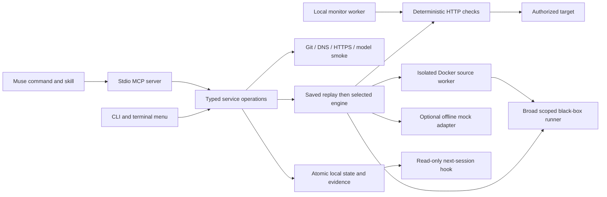

# Architecture and implementation boundaries

The whitebox scanner lives in `scanner/` (Python core, policies, protocol) and
`src/scanner/` (Node Docker/MCP/API-driver boundaries). Users choose SAST, policy,
or both, with independent include/exclude filters. Python owns snapshots,
CodeQL discovery, policy task preparation, source evidence, durable workflow,
submission validation, and reports. Scanner state remains separate from existing
assessment findings.

SAST uses a pinned CodeQL image and requires no LLM settings. Policy-only uses a
lightweight Python image and bounded source-only tasks. Muse requests, performs,
and submits those tasks in its active session; Bypass never reads an API profile
or calls a provider in that path. The standalone CLI uses its explicitly
configured API profile through the same task/evidence protocol. Source-only
evaluation follows discovery by default, with separate cases, severity reasoning,
and bounded follow-up tasks. `tasks.py` shares task/evidence enforcement between
policy discovery and evaluation. `--discovery-only` skips evaluation and preserves
model-free SAST discovery; default standalone scans require API readiness.
Runtime reproduction and patching remain pending. See the [scanner README](../scanner/README.md)
for configuration, evidence limits, provenance, and usage-accounting limitations.

`src/` and `scanner/` are authoritative source trees. The plugin manifest,
commands, skill, and entry points are authored under `plugin/`; its `runtime/`
subdirectory is ignored build output generated by `scripts/build-plugin.mjs`.
Release artifacts contain that output to remain self-contained, while Git stores
each implementation once. npm check/test/validation entry points build it first.
The scanner protocol shares repeated schemas through local references expanded
by Python and Node before exposing self-contained MCP schemas.

## Shared application core

Node 22 supplies HTTP/TLS, DNS, child processes, readline, filesystem operations and the test runner. The standalone API adapter uses the pinned OpenAI-compatible SDK; the Muse plugin uses its host session instead. Authored source remains shared and the generated Muse runtime is self-contained and inspectable.

| Module | Responsibility |
| --- | --- |
| `catalog.mjs` | Strict command parsing and help catalog |
| `service.mjs` | Shared application operations and configuration rules |
| `ui.mjs` | Setup wizard and terminal navigation |
| `store.mjs` | Local canonical state, locks, atomic writes, summaries, audit events |
| `network.mjs` | Exact-origin scope, ownership challenges, address checks, pinned DNS requests |
| `project-memory.mjs` | Cited application knowledge, historical investigation consolidation, freshness and feature-context retrieval |
| `repository.mjs` | Git connection and nonexecuting local source inventory |
| `project-selection.mjs` | Read-only workspace inspection, explicit application selection, and tooling-repository detection |
| `models.mjs` | Provider profiles and synthetic connection smoke tests |
| `engine.mjs` | Durable runs, engine selection and evidence-based retesting |
| `audit-engine.mjs` | Canonical code/live/combined orchestration, source-to-live handoff and finding reconciliation |
| `real-engine.mjs` | Cited source review and source security memory |
| `blackbox/` | Broad route discovery, scoped live tests, independent proof replay, report and coverage |
| `agent-runtime.mjs` / `agents/worker.mjs` | One networkless, constrained Docker source worker and its bounded read loop |
| `inference.mjs` | Host-side structured model connection for source planning and review |
| `poc.mjs` | Isolated fixture support for tests and the optional exercise flow |
| `checks.mjs` | Check bindings, persistence, freshness, and export |
| `portable-check.mjs` | Independent HTTP regression runtime copied into exported suites |
| `jobs.mjs` | Durable runs, cancellation, local scheduling |
| `mcp.mjs` | Typed JSON-RPC tools, resources, prompts, progress, cancellation |
| `demo.mjs` | Isolated Ledger fixture and source-editable application behavior |

## State and evidence

The Muse server starts with no selected application. `bypass_workspace` inspects its host folder without initialization. `bypass_connect_repository` requires a user-identified local path or Git URL and binds subsequent tools and context reads to that root for the MCP session. The compatibility `bypass_init` tool requires the same explicit selection. Tooling repositories require an explicit request to review the tooling itself. Selecting an application does not move Muse's editor; a differing editor workspace is reported before any source fix. Selection does not copy another project's permissions or evidence.

Scan plans and readiness share repository/remote/branch, app origin/environment, and explicit source/live statuses. A plan with setup blockers remains a successful plan read; starting an unauthorized live scan is blocked. Offline code preview needs no model. Real source review needs a model and Docker but can proceed without app authorization. Live-only mode skips source review and invokes the full black-box runner. Combined mode starts source review and live reconnaissance concurrently, waits for cited source leads at the black-box source phase, and finishes through the same broad test/proof/report pipeline as app-only mode. Saved paths, methods, rate and compatible account references are copied into an immutable per-run scope snapshot.

The canonical file is `.bypass/state.json` (local, mode 0600, Git-ignored). Writes are atomic and serialized by a short-lived directory lock. `project.json` and `checks.json` are generated nonsecret summaries, not a second canonical database. Edit configuration through commands; summaries can be regenerated from state.

Run evidence is stored separately in `.bypass/runs/<run-id>.json`. The state keeps up to 100 recent run records and 200 recent audit events; individual run files remain available on disk. Requests persist statuses and assertions, not response bodies or credential values. Worker logs and state are local and ignored by Git.

The current local project is a single-operator trust boundary. A person who can edit its files can edit its guardrails. This is not an externally enforced multi-tenant authorization service.

## Evidence semantics

| State | Meaning |
| --- | --- |
| `simulated_unproven` | Mock adapter supplied a scenario; no real issue has been established |
| `unproven` | Real source hypothesis with a validated file/line citation; no HTTP confirmation |
| `confirmed` | Scoped HTTP controls observed unauthorized resource access with both account login controls valid |
| `not_reproduced` | Current HTTP controls do not reproduce the hypothesis; not automatically a verified fix |
| `confirmed_fixture` | The deliberately vulnerable local fixture returned the expected resource to the wrong account |
| `not_reproduced_fixture` | Fixture verification did not reproduce the behavior; not automatically a verified fix |
| `fixed_verified` | Retest of a previously confirmed finding passed the identity, owner and negative controls |
| `passed` | This exact saved HTTP behavior passed on its bound target |
| `failed` | A saved check observed the expected resource crossing the account boundary |
| `blocked` | Invalid credentials, absent fixture, expired scope, network failure, or inconclusive response |
| `stale` | HTTP assertions passed, but the eligible source fingerprint changed since verification |

A failed saved regression wins over other incomplete outcomes. A mock scan always remains incomplete, even when no mock candidate is new. Zero checks never counts as passing coverage. Coverage is behavior-specific and explicitly incomplete.

## Network and credential boundaries

- Exact origins; path-prefix boundaries; no sibling-domain or redirect expansion.
- Public deployed targets require HTTPS. Loopback testing requires local environment selection and explicit acknowledgment.
- DNS TXT/HTTPS ownership challenges expire in one day. Successful control verification lasts 30 days. Testing scope defaults to seven days and cannot exceed 30.
- Requests resolve addresses, reject private/reserved destinations for deployed targets, and pin the checked address for the connection. Redirects are returned as inconclusive rather than followed. TLS verification stays enabled.
- App test scope is separate from model inference destinations. An explicitly configured internal inference endpoint does not authorize an internal test target.
- Identities store environment-variable references. There is no hidden `.env` loading, token extraction, or credential fallback to a hosted provider.
- Reusable checks bind the origin, resource, two identity references, positive/negative assertions, and expiry. Exports carry that scope and expire; changing their target requires a new reviewed binding and export.
- The test runner is sequential within a run and honors the target's configured per-run request rate. This skeleton does not implement distributed rate limiting across separate processes.

## Real engine and offline preview

`real-engine.mjs` runs only cited source review. Its networkless worker reads eligible excerpts through a host broker and cannot execute repository code. `blackbox/` is the only live audit implementation: it discovers the authorized surface, executes allowed methods, schedules deterministic and model-assisted checks, and independently replays supported proofs. `audit-engine.mjs` composes them. In combined mode a source hypothesis can prioritize a live test, but the source model cannot confirm a vulnerability, send HTTP itself, execute shell commands, or expand network scope.

One `run_*` record is the user-facing parent. A live or combined parent links one sealed `bx-*` evidence folder and reconciles confirmed black-box findings into project state instead of creating a second competing audit result. `report.md`, `coverage.json`, `evidence.jsonl`, generated proofs and the per-run scope remain under that linked folder. Project identity references are translated into the black-box environment only for the active process; credential values are never written to scope or state.

`mockCandidate` remains only for the optional offline preview and fixture tests. Mock examples cannot enter the arbitrary-app verification path. Source findings remain unproven until scoped HTTP replay confirms them. Confirmed live findings retain their sealed run and proof IDs, and exported regression tests can check a later fix. Account-boundary checks require valid, distinct identity controls.

Source and live review are bounded by file, request, time and model-call limits; neither implies complete vulnerability coverage. HTTP-only review can establish an exposure without claiming a source location. Inference failure retains partial evidence and never substitutes a seeded finding. See [running-app security audit](BLACKBOX_AUDIT.md).

## Boundaries deliberately exposed

Hosted Bypass authentication, cloud evidence storage, remote worker provisioning, deployment attestation, general production scanning engines, OS keychain integration, and a plugin marketplace release are not provisioned. Their absence is shown explicitly; local mode, environment references, and local scheduling provide the complete runnable journey without pretending those services exist.

## Research references

- [CLI Guidelines](https://clig.dev/): predictable help, machine-readable output, terminal-aware prompts, and explicit failure states.
- [Muse native plugin manifest](https://meta-models.github.io/muse-code-sdk/next/guides/plugins/reference/manifest/): native capability packaging, validated with the installed Muse CLI.
- [Muse MCP plugin behavior](https://meta-models.github.io/muse-code-sdk/next/guides/plugins/concepts/mcp-servers/): stdio framing, capability review, and tool annotations.
- [Muse hook events](https://meta-models.github.io/muse-code-sdk/next/guides/plugins/reference/hook-events/): SessionStart payload and additional-context output.
- [Muse subscription documentation](https://dev.meta.ai/docs/muse-code/subscriptions): use the official CLI account rather than extracting subscription credentials.
- [OWASP SSRF guidance](https://cheatsheetseries.owasp.org/cheatsheets/Server_Side_Request_Forgery_Prevention_Cheat_Sheet.html): address validation and redirect restrictions.
- [DNS/HTTP challenge tradeoffs](https://letsencrypt.org/docs/challenge-types/): propagation and exact challenge content; Bypass uses its own namespace and is not an ACME implementation.

## Feature-development context

`bypass_feature_context` retrieves local security history before the host coding agent implements a feature. It does not require review readiness, call inference or send HTTP requests. The source worker returns bounded `knowledge` interpretations with exact read citations, separate from vulnerability candidates. Host checks accept/reject those citations; deterministic consolidation adds real findings, HTTP observations and saved regressions. No mock findings are learned.

Memory is namespaced by project ID inside canonical state. Source hashes and the eligible repository fingerprint govern freshness; immutable observed origins prevent evidence being silently reassigned when a target URL changes. Retrieval is bounded, ranks task/files, reserves room for saved regressions, and treats records as untrusted data. Review evidence retains a retrieval receipt; UI and MCP expose inspection, forget and disable. See [Security memory](SECURITY_MEMORY.md) for limits, privacy and migration behavior.
