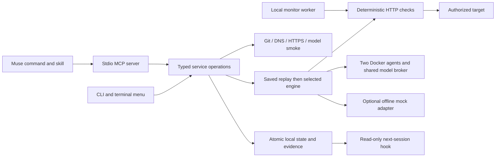

# Architecture and implementation boundaries

For the proposed discovery pipeline, see
[Vulnerability discovery service](VULNERABILITY_DISCOVERY.md).

The whitebox CodeQL scanner is in `scanner/` (Python core/protocol) and
`src/scanner/` (Node Docker/MCP/API-driver boundaries). It has separate discover
commands and Muse tools, with no integration into existing assessment findings.
Python owns snapshots, language detection, exact rule selection, extraction,
query execution, SARIF normalization, durable lifecycle, and discovery reports.
Node prepares the bundled Docker recipe on first use, controls offline containers
and explicitly network-enabled build helpers, and exposes the same operations to
CLI and Muse. Deterministic discovery requires no API settings or model calls.
AI discovery/evaluation remain unavailable. Future Muse reasoning uses the active
session; the reserved standalone API driver requires explicit API settings. See the
[scanner README](../scanner/README.md) for packaging and development instructions.

## Shared application core

No npm runtime dependencies. Node 22 supplies HTTP/TLS, DNS, child processes, readline, filesystem operations, and the test runner. This keeps the standalone CLI and the Muse-cached plugin package portable and inspectable.

| Module | Responsibility |
| --- | --- |
| `catalog.mjs` | Strict command parsing and help catalog |
| `service.mjs` | Shared application operations and configuration rules |
| `ui.mjs` | Setup wizard and terminal navigation |
| `store.mjs` | Local canonical state, locks, atomic writes, summaries, audit events |
| `network.mjs` | Exact-origin scope, ownership challenges, address checks, pinned DNS requests |
| `project-memory.mjs` | Cited application knowledge, historical investigation consolidation, freshness and feature-context retrieval |
| `repository.mjs` | Git connection and nonexecuting local source inventory |
| `project-selection.mjs` | Read-only workspace inspection, explicit application selection, and tooling-repository detection |
| `models.mjs` | Provider profiles and synthetic connection smoke tests |
| `engine.mjs` | Durable runs, engine selection and evidence-based retesting |
| `real-engine.mjs` | Source grounding, shared inference, scoped probes and real findings |
| `agent-runtime.mjs` / `agents/worker.mjs` | Separate constrained Docker services and bounded agent loops |
| `inference.mjs` | One host-side model connection for orchestrator and both workers |
| `poc.mjs` | Independent real-AI exercise app and public account setup |
| `checks.mjs` | Check bindings, persistence, freshness, and export |
| `portable-check.mjs` | Independent HTTP regression runtime copied into exported suites |
| `jobs.mjs` | Durable runs, cancellation, local scheduling |
| `mcp.mjs` | Typed JSON-RPC tools, resources, prompts, progress, cancellation |
| `demo.mjs` | Isolated Ledger fixture and source-editable application behavior |

## State and evidence

The Muse server starts with no selected application. `bypass_workspace` inspects its host folder without initialization. `bypass_connect_repository` requires a user-identified local path or Git URL and binds subsequent tools and context reads to that root for the MCP session. The compatibility `bypass_init` tool requires the same explicit selection. Tooling repositories require an explicit request to review the tooling itself. Selecting an application does not move Muse's editor; a differing editor workspace is reported before any source fix. Selection does not copy another project's permissions or evidence.

Scan plans and readiness share repository/remote/branch, app origin/environment, and explicit white-box/black-box statuses. A plan with setup blockers remains a successful MCP plan read; starting an unauthorized live scan is still blocked. Offline code preview needs no model. Real source review needs a model and Docker but can proceed without DNS. Live-only mode skips source inventory. Real combined mode uses exact approved JSON resource probes, while the optional mock engine remains seeded.

The canonical file is `.bypass/state.json` (local, mode 0600, Git-ignored). Writes are atomic and serialized by a short-lived directory lock. `project.json` and `checks.json` are generated nonsecret summaries, not a second canonical database. Edit configuration through commands; summaries can be regenerated from state.

Run evidence is stored separately in `.bypass/runs/<run-id>.json`. The state keeps up to 100 recent run records and 200 recent audit events; individual run files remain available on disk. Requests persist statuses and assertions, not response bodies or credential values. Worker logs and state are local and ignored by Git.

The current local project is a single-operator trust boundary. A person who can edit its files can edit its guardrails. This is not an externally enforced multi-tenant authorization service.

## Evidence semantics

| State | Meaning |
| --- | --- |
| `simulated_unproven` | Mock adapter supplied a scenario; no real issue has been established |
| `unproven` | Real source hypothesis with a validated file/line citation; no HTTP confirmation |
| `confirmed` | Scoped HTTP controls observed unauthorized resource access with both account login controls valid |
| `not_reproduced` | Current HTTP controls do not reproduce the hypothesis; not automatically a verified fix |
| `confirmed_fixture` | The deliberately vulnerable local fixture returned the expected resource to the wrong account |
| `not_reproduced_fixture` | Fixture verification did not reproduce the behavior; not automatically a verified fix |
| `fixed_verified` | Retest of a previously confirmed finding passed the identity, owner and negative controls |
| `passed` | This exact saved HTTP behavior passed on its bound target |
| `failed` | A saved check observed the expected resource crossing the account boundary |
| `blocked` | Invalid credentials, absent fixture, expired scope, network failure, or inconclusive response |
| `stale` | HTTP assertions passed, but the eligible source fingerprint changed since verification |

A failed saved regression wins over other incomplete outcomes. A mock scan always remains incomplete, even when no mock candidate is new. Zero checks never counts as passing coverage. Coverage is behavior-specific and explicitly incomplete.

## Network and credential boundaries

- Exact origins; path-prefix boundaries; no sibling-domain or redirect expansion.
- Public deployed targets require HTTPS. Loopback testing requires local environment selection and explicit acknowledgment.
- DNS TXT/HTTPS ownership challenges expire in one day. Successful control verification lasts 30 days. Testing scope defaults to seven days and cannot exceed 30.
- Requests resolve addresses, reject private/reserved destinations for deployed targets, and pin the checked address for the connection. Redirects are returned as inconclusive rather than followed. TLS verification stays enabled.
- App test scope is separate from model inference destinations. An explicitly configured internal inference endpoint does not authorize an internal test target.
- Identities store environment-variable references. There is no hidden `.env` loading, token extraction, or credential fallback to a hosted provider.
- Reusable checks bind the origin, resource, two identity references, positive/negative assertions, and expiry. Exports carry that scope and expire; changing their target requires a new reviewed binding and export.
- The test runner is sequential within a run and honors the target's configured per-run request rate. This skeleton does not implement distributed rate limiting across separate processes.

## Real engine and offline preview

`real-engine.mjs` runs the Docker POC. The host orchestrator and both mini agents share one immutable profile snapshot. The source worker reads eligible files and supplies exact citations; the live worker chooses operator-configured GET probes. The host validates every capability and determines findings from observed HTTP controls. The model cannot mark an issue confirmed, execute shell commands, generate a patch for automatic execution, or expand network scope.

`mockCandidate` remains only for the optional offline preview and seeded walkthrough. Mock examples cannot enter the arbitrary-app verification path. Real findings carry `engine: docker`, a scoped binding and genuine HTTP evidence; a fixed result creates the existing standalone regression contract. Two account-login controls prevent expired or identical account sessions from masquerading as passing negative controls.

The POC covers cross-account access and missing authentication for top-level JSON resource identifiers. Source review is bounded by file/read/model budgets and does not imply complete coverage. HTTP-only review can establish an exposure without claiming a source location. Inference failure retains partial evidence and never substitutes a seeded finding. See [real POC architecture, limits and usage](REAL_POC.md).

## Boundaries deliberately exposed

Hosted Bypass authentication, cloud evidence storage, remote worker provisioning, deployment attestation, general production scanning engines, OS keychain integration, and a plugin marketplace release are not provisioned. Their absence is shown explicitly; local mode, environment references, and local scheduling provide the complete runnable journey without pretending those services exist.

## Research references

- [CLI Guidelines](https://clig.dev/): predictable help, machine-readable output, terminal-aware prompts, and explicit failure states.
- [Muse native plugin manifest](https://meta-models.github.io/muse-code-sdk/next/guides/plugins/reference/manifest/): native capability packaging, validated with the installed Muse CLI.
- [Muse MCP plugin behavior](https://meta-models.github.io/muse-code-sdk/next/guides/plugins/concepts/mcp-servers/): stdio framing, capability review, and tool annotations.
- [Muse hook events](https://meta-models.github.io/muse-code-sdk/next/guides/plugins/reference/hook-events/): SessionStart payload and additional-context output.
- [Muse subscription documentation](https://dev.meta.ai/docs/muse-code/subscriptions): use the official CLI account rather than extracting subscription credentials.
- [OWASP SSRF guidance](https://cheatsheetseries.owasp.org/cheatsheets/Server_Side_Request_Forgery_Prevention_Cheat_Sheet.html): address validation and redirect restrictions.
- [DNS/HTTP challenge tradeoffs](https://letsencrypt.org/docs/challenge-types/): propagation and exact challenge content; Bypass uses its own namespace and is not an ACME implementation.

## Feature-development context

`bypass_feature_context` retrieves local security history before the host coding agent implements a feature. It does not require review readiness, call inference or send HTTP requests. The source worker returns bounded `knowledge` interpretations with exact read citations, separate from vulnerability candidates. Host checks accept/reject those citations; deterministic consolidation adds real findings, HTTP observations and saved regressions. No mock findings are learned.

Memory is namespaced by project ID inside canonical state. Source hashes and the eligible repository fingerprint govern freshness; immutable observed origins prevent evidence being silently reassigned when a target URL changes. Retrieval is bounded, ranks task/files, reserves room for saved regressions, and treats records as untrusted data. Review evidence retains a retrieval receipt; UI and MCP expose inspection, forget and disable. See [Security memory](SECURITY_MEMORY.md) for limits, privacy and migration behavior.
