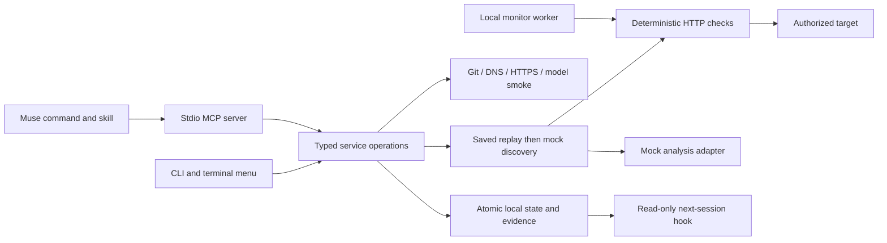

# Architecture and implementation boundaries

## Shared application core

No npm runtime dependencies. Node 22 supplies HTTP/TLS, DNS, child processes, readline, filesystem operations, and the test runner. This keeps the standalone CLI and the Muse-cached plugin package portable and inspectable.

| Module | Responsibility |
| --- | --- |
| `catalog.mjs` | Strict command parsing and help catalog |
| `service.mjs` | Shared application operations and configuration rules |
| `ui.mjs` | Setup wizard and terminal navigation |
| `store.mjs` | Local canonical state, locks, atomic writes, summaries, audit events |
| `network.mjs` | Exact-origin scope, ownership challenges, address checks, pinned DNS requests |
| `repository.mjs` | Git connection and nonexecuting local source inventory |
| `models.mjs` | Provider profiles and synthetic connection smoke tests |
| `engine.mjs` | Real orchestration around explicit mock discovery/verification boundaries |
| `checks.mjs` | Check bindings, persistence, freshness, and export |
| `portable-check.mjs` | Independent HTTP regression runtime copied into exported suites |
| `jobs.mjs` | Durable runs, cancellation, local scheduling |
| `mcp.mjs` | Typed JSON-RPC tools, resources, prompts, progress, cancellation |
| `demo.mjs` | Isolated Ledger fixture and source-editable application behavior |

## State and evidence

The canonical file is `.bypass/state.json` (local, mode 0600, Git-ignored). Writes are atomic and serialized by a short-lived directory lock. `project.json` and `checks.json` are generated nonsecret summaries, not a second canonical database. Edit configuration through commands; summaries can be regenerated from state.

Run evidence is stored separately in `.bypass/runs/<run-id>.json`. The state keeps up to 100 recent run records and 200 recent audit events; individual run files remain available on disk. Requests persist statuses and assertions, not response bodies or credential values. Worker logs and state are local and ignored by Git.

The current local project is a single-operator trust boundary. A person who can edit its files can edit its guardrails. This is not an externally enforced multi-tenant authorization service.

## Evidence semantics

| State | Meaning |
| --- | --- |
| `simulated_unproven` | Mock adapter supplied a scenario; no real issue has been established |
| `confirmed_fixture` | The deliberately vulnerable local fixture returned the expected resource to the wrong account |
| `not_reproduced_fixture` | Fixture verification did not reproduce the behavior; not automatically a verified fix |
| `fixed_verified` | Retest passed the owner and negative controls for this fixture |
| `passed` | This exact saved HTTP behavior passed on its bound target |
| `failed` | A saved check observed the expected resource crossing the account boundary |
| `blocked` | Invalid credentials, absent fixture, expired scope, network failure, or inconclusive response |
| `stale` | HTTP assertions passed, but the eligible source fingerprint changed since verification |

A failed saved regression wins over other incomplete outcomes. A mock scan always remains incomplete, even when no mock candidate is new. Zero checks never counts as passing coverage. Coverage is behavior-specific and explicitly incomplete.

## Network and credential boundaries

- Exact origins; path-prefix boundaries; no sibling-domain or redirect expansion.
- Public deployed targets require HTTPS. Loopback testing requires local environment selection and explicit acknowledgment.
- DNS TXT/HTTPS ownership challenges expire in one day. Successful control verification lasts 30 days. Testing scope defaults to seven days and cannot exceed 30.
- Requests resolve addresses, reject private/reserved destinations for deployed targets, and pin the checked address for the connection. Redirects are returned as inconclusive rather than followed. TLS verification stays enabled.
- App test scope is separate from model inference destinations. An explicitly configured internal inference endpoint does not authorize an internal test target.
- Identities store environment-variable references. There is no hidden `.env` loading, token extraction, or credential fallback to a hosted provider.
- Reusable checks bind the origin, resource, two identity references, positive/negative assertions, and expiry. Exports carry that scope and expire; changing their target requires a new reviewed binding and export.
- The test runner is sequential within a run and honors the target's configured per-run request rate. This skeleton does not implement distributed rate limiting across separate processes.

## Engines to replace later

`mockCandidate` in `engine.mjs` is the discovery seam. Replace it with structured candidate generation without changing setup, evidence labels, test persistence, CLI/MCP operations, or scheduling. A real verifier must supply reproducible proof and valid positive controls before any real finding can be marked confirmed.

The fixture-specific `verifyFinding` branch is an integration exercise for the proof-to-regression contract. It must not be enabled for arbitrary deployed applications as a generic exploit engine.

The source inventory uses conservative hashes and a limited route heuristic; it does not parse every framework, map deployment commits, or establish coverage completeness. Generated Bypass test files are excluded from source freshness checks.

## Boundaries deliberately exposed

Hosted Bypass authentication, cloud evidence storage, remote worker provisioning, deployment attestation, production engine adapters, OS keychain integration, and a plugin marketplace release are not provisioned. Their absence is shown explicitly; local mode, environment references, and local scheduling provide the complete runnable journey without pretending those services exist.

## Research references

- [CLI Guidelines](https://clig.dev/): predictable help, machine-readable output, terminal-aware prompts, and explicit failure states.
- [Muse native plugin manifest](https://meta-models.github.io/muse-code-sdk/next/guides/plugins/reference/manifest/): native capability packaging, validated with the installed Muse CLI.
- [Muse MCP plugin behavior](https://meta-models.github.io/muse-code-sdk/next/guides/plugins/concepts/mcp-servers/): stdio framing, capability review, and tool annotations.
- [Muse hook events](https://meta-models.github.io/muse-code-sdk/next/guides/plugins/reference/hook-events/): SessionStart payload and additional-context output.
- [Muse subscription documentation](https://dev.meta.ai/docs/muse-code/subscriptions): use the official CLI account rather than extracting subscription credentials.
- [OWASP SSRF guidance](https://cheatsheetseries.owasp.org/cheatsheets/Server_Side_Request_Forgery_Prevention_Cheat_Sheet.html): address validation and redirect restrictions.
- [DNS/HTTP challenge tradeoffs](https://letsencrypt.org/docs/challenge-types/): propagation and exact challenge content; Bypass uses its own namespace and is not an ACME implementation.
