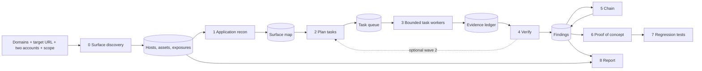

# Black-box penetration audit: technical design

> **Evidence status, October 30:** this file includes historical design and author-run notes. Referenced private run artifacts were not included in the PR; their timings, scores and live-Muse claims are **not independently verifiable from this repository** and are not release acceptance evidence. Unretained citations below are explicitly marked. Use [the merge/UAT report](MERGE_UAT_2026_10_30.md) for checks performed on the combined white-box/black-box build. Automated fixtures, native Muse sessions and production checks are separate gates.

`bypass blackbox` is the Bypass CLI entry point for an authorized external penetration audit. The intended workflow covers each verified apex domain and its descendant hosts, public source maps and JavaScript bundles, application endpoints and their input contracts, test identities, model-guided attack hypotheses, guarded execution, independent proof, chaining, regression tests and an evidence-backed report. The operator may also explicitly provide application source for a **source-assisted** run; the report labels conclusions from source separately from behavior proved over HTTP. The auditor never reads the answer keys of blind test applications while scoring them. Coverage is bounded by scope, time, rate, reachable surface and available identities; a run must list what it did not test.

For a **focused source-to-live check**, pass `--finding <saved-finding-id>` to `bypass blackbox <url>`, or pass `finding` to `bypass_blackbox_start` in the Muse plugin after a combined source review. Bypass reads that finding's citation and affected route, requests the route under the existing scope, gives the source hypothesis and response evidence to Muse, and uses the normal scoped sequence, feedback, proof replay, and report pipeline. `--focus-path` supplies a concrete route when the source finding has a template. If an observed JSON endpoint exposes the deployed full commit SHA, `--revision-path` and `--revision-field` compare it with the checkout; otherwise the report marks source/live revision unverified. The report marks this as focused coverage. Omit `--finding` for the independent full audit.

This is also the live engine used by `bypass scan --mode live` and `bypass scan --mode combined`. Combined mode adds cited source leads before live planning finishes; it does not invoke a second narrow Docker live worker. The surface is discovered, tasks are planned, and Muse reads bounded route and proof facts to propose tests and annotate independently proved findings. The operator configures scope and, when available, two test accounts. The standalone CLI, terminal `/blackbox` shortcut, and Muse `/bypass:blackbox` command use this same runner; the earlier design in section 19 is retained as historical context.

Status: evolving design and implementation, 2026-10-30. Integration branch `feat/blackbox-integration`. The current implementation is tracked below; the later sections describe the target architecture and are not evidence that those features already run. Integration verification is tracked in [BLACKBOX_INTEGRATION_TODO.md](BLACKBOX_INTEGRATION_TODO.md).

The standalone CLI uses the configured Meta API profile by default. The Muse Code command passes each model prompt and its JSON schema to the active Muse session through typed MCP tools; it does not launch a nested Muse process or need a separate API key. Scope checks, requests, evidence, proof replay, and export stay in the runner. Source and packaged MCP process tests have verified this handoff with schema-shaped test decisions. A real installed-plugin Muse audit is still required before claiming live plugin verification. A separate blind local CLI audit without a model proved reflected XSS on a randomized route, replayed the proof, and exported a regression that failed before the fixture fix and passed afterward; it is not evidence of live Meta model behavior.

| Current runnable path | Still required for the intended hackathon audit |
|---|---|
| One-command scope and target preparation with resumable DNS challenges and reviewable authorization files; loopback and verified deployed scopes; DNS/CT and recursive host discovery with HTTPS-to-anonymous-HTTP fallback, per-host JavaScript/source-map and API-document mining plus opt-in OSV advisory leads; bounded Muse DNS-name proposals and interpretation of observed host roles and API parameter purposes; optional source-assisted route review; anonymous exposure and redirect checks, including credential material in documented account-list JSON and independently confirmed public-asset private keys and credential-shaped tokens; CRLF response-header checks; credentialed CORS checks; local-target SSRF checks through an audit-owned loopback callback; reflected GET-parameter XSS, a reviewed local JSON POST-to-HTML stored-XSS check, inert HTML markup insertion and fragment-driven DOM XSS on captured pages and static scripts with isolated Chrome; harmless arithmetic SSTI checks in raw server responses, a bounded SQL boolean record-lookup check using documented or Muse-selected public baselines, a bracketed equality-operator cross-account check, a harmless command-output canary, a benign hosts-file traversal check and an XML-entity hosts-file check on documented GET parameters and exact reviewed XML POST routes; `discovery.auditDomains` opt-in for anonymous web probes on observed GET operations of authorized descendants; one-account missing-authentication checks on an explicitly configured identity route and verified owner-bound sensitive item reads; two-account access-control tests on the configured target and exact credential origins with verified identities; Muse recon, access-control planning, web-lead ranking, free-family GET and reviewed JSON, form and XML HTTP-sequence response experiments with budgeted result-informed revisions, and finding annotation; deterministic verdicts, fresh verification, two bounded list-to-item chain templates plus Muse selection across proved cross-path pairs, executed PoCs, exported Node regressions and coverage report; real CLI tests for IDOR, list leaks, open redirect, arithmetic SSTI, SQL boolean injection against SQLite, bracketed equality-operator cross-account bypass, command output from a real shell, relative file traversal against a real local file, XML external-entity processing in a real parser, reflected and fragment-driven DOM XSS, HTML injection under a no-script CSP, local callback SSRF, CRLF response-header injection, credentialed CORS and one-account missing authentication, plus randomized API routes and record IDs | Full authenticated application probing on every authorized descendant; broader one-account and many-account boundary tests; more discovery sources and proof of advisory exploitability; stored XSS beyond the reviewed local JSON POST-to-HTML shape and DOM sources beyond URL fragments, broader SQL and NoSQL injection, broader command injection, deployed SSRF, broader XXE, broader file and upload, session and workflow probe families; general account workflows, raw HTTP request-framing probes, impact oracles for arbitrary Muse sequences, broader model-directed follow-up and new chain task generation; independent blind scoring |

With one usable account, recon now records an owner-only identity when the configured or discovered identity route returns that account's principal and denies anonymous access. The planner retains anonymous checks for owner-attributed item records carrying high-sensitivity fields such as a token, secret, card or balance, alongside the configured identity-route check. It withholds cross-account tasks when both supplied credentials resolve to the same principal. A real CLI fixture proves a randomized sensitive item read, rejects a public owner-shaped decoy, and replays its proof and exported regression before and after a fix. Other one-account inference and account-flow families remain untested.

Some apps use a bearer token on resource APIs but require the same token in a cookie on their identity route. The optional `identities.identityCookieName` scope field enables this only for the exact configured `identities.identityPath`; other requests keep bearer placement. Scope validation requires a safe cookie name and bearer auth, the requester still applies origin, path, method and rate checks, and generated proofs use the same exact-path rule. An actual CLI fixture verifies two distinct identities through the cookie route, proves a bearer-only cross-account item read, and replays the proof after a fix. This does not infer credential placement automatically on arbitrary apps.

The current runner also checks a bounded HTTP parameter pollution case: duplicate values of a documented redirect parameter must bypass a rejected single external destination, with two independent canaries and a replayable proof. Other parameter pollution effects remain untested.

The HTML-injection probe checks documented GET parameters with an inert `<b>` element bearing a unique audit ID. A plain-text control must produce no such DOM element; two different markup canaries must then become actual elements in isolated Chrome with the target's CSP preserved. The browser oracle rejects marker text that remains escaped, inside an attribute, or inside a script string. It makes no script-execution claim. A process-level CLI fixture proves a vulnerable route under `script-src 'none'`, rejects an HTML-escaped decoy, and verifies the saved proof and exported regression both clear after output encoding. Stored markup injection, other methods and cross-user delivery remain untested.

The XML external-entity probe checks documented GET parameters named for XML or described as XML by a recorded model interpretation, plus exact OpenAPI XML POST routes listed in `probes.xmlPostPaths`. It sends one literal-entity control and two distinct external entities referencing only `file:///etc/hosts`. A finding requires the benign hosts-file signature in both uncached responses and its absence from the control, then an executed, exportable proof repeats the check. Local scopes enable it; deployed scopes require `probes.xmlExternalEntity=true` and an exact `xmlPostPaths` entry in the target authorization. Actual CLI fixtures use Python SAX with external entities enabled, reject a static-content decoy and an unlisted POST route, and turn proofs and exported regressions green when external entities or all DTDs are disabled. Blind XXE, network fetching and other files remain untested.

For documented account-list GET routes, the runner also checks whether an anonymous JSON response contains two distinct records with different credential-shaped values in a password, password-hash, API-key or session-token field. It requires a second uncached response and an executed standalone proof; the field name and count are recorded, while credential values are masked from evidence and absent from run artifacts. A process-level CLI fixture finds a randomized vulnerable route, rejects a placeholder-value decoy, and verifies the generated regression before and after removal. This is bounded evidence of anonymous credential disclosure; key validity, broader personal-data exposure and account takeover remain untested.

Public JavaScript and source maps now receive a separate private-key exposure check. A scanner hit is only a lead: the CLI anonymously re-fetches the asset, parses a complete PEM private key, derives a public-key fingerprint, confirms that the same key remains publicly readable on a second request, and executes a standalone proof that repeats both reads. The key text is never written to the run artifacts or sent to Muse. Process-level CLI fixtures prove a script leak and a source-map-only leak, reject a fake PEM marker, and verify removal after a fix. The leaked key's privileges remain unverified.

High-confidence GitHub, Stripe and SendGrid credential-shaped values in public JavaScript or source maps now have a bounded confirmation path. The CLI rejects placeholders and public key prefixes, rereads the exact asset anonymously twice, compares only a SHA-256 fingerprint, and keeps a finding only when an executed proof repeats both reads. It does not use the credential or claim that it is active. Process-level CLI fixtures prove script and source-map leaks, reject a placeholder and a publishable key, and turn proof replay and exported regression green after removal. Other secret formats and credential privileges remain unverified.

Public JavaScript and source-map content also yield bounded hints for indirect HTTP calls whose route expression the parser did not resolve. The stored hint preserves route-shaped literals and call structure while removing comments and other string values. Muse may propose an exact GET path from a hint only when every path segment and query key matches those literals and the hint is a GET call. Proposals are routed through the ordinary scope guard and live proof checks. An actual CLI fixture with a stubbed Muse process finds and replays an open redirect from a random route assembled with JavaScript `join`; its code-only run misses the route, and an ungrounded path plus a POST decoy are rejected. A user-operated local Muse run accepted 14 grounded asset path proposals; broad indirect-call recall remains unmeasured.

Source-assisted route extraction now recognizes literal HTTP-method registrations in Laravel, Spring, ASP.NET Minimal APIs and FastAPI alongside JavaScript route calls. The extractor composes direct literal Laravel `Route::prefix(...)->group(function...)` blocks (including nested blocks), Spring class-level `@RequestMapping` paths, ASP.NET Minimal API `MapGroup` variable chains and same-file FastAPI `APIRouter(prefix=...)` declarations. It also follows simple same-project Python imports into FastAPI routers registered with literal `app.include_router(..., prefix=...)` calls, including a router registered under multiple prefixes. For route declarations whose paths remain unresolved, Muse receives bounded, redacted excerpts and may propose exact GET paths; those proposals pass the normal scope guard and require HTTP proof. Dynamic paths or prefixes are not automatically resolved, and unresolved declarations keep a clean run incomplete. Process-level CLI fixtures confirm grouped Laravel-style, imported FastAPI and one Muse-inferred dynamic PHP GET route reach guarded redirect probes, proofs and exported regressions; POST decoys are never requested.

It also checks a bounded GraphQL object authorization case when two same-role accounts and GET introspection are available. It pairs observed list and item query fields of the same object type, lets Muse rank bounded pages of those exact pairs when available, requires an `id` and owner field, selects only an ID from the owner's own list, and compares that item under the owner, outsider and anonymous identities. The finding requires fresh re-verification and an executed, exportable red/green proof. Other GraphQL authorization shapes, injection and complexity remain untested.

Do not describe a partial run as a complete penetration test. A feature listed as required above must appear as an untested limitation until the code and end-to-end evidence prove it works.

## 1. Goals and non-goals

Goals, in priority order:

1. Map the external surface of the target's domains the way an attacker would: every subdomain at every level, every live host, the stack and version behind it, exposed files and debug endpoints, secrets leaked in client-side code, client libraries with known CVEs, and the hosts and API endpoints those assets reveal, recursively.
2. Find verified vulnerabilities on every in-scope application. Access-control reads are the first implemented family: cross-account reads, missing authentication, property and function authorization, list/filter leaks and enumeration. The intended strategy catalog also covers input injection (SQL/NoSQL, command, template, XXE), server-side request forgery, XSS, path traversal and file disclosure, upload and deserialization paths, authentication/session takeover, and framework-specific exploit chains. Every family needs a concrete test oracle, a harmless proof, a regression test, and an explicit scope policy before it can be reported as supported.
3. Produce evidence a security engineer accepts: every claim cites recorded exchanges, every confirmed finding is reproduced a second time before it is reported, and every proof of concept is executed by the harness before it is written into the report.
4. Chain findings into higher-impact attacks when the evidence supports it, for example a list leak of other users' IDs plus an IDOR on the item endpoint equals mass cross-account read.
5. Leave something behind: a regression test per finding that fails today and passes after the fix, and a report the team can act on.
6. Stay lean. One folder, zero new dependencies, no Docker, every capability justified by the blind scoring in section 18 or by the demo on the team's own domains.


## 2. Principles

- **Black-box by default, source-assisted when requested.** External behavior is the proof boundary. Optional operator-supplied source and publicly served source maps may guide hypotheses; source alone cannot confirm a live vulnerability. Identities may be absent or have different roles, and unsupported identity arrangements are reported as untested until implemented.
- **Code decides, the model proposes.** Every DNS query, TLS handshake and HTTP request was generated or validated by code against scope, method and identity rules. The model reads artifacts, proposes hosts, paths and tasks, interprets ambiguous evidence, proposes chains in a fixed vocabulary and writes narrative sentences. It never executes anything.
- **Evidence first.** The evidence ledger is written before verdicts exist. Verdicts, chains, proofs and the report are derived from it and cite it by ID.
- **Fail closed.** Anything inconclusive stays inconclusive. There is no "probably safe", and an audit that cut work or left items inconclusive never exits 0.
- **Always prove.** A finding requires a safe, executable PoC that reproduces under the recorded scope. If the proof fails or the impact cannot be established safely, the verdict is inconclusive and the report says why.
- **Bounded everywhere.** One table of bounds (section 17) that every stage cites.
- **Measured, not asserted.** The report says which hosts, patterns and findings came from seeds, from code rules and from the model, and the scorer prints what the model adds on applications the auditor's author did not write.

## 3. Pipeline and artifacts



Intermediate artifacts live under `.bypass/runs/<run-id>/`: `discovery.json` when enabled, `assets.json`, `advisories.json`, optional `source.json`, `surface.json`, `graphql.json`, `credential-origins.json` when additional credential origins are configured, `tasks.json`, `results.json`, `web-probes.json`, `findings.json`, `chains.json`, `chain-planning.json`, `assessment.json`, `coverage.json`, `evidence.jsonl`, `poc/`, `report.md`, `report.json` and `run.json`. Generated regression tests go to `tests/security/blackbox/` on `blackbox export`. The run folder is the deliverable; the report cites its evidence IDs.

The implemented swarm uses bounded async worker pools, not separate autonomous Muse sessions. `--agents` caps concurrent Muse calls and `--http-workers` caps concurrent scoped HTTP work; both share the request-rate limiter. Independent host discovery, asset downloads, public route reads, response-fact fetches, first Muse planning pages, web checks, and proof rechecks can overlap. After a proved login, derived-session recon reads run in batches up to `min(8, limits.agents)` with the session credential kept in memory. Each investigator keeps its request sequence and checkpoint in order; a stateful revision can start while an unrelated route is still being investigated, but shared routes remain serialized. Later web and sequence pages can be planned while an earlier access investigation receives feedback. Accepted sequence leads deferred behind that access work are saved with their page offset and can resume after interruption. Independent pending leads on a saved route page now resume in the bounded research pool with their own active states. A lead stays checkpointed when no Muse call is available for its saved attempt or its revision call fails. Only independent anonymous exposure GET proofs use a separate two-process pool with a conservative share of the request rate. Results are committed in input order. Research checkpoints preserve scoped pending work and non-secret response facts, but they do not make every task resumable.

## 4. Inputs and configuration

### 4.1 Command line

```text
bypass blackbox <url>
  --domains example.com,example.io  apex domains for surface discovery; ownership proven by the existing DNS TXT challenge
  --audit-domains example.com      subset of --domains with apex authorization for anonymous descendant web probes
  --owner-env OWNER_TOKEN       env var holding the owner account credential
  --other-env OTHER_TOKEN       env var holding the outsider account credential
  --auth bearer|cookie|header:<name>   credential placement (default bearer)
  --identity-path /api/me       optional; discovered when omitted
  --scope <file>                scope file (default blackbox.scope.json in the project root; a first local run creates one)
  --agents 12                   maximum concurrent Muse investigation calls (max 100)
  --http-workers 40             maximum concurrent HTTP task/recon workers (max 100)
  --rps 50                      requests per second on loopback (deployed targets: at or below the authorized rate)
  --model-calls 120              Muse call budget for this run (first local run also saves it in the generated scope)
  --max-urls 400                 authenticated recon URL-count cap per derived session; 0 removes this count cap
  --minutes 30                   wall-clock audit budget; research ends early to reserve proof replay time
  --dom-script-bytes 2097152      DOM script read cap per script; may be raised through 16777216 (16 MiB)
  --accept-local                optional direct loopback audit; creates a scope file if needed
  --no-discovery                skip Stage 0 (default when no domains are given)
  --offline                     no third-party lookups (certificate transparency, OSV, Wayback index); discovery from DNS and the target's own assets only
  --model <profile>             named Bypass model profile; default active profile or Muse Code
  --no-model                    code-only mode: no model calls anywhere (used by the scorer in CI)
  --source <dir>                optional local source-assisted route analysis
  --dry-run                     discovery, recon and planning only; save the task list without running the swarm
  --out <dir>                   run folder override
  --json                        machine-readable result
bypass blackbox scope <url>       write a reviewable scope template from flags (section 4.2)
bypass blackbox setup <url>       prepare scope, deployed ownership challenges and authorization files
  --rps 5                      set the requested rate in the generated scope
  --model-calls 120             set the Muse call budget in the generated scope
  --max-urls 400                set the authenticated recon URL-count cap in the generated scope
  --dom-script-bytes 2097152    set the DOM script read cap in the generated scope
  --credential-origins https://api.example.com,https://admin.example.com   optional exact origins for authenticated audits
bypass blackbox verify <run-id>   re-execute every saved proof of concept
bypass blackbox export <run-id>   write regression tests for confirmed findings
```

The command works in an uninitialized folder: it resolves the project root with `rootFrom(working, false)` and writes under `.bypass/runs/<run-id>/`. Credential values are read from the environment at request time and never stored, logged or sent to the model. The scope file controls network authorization; run flags cannot add authorized origins or methods or raise the approved rate. `--agents` sets the concurrent Muse-call cap (`limits.modelConcurrency`, default 4), and `--http-workers` sets the separate HTTP worker cap (`limits.agents`, default 40); neither raises the request rate. `--model-calls`, `--max-urls`, `--minutes` and `--dom-script-bytes` are separate execution budgets and may raise or lower their saved values for one run; effective values are recorded in `run.json`. Generated scopes default to 30 minutes; research reserves up to three minutes for proof replay and reporting. `--max-urls 0` removes only the authenticated recon URL-count cap; scope, rate and deadline remain enforced. `--dom-script-bytes` may raise the per-script read cap from 2 MiB through 16 MiB. Resume retains the original scope and budgets unless the operator explicitly changes a supported run budget.

Exit codes: 1 when a finding is confirmed; 0 when every **supported, queued** task reached a definite verdict and nothing in that queue was cut; 3 for blocked, inconclusive or untested queued work, missing account controls, model failure or discovery cuts; 2 for a usage error. Exit 0 never means a full penetration test passed: `coverage.json` and report section 8 list unsupported families. When a confirmed finding takes precedence over a model failure, the CLI summary states the Muse failure and incomplete coverage; JSON results expose `modelError` and `incomplete`. `bypass blackbox verify` returns 1 when any proof still reproduces, 0 when all recorded proofs stop reproducing, and 3 for inconclusive proofs. The scorer should read `report.json` and `coverage.json`, not infer safety from the exit code.

### 4.2 Scope file

Every run is governed by an effective JSON scope. A first local `bypass blackbox <url> --rps 5 --model-calls 120` invocation creates `blackbox.scope.json` with `/` included and starts the audit at the chosen rate and Muse budget; a process-level CLI fixture proves this path. `bypass blackbox setup <url>` remains the preparation path for reviewing scope before sending requests: it writes or reuses the scope, creates local project state if needed, registers the deployed app and exact credential origins, and writes authorization JSON files for application origins and active audit apices. DNS/HTTPS ownership proof is off by default for the primary app and credential origins; setup prints a `target verify` step only when the project explicitly enables ownership verification or the scope requests discovery apices, which retain DNS proof. It always prints any required `target authorize` action and the final audit command with `--project`; it never proves ownership or grants authorization automatically. On loopback, setup writes the scope and prints the audit command; the reviewed scope file acknowledges the local target, so no extra flag or target registration is needed. A repeated setup reuses unexpired challenges and reviewed files when its flags still match. `bypass blackbox scope <url>` remains a scope-only generator. Both preparation commands accept `--include`, `--domains`, `--audit-domains`, `--credential-origins`, `--never`, `--owner-env`, `--other-env`, `--auth`, `--identity-path`, `--environment`, `--rps`, `--model-calls`, `--max-urls`, `--dom-script-bytes`, `--out` and `--force`; `--audit-domains` is a subset of `--domains`, while `--credential-origins` is a comma-separated list of exact application origins and always includes the primary origin. Edit the JSON for other limits, expiry, a pinned login or other fields. The generated `never` list is a default: an explicitly reviewed `never` array replaces it, including removals; omitting the field retains the defaults. Method, origin and deployed authorization checks still apply. The more extensive questionnaire below is a **planned interactive setup flow**, not a description of the current command.

On a repeated `blackbox setup`, an explicit lower `--rps` is carried into the printed audit command without changing the saved scope. An explicit higher rate updates only `limits.rps` in that scope and retains its other settings; deployed authorization must still cover the new rate. Explicit `--model-calls` and `--minutes` values are carried into the printed audit command as per-run limits without replacing the scope. `blackbox scope --force` creates a new template from defaults, so use `blackbox setup` to change these values on an existing project.

Planned questionnaire fields:

1. Target origin and environment (local, staging, production). Production requires the explicit production acknowledgment that `target authorize` already uses.
2. Apex domains for surface discovery, each already verified with the DNS TXT challenge of `target verify`, and whether discovery may recurse into every subdomain it finds (yes by default) or only probe a listed set. Which third-party lookups are allowed: certificate transparency and OSV (both off by default); Wayback is planned and does not run even if its scope switch is set. CDN hosts outside `domains` from which the application's own script files may be fetched as static content (`discovery.assetHosts`). Whether the sensitive-path checks of section 5.5 may run on every live host (yes by default).
3. Path prefixes strictly in scope on the application origin, for example `/api`, `/v1`. Anything outside is recorded during recon as seen, out of scope, not requested.
4. Paths that must never be requested, even with GET, on any host. The defaults are pre-filled (below). GET routes with side effects are the one way a read-only audit can do damage, so this list is the most important answer; the generator prints every discovered pattern the list would exclude.
5. The identities the operator has, if any: for each one a name, a role (`member`, `admin`, or any label the app uses), an optional tenant label, and either a ready token or login credentials (env var names only); the credential placement (bearer, cookie, a header name, basic auth) when it is not discovered; the identity path if known; and `credentialOrigins`: the origins credentials may be sent to, default the target origin only. Zero identities is a valid answer. A host found in discovery never receives a credential unless it is listed here.
6. Data of other accounts: whether the outsider's harvested IDs may be used against owner patterns (yes by default); maximum sequential neighbors per pattern (default 3, 0 on production); and whether records belonging to accounts other than the two test accounts may be fetched (`harvest.thirdParty`: `read` by default on local, `count-only` on staging and production). Under `count-only` the chain and enumeration stages prove reach by counting IDs in leaked lists and by one HEAD per neighbor, never by reading a third party's body, and the report says so. Fields to mask in excerpts beyond the built-in list (emails, phone numbers, addresses).
7. Limits: requests per second, hosts, DNS queries, requests per host, recursion depth, maximum URLs, tasks per wave, agents, waves, model calls, model concurrency, wall-clock budget (section 17 has the defaults).
8. Extra seeds: known subdomains, an OpenAPI URL, known API prefixes, a list endpoint to start harvesting from, and the wordlists used for DNS brute force and for the path fallback (section 6.4).
9. Expiry: how long this scope is valid (default 7 days, maximum 30). Pick a date past the judging window. It is written into exported regression tests for deployed targets only; tests exported for a local target carry no expiry.

```json
{
  "schemaVersion": 1,
  "target": {"origin": "https://app.example.com", "environment": "staging", "acknowledged": "dns-txt"},
  "domains": ["example.com"],
  "discovery": {"recurse": true, "depth": 127, "knownHosts": ["api.example.com"], "sensitivePaths": true,
                "assetHosts": ["d1abc.cloudfront.net"], "auditDomains": ["example.com"],
                "external": {"certificateTransparency": true, "osv": false, "wayback": false}},
  "credentialOrigins": ["https://app.example.com"],
  "include": ["/api"],
  "discover": ["/", "/openapi.json", "/swagger.json", "/swagger/v1/swagger.json", "/api-docs", "/docs", "/robots.txt", "/sitemap.xml"],
  "never": [],
  "methods": ["GET", "HEAD"],
  "identities": {
    "owner": {"env": "ALICE_TOKEN", "role": "member"},
    "outsider": {"env": "BOB_TOKEN", "role": "member"},
    "auth": "bearer", "identityPath": "/api/me", "identityCookieName": null,
    "login": null
  },
  "harvest": {"useOutsiderIds": true, "sequentialNeighbors": 0, "thirdParty": "count-only", "redactFields": ["email", "phone"]},
  "probes": {
    "crlfResponseHeader": false,
    "hostHeaderRedirect": false,
    "jwtUnsigned": false,
    "commandExecution": false,
    "pathTraversal": false,
    "xmlExternalEntity": false,
    "xmlPostPaths": [],
    "massExposure": ["all=1", "all=true", "scope=all", "mine=false", "limit=1000", "include=all"],
    "expandKeys": ["include", "expand", "fields"], "expandValues": ["email", "user", "owner", "private", "all", "*"],
    "identityFilters": ["userId", "user_id", "uid", "owner", "ownerId", "owner_uid", "account", "accountId", "tenant", "tenantId", "email"]
  },
  "limits": {"rps": 2, "hosts": 200, "dnsQueries": 5000, "requestsPerHost": 50, "maxUrls": 400, "domScriptBytes": 2097152, "tasks": 0, "agents": 40, "waves": 1, "modelCalls": 120, "modelConcurrency": 4, "minutes": 30},
  "seeds": {"openapi": "/openapi.json", "lists": ["/api/invoices"], "words": "default", "children": "default", "dnsWords": "default"},
  "expiresAt": "2026-11-25T00:00:00Z",
  "notes": "Staging scope for the invoices application; discovery over example.com."
}
```

For deployed username/password login, set `identities.login` to an exact route such as `{"path":"/api/login","usernameField":"email","passwordField":"password"}`, then rerun `blackbox setup`. It writes a new reviewable authorization file with that path in `loginPaths` for every exact credential origin, including secondary apps; authorize each file with its printed `target authorize --scope-file <authorization.json>` command. The authorization lists the scope's selected methods. The login path remains pinned to the supplied credential contract. Credentials default to `OWNER_USER`/`OWNER_PASS` and `OTHER_USER`/`OTHER_PASS`; set `identities.owner.login` and `identities.outsider.login` to `{ "usernameEnv": "...", "passwordEnv": "..." }` to choose other variable names. Ready tokens in `ALICE_TOKEN` and `BOB_TOKEN` need no login POST. The two accounts share the route and field mapping, with separate credentials.

Semantics the implementation and the tests pin down:

- `domains` are apex domains whose ownership was proven with the existing DNS TXT challenge (`target verify`), or loopback test domains under `--accept-local` with an injected resolver (section 20). Discovery enumerates names under them, probes the ones that resolve, and treats every other hostname it meets as third party: recorded, never contacted. A host under a listed domain that redirects off-domain is recorded with the redirect target and not followed.
- `credentialOrigins` is the only place credentials may go. Stage 0 runs anonymously on every host. Authenticated recon and the swarm run on the configured target and each exact credential origin whose two identities validate on that origin. Secondary origins establish their own sessions from a discovered or pinned login when the operator supplies usernames and passwords; an explicitly allowed primary session can still be reused when a secondary login is unavailable. Saved proofs replay login from environment variables without storing credential values. `discovery.auditDomains` enables anonymous web probes on observed GET operations of descendant hosts under separately authorized apex domains; it never sends those hosts credentials unless they are also listed in `credentialOrigins`.
- `include` entries are path prefixes on the application origin, matched exactly as `pathAllowed` in `src/network.mjs` does: `/api` matches `/api` and `/api/...`, not `/apiv2`. Matching is case-sensitive; a target whose routes are case-insensitive is out of scope before Nov 4. The generator rejects a scope whose `identityPath` or `seeds.lists` fall outside `include`, and requires every `identities.*.env` to pass `envName()` from `src/util.mjs`.
- `discover` lists exact anonymous documents recon may fetch outside `include` to learn the surface, plus any same-origin `<script src>` found on those pages. An operator may also add an exact path (including its query when present) to review a GET/HEAD action refused by the mutating-read guard. Task requests still require `include` and target authorization; `never` applies to all discover entries.
- The built-in `never` list is empty. An operator-supplied `never` entry remains an absolute exclusion on every host. It can be a path glob (`/api/billing/*`, where `*` spans `/`) or a bare verb (`delete`); verbs match path segments and decoded query keys or values when the next character is not a lowercase letter. Existing saved scope files retain their written exclusions, including older broad default lists, until the operator edits or regenerates them. A pathname containing `%` is refused before matching (section 7.4).
- GET/HEAD requests with a clearly mutating action segment such as `/api/delete/42`, `/api/account/logout` or `/api/billing/charge`, or `action=delete`/`op=delete`/`do=delete`, are refused with `read-action-review` unless that exact path and query appears in the operator-reviewed `discover` list. The selected method scope admits POST, PATCH and DELETE on in-scope paths when the target authorization includes them; Muse receives observed method and field contracts for planning. Method selection alone does not imply that an input contract was discovered or that a vulnerability class was tested.
- Discovery, recon, task workers, fresh verification and chain replay use the guarded requester in `src/blackbox/scope.mjs`. It checks origin, method, credential destination, include, never, expiry, the run deadline and request rate before `safeRequest` pins DNS to a permitted address. Recursive discovery separately caps DNS queries and per-host requests. Generated proofs are standalone Node scripts with their own recorded-origin, path, never, expiry, DNS and rate guards; they do not use the in-process requester. Approved off-origin `assetHosts` scripts, chunks and source maps are fetched anonymously as static content; a local CLI fixture proves that a random IDOR described only in such a script is found and verified. HTTPS certificate SAN lookup is now implemented for verified live hosts using one pinned, bounded TLS handshake per host; exact in-scope names re-enter the discovery queue, while wildcard and off-domain names are recorded without resolution. A deterministic discovery fixture proves this path; a live deployed TLS run remains unverified. Certificate-transparency lookup and opt-in OSV package-version queries are implemented; Wayback remains untested. An OSV match is a version lead, never a proved exploit. The effective scope and hash are copied into `run.json`. `--dry-run` saves discovered hosts, surface and `tasks.json` but does not run task workers.

### 4.3 Deployed targets: two scopes

On loopback the reviewed scope file is the whole authorization; a first CLI audit without a file creates one, including when `--accept-local` is used for a direct run. On a deployed target the file is loaded on top of `target authorize` and, only when enabled for that target, `target verify`: `include` must sit inside the authorized paths, `limits.rps` must be at or below the authorized rate, and expiry is bounded by scope and application authorization plus any enabled ownership proof. A scope that widens the authorization is rejected at load time. The guarded requester also calls `scopeReady` for each registered application or credential-origin request. Discovery under `domains` still relies on separate DNS TXT proof for every apex plus host, DNS and per-host budgets. The default scope ceiling of 50 requests per second is for loopback; fresh standalone and deployed scopes use 20 requests per second unless `--rps` is supplied.

### 4.4 Identities and authentication

**Planned identity model:** the table below describes the intended future behavior. The current schema has fixed `owner` and `outsider` entries. With neither account, the runner performs anonymous discovery, sensitive-path checks and documented redirect-parameter checks. With one usable owner account and an explicitly configured `identities.identityPath`, it also checks that route anonymously for missing authentication; without that path it records the missing control. With two distinct usable same-role accounts it runs horizontal read tests. Many-account, role and tenant matrices are not implemented. The coverage table marks these limits explicitly.

| Identities available | Test classes enabled |
|---|---|
| None (public app, no registration, or no account at hand) | Discovery, JavaScript mining, exposures, secrets, vulnerable libraries; **anonymous data exposure**: an endpoint that answers anonymously with records carrying sensitive fields or the ownership values of several distinct principals; privileged-looking routes that answer anonymously with records; enumeration of sequential IDs that returns records of different owners anonymously. |
| One account | Everything above, plus **missing authentication** proven with a control (the account reads a private resource and the anonymous request gets the same one); **function-level authorization** when the account is declared ordinary (privileged routes that return records of other principals); **third-party data exposure**: the account receives records owned by other principals through an item endpoint, a list, a filter or expand parameter, or a sequential neighbor, on a pattern where its own list shows only its own records. |
| Two or more accounts of the same role | Everything above, plus **horizontal cross-account proof** with owner controls and the mirror request (sections 7.1, 9.2, 9.4), nested-ID swaps and identity-filter tasks with the other account's real principal. |
| Accounts with different roles | **Vertical tests**: every pattern the higher-privilege identity can read becomes a task for each lower-privilege identity and for anonymous, with the higher identity's response as the control. |
| Accounts in different tenants | **Cross-tenant tests**: the horizontal rules applied across tenant labels, with tenant fields treated as ownership. |

For horizontal tests the planner takes the identities pairwise within the same role: the one that owns the resource is the owner for that task and any other is the requester, so with three members every pair is covered once, bounded by `limits.tasks`. With one account the single-account verdict rules apply (section 9.6); findings proven that way are tagged `single-account`, keep their severity, and the report notes that a second account would allow mirror verification.

Credential placement is discovered or declared per identity: bearer token, cookie, a named header (API keys), or basic auth. Apps without registration are audited with whatever accounts exist, for example one admin account (vertical tests against anonymous) or one ordinary account; an app with no accounts at all gets the anonymous classes.

- **Input.** For each identity either a ready token (`env`) or login credentials (`login.usernameEnv` and `login.passwordEnv`), by env var name only. A token skips login.
- **Login discovery.** Recon and JavaScript mining already find the login call: an OpenAPI operation or a bundle call site with method POST whose path contains `login`, `signin`, `session`, `auth/token` or `oauth/token`, and the body field names used there (`email`, `username`, `password`). The operator can pin it with `identities.login = {path, usernameField, passwordField}` when the app is unusual.
- **One login per account.** A single POST of the operator's credentials, JSON or form-encoded as the call site does it, to a credential origin only. It is separate from the exact reviewed XML POST audit probe; it passes the guarded request function under its own rule (exact login path, credential origin, one attempt per account plus re-logins), and its body is never written to the ledger.
- **Token handling.** The token is taken from the JSON response (a JWT-shaped value or `token`, `accessToken`, `access_token`, `authentication.token`) or from `Set-Cookie`, and placement (bearer or cookie) follows what was received. It lives in memory only and is scrubbed from every artifact like any credential.
- **Refresh.** On a 401 for an identity that was valid, or when a JWT's `exp` is less than a minute away, the tool logs in again once. A failed re-login stops the run as `blocked`.
- **Never.** No account registration, no guessing or reuse of credentials, no attempt with anything the operator did not supply, no retry after a failed login. A failure reports which step failed.
- **No identities.** The run uses the anonymous classes of the table above and the report says which classes were skipped and what kind of identity would enable each.

## 5. Stage 0: external surface discovery

Discovery answers "what does this company expose to the internet" before the application audit answers "what is wrong with the app". It runs anonymously, under `domains`, GET and HEAD only, and recurses until nothing new appears or a budget is reached. It is skipped when no domains are given.

### 5.1 Host discovery

Discovery gives observed names priority over guesses. Each observed hostname re-enters the guarded queue:

- **Seeds.** The target origin's host, each apex and `discovery.knownHosts` are probed before lower-confidence names use host slots.
- **Observed host references.** Each live host can yield names from verified HTTPS certificate SANs, public JavaScript and source maps, root-page HTML script and link URLs, and explicit URLs in the root response's `Link`, `Location`, `Content-Security-Policy` and `Access-Control-Allow-Origin` headers. HTML root pages are recognized by MIME type or a leading doctype or `html` tag. An off-domain name is recorded without DNS or HTTP contact. Root-page HTML and header URL references are capped at 256 per host; omitted references count as a discovery cut.
- **Certificate transparency.** After the seed queue and its observed leads drain, one query per apex to crt.sh (`?q=%25.<apex>&output=json`) supplies deduplicated exact names when the host budget still has room. It is skipped under `--offline` or when the host budget is already full. CT hosts can yield more observed references.
- **Muse naming.** After seed, CT, certificate and asset leads are probed, Muse sees bounded live-host summaries and may propose exact names. Proposals pass the same domain, depth, DNS, host and deadline guards before contact.
- **DNS wordlist.** Finally, each live parent receives a random 20-character wildcard check and batches of at most 20 `<word>.<parent>` DNS queries. The default has small root and child lists; a reviewed `seeds.dnsWords` list can supply up to 2,000 lowercase single-label words. A resolved name is probed at most once per run. A wildcard-matching candidate needs a different HTTP fingerprint from the random label to count as a distinct host. Generic name permutations beyond the configured list remain planned.

The model naming pass receives up to four bounded pages of live host names, titles, stack hints and observed route paths, with up to 30 exact proposals per page. Code rejects malformed, wildcard, duplicate and off-domain proposals before DNS and drains accepted names through the normal discovery queue. Wordlist expansion follows that pass, so late wordlist hosts may remain unreviewed by Muse; `modelNaming.hostsCut` records them. `discovery.json` records proposed, accepted, resolved and rejected counts and names not sent to Muse. Fixtures prove that CT cannot crowd out the configured target, model naming precedes generic guesses under a tight host limit, DNS evidence is reused, custom words reach deep parents and off-domain header names are not contacted. A live Muse run remains unverified.

TLS certificate harvesting also runs after a successful HTTPS root probe. The separate handshake connects to a public address already resolved for that in-scope host, uses the hostname for SNI and certificate verification, and times out after three seconds. It records the issuer, expiry, exact SAN names and wildcard SAN names in the ledger and host record. Exact names under the verified apex re-enter discovery; off-domain names are recorded without contact, and wildcard SANs do not imply a live host. A failed certificate lookup is recorded as a discovery cut, so an otherwise clean run remains incomplete. The report lists up to five names per host and retains the bounded full list in `report.json`. Fixtures inject certificate observations and verify deep-host discovery, scope filtering, failure reporting and ledger integrity; a deployed certificate run is still unverified.

### 5.2 Recursion and bounds

Every discovered host becomes a parent for the next round. `discovery.depth` may narrow this; its default of 127 is effectively the DNS label limit, so the operational stops are `limits.hosts`, `limits.dnsQueries` and the wall-clock budget. `api.dev.eu.example.com` is depth 3. Names are deduplicated, and a host learned from an asset re-enters the queue. Finite dictionaries and time budgets cannot prove that every possible hostname has been found.

With `discovery.recurse=false`, the runner probes only the target host when it is under a verified domain, each apex, and explicitly listed `discovery.knownHosts`. It records names seen in certificates and assets but does not resolve or request those unlisted hosts; certificate-transparency lookup is skipped. A fixture checks that a deep SAN name remains uncontacted under this setting.

### 5.3 Host probing and fingerprinting

For each resolved host, in order: HTTPS GET `/`, then HTTP GET `/` only if HTTPS failed to connect; HEAD first when the fingerprint of an alias says the body is large. Recorded: status, final URL after at most two same-host redirects (off-host redirects are recorded, not followed), title, `server`, `x-powered-by`, `via`, `x-generator`, CSP, CORS and `strict-transport-security` headers, cookie names, body size and hash, and the technology markers below. Also probed per host: `/robots.txt`, `/sitemap.xml`, `/openapi.json`, `/swagger.json`, `/api-docs`, `/.well-known/security.txt`, and the sensitive paths of section 5.5. Everything counts against `limits.requestsPerHost` (default 50).

Fingerprinting is a table of markers in `discovery.mjs`, each with a product and, when present, a version: headers (`Server: nginx/1.18.0`, `X-Powered-By: Express`, `X-AspNet-Version`), cookie names (`connect.sid` Express, `JSESSIONID` Java, `PHPSESSID` PHP, `laravel_session` Laravel, `csrftoken` and `sessionid` Django, `_rails_session`), HTML markers (`<meta name="generator">`, `wp-content` WordPress, `/_next/` Next.js, `ng-version` Angular, `data-reactroot` React, `__NUXT__` Nuxt, `/static/js/main.` Create React App), and well-known paths that answer (`/wp-login.php`, `/actuator`, `/graphql`, `/_profiler`, `/elmah.axd`). Each host gets a `stack` list with product, version when seen, and the evidence ID of the marker. The model refines the classification (section 5.7); code never overwrites a version it saw with one the model guessed.

### 5.4 JavaScript mining

Client-side code is a rich external source: it can name API routes the front end calls, parameters it sends, hosts and buckets it talks to, feature flags and admin screens, and keys it should never have shipped. Mining it is a stage of its own, run on every live host and again on the application origin.

**Current collection.** The miner starts from the configured discovery pages, follows same-origin HTML links without query strings under the scope's `include` prefixes, and mines scripts found on those pages. The primary and exact credential origins allow up to 30 pages at depth 3; recursive host discovery allows up to eight pages per host so API-document and sensitive-path checks retain part of the per-host request budget. Each page follows at most 50 qualifying links. Page cuts are saved in asset stats and make an otherwise clean run incomplete. Scripts, named chunks, declared or sibling source maps, inline JavaScript and approved `discovery.assetHosts` static files are mined; other third-party files are only recorded by URL. A real CLI fixture finds an IDOR whose route is named only by a CDN script on a linked page, then verifies that the proof stops reproducing after the fix. A fixed numeric parent segment in a documented collection URL remains concrete, so ID-shaped slugs do not erase the collection route.

**Observed-route pass on the configured application origin.** Before asset mining, a guarded read-only pass parses same-origin `Allow`, `Disallow` and `Sitemap` values from `/robots.txt`, sitemap `<loc>` entries, same-origin HTML links, redirects and recognized HTML or JSON directory indexes. A robots directive is a route lead, not a claim of sensitive content. The pass records each route's source, status and evidence ID in `observed-routes.json`, and feeds eligible pages to the existing asset miner. It follows directory links up to depth four, 160 routes, 64 requests and 48 links per page, with every cut recorded. Likely backup or database files receive only a 64-byte range request for a file-format check; URL shortcut files and unrecognized listing entries remain recorded but unfetched. Directory indexes require a fresh read and a missing-sibling control; file exposure signatures are independently rechecked before findings are reported. A read-only Juice Shop CLI smoke run (historical artifact not retained; unverified) found `/ftp` from `robots.txt`, traversed `/ftp/quarantine`, recorded 24 routes and two directory indexes, and identified one ranged KDBX header. This was a dry run without Muse or task execution; the full Muse result (historical artifact not retained; unverified) is recorded separately.

**Target collection.** Script files are gathered from every HTML page discovery reaches (the front page, sitemap entries, linked pages up to 30 per host, `/robots.txt` paths, `/.well-known/security.txt`), from `<script src>`, `<link rel="modulepreload">`, `<link rel="preload" as="script">`, inline `<script>` blocks and inline JSON (`__NEXT_DATA__`, `window.__INITIAL_STATE__`, `__NUXT__`), from service workers (`/sw.js`, `/service-worker.js`, `/workbox-*.js`) and web app manifests, from build manifests (`/asset-manifest.json`, `/_next/static/<build>/_buildManifest.js`, `/_next/static/<build>/_ssgManifest.js`, `/manifest.json`, Vite `/.vite/manifest.json`), from chunk maps inside bundles (webpack `{1:"a3f2",2:"9c1d"}` tables next to the chunk URL template, `import("…")` and `__webpack_require__.e` calls, Next.js `/_next/static/chunks/pages/*`), and from source maps (`<bundle>.map`, the `//# sourceMappingURL` value, and `X-SourceMap` headers). Each file is fetched once with `maxBytes` 4 MB (the `safeRequest` default of 128 KB destroys the request without a partial body), deduplicated by content hash across hosts, and bounded to 60 files, 32 MB and depth 3 per host. Files hosted on an operator-listed CDN (`discovery.assetHosts`, for a `cloudfront.net` or `cdn.example.com` that is not under `domains`) are fetched as static content and nothing else is ever requested from that host; any other third-party script is recorded by URL and not fetched. With `discovery.external.wayback` on, the Wayback Machine CDX index is asked once per host for historical `.js` URLs on that host (at most 50), and the ones that still answer are mined too, since old bundles keep old endpoints; the archived copies themselves are not fetched before Nov 4.

**Extraction, per file.** Regex passes run first; the model reads the extracted material afterwards (section 5.7). Minified code is normalized before matching: string concatenations are joined, template literals keep their `${…}` slots as `{id}`, and base64 literals longer than 40 characters are decoded and scanned again when they decode to JSON or text.

- **Endpoints and methods**: the current matcher extracts absolute same-origin URLs; relative paths that start with `/` and contain a letter; template literals; concatenated `prefix/` plus variable as `prefix/{id}`; route-table `path` strings; and methods and headers from `fetch`, verb calls such as `axios.post`, config-object calls such as `axios({url, method})` and `$.ajax({url, type})`, and `XMLHttpRequest.open(method, url)`. It also resolves `fetch(new URL(...))` when the base is a static absolute URL or the current page origin, and `const` Axios instances created with a literal `baseURL` or a single literal constant, retaining relative paths and query keys. Unresolved Axios bases are not guessed. GET routes feed passive response recon; observed non-GET method and input contracts feed Muse's method-aware planning when the scope authorizes them. GraphQL root fields can now be inventoried separately when an in-scope GET introspection endpoint answers; extracting operation names from client source and resolving dynamic API bases remain planned.
- **Parameters**: query keys from literals and `URLSearchParams` constructions, body field names from object literals at call sites, and header names (`Authorization`, `X-Api-Key`, `X-Tenant-Id`), attached to the endpoint they belong to and fed to the parameter probes of section 7.1 and the planner.
- **Hosts and services**: every hostname, IP and URL, WebSocket endpoints (`wss://`), cloud storage buckets (`s3.amazonaws.com/<bucket>`, `<bucket>.s3.<region>.amazonaws.com`, `storage.googleapis.com/<bucket>`, `<account>.blob.core.windows.net`, `r2.cloudflarestorage.com`), Firebase, Supabase, Auth0, Okta and Cognito configurations, analytics and error-tracking DSNs, and internal names (`.internal`, `.local`, `.corp`, RFC 1918 addresses). In-scope hosts feed section 5.1; buckets and third parties are recorded and never contacted; internal names are an `exposure` finding of severity low.
- **Environment leakage**: literals that name environments (`staging`, `dev`, `qa`, `sandbox`, `localhost:3000`), feature flags (`isAdmin`, `enableBeta`, `debugMode`), hidden UI routes (`/admin`, `/internal`, `/debug`, `/impersonate`) and `console.log` of request or user data; recorded as `info` with the file and line so the report can point at them.
- **Secrets**: the current scanner has a confidence per pattern for AWS access keys (`AKIA[0-9A-Z]{16}`), Google API keys (`AIza[0-9A-Za-z_-]{35}`), Stripe live keys (`sk_live_`, `rk_live_`; `pk_live_` is public by design), GitHub tokens (`ghp_`, `gho_`, `github_pat_`), Slack tokens (`xox[abprs]-`), Twilio, SendGrid, Mailgun and Mapbox formats, JWTs, private key blocks, basic-auth URLs, Firebase public config and generic secret-like assignments. A match is recorded with the pattern name, URL, line, column, masked value and SHA-256 for deduplication; the full value is never stored or sent to the model. A complete private-key block is used only in memory to verify that it parses and to derive a public-key fingerprint. High-confidence GitHub, Stripe and SendGrid credential-shaped values receive a separate two-read fingerprint check. An executed proof must reproduce either public-asset leak before it becomes a finding. A JWT's header and claims are decoded without verifying its signature. Broader credential formats and validity checks remain planned.
- **Libraries and versions**: the current matcher records banner comments (`/*! jQuery v1.12.4`, `@license … lodash 4.17.15`) and version strings adjacent to known library names. Opt-in OSV lookup for these version leads is implemented (section 5.6); package metadata matching remains planned.
- **Source maps**: a served map is recorded in the asset inventory. Every embedded `sourcesContent` original is mined like a bundle, including dependency entries beyond the former 200-source cutoff. For a missing embedded original, the miner tries a literal same-origin HTTP URL, root-relative path, or relative path beside the map after primary assets, within the existing asset file and byte budgets. An HTML application fallback is not counted as recovered source. Extracted routes, comments and secret matches retain their original source filename; sensitive source names are redacted. Virtual `webpack://` names and other unavailable originals remain explicitly uninspected. A public source map alone is not confirmed as a security finding; a parseable private key or high-confidence credential-shaped value inside the fetched public content can be independently proved as a public exposure.
- **Comments**: author names, emails, ticket numbers and TODO notes in non-minified files and in source maps, recorded as `info`.

**Per-file record** in `discovery.json` or `assets.json`: URL, bytes, hash, how it was found, extracted facts, source-map status and evidence IDs. The report's external-surface section lists files, their model role when reviewed, and bounded extracted API calls with original source filenames where a source map supplies them, methods, parameters, safe literal examples and accepted purpose notes; full extracted records remain in the asset artifacts.

**Current bounded model analysis of assets** (section 5.7): after code extraction, Muse receives pages of per-file route paths, methods, parameter names, safe literal query examples, header names, original source filenames from maps, host names, environment hints and secret-pattern names. It also receives contiguous source-text chunks from fetched JavaScript, inline scripts and embedded source-map originals. The asset stage does not mask or summarize these chunks before model handoff; the model transport still masks configured runtime secrets. Extracted route facts are presented first so a large bundle cannot hide later route contracts; the number of source chunks presented and cut is recorded in `asset-analysis.json`. Script text is held only in memory and is excluded from `assets.json`. Muse labels a file's role, gives an unverified authentication-flow hypothesis, and explains observed routes and parameters. Accepted authentication-flow observations are passed to the later research planner. Code accepts route notes only for the exact file, method, path and parameter on that page; this interpretation pass does not make HTTP requests. The accepted notes enter application planning, and `asset-analysis.json`, `assets.json`, `discovery.json` and the report record the file-level interpretation and reviewed/cut counts. Core-pipeline and real-CLI fixtures show that the `scope=global` value mined from a bundle leads to a model-only list-exposure task with an independent red/green proof; the CLI fixture invokes a stubbed Muse process. Generic cookie-session experimentation remains limited by the current HTTP sequence request shapes; seeing a cookie name in source does not by itself prove access.

For generated request wrappers, asset mining keeps a literal method/path pair as a sourced call hint rather than promoting its path to a same-origin GET. Muse receives the method, path, host-config clue and nearby call text during initial asset analysis. After a proved access change, script reconnaissance also gives Muse the call, caller and transport snippets so it can infer the destination origin and body field names. That inferred contract retains its source evidence ID. A same-origin contract enters follow-up planning; a contract for another origin is recorded in `confirmed-access-recon.json` and shown to Muse as context without sending a request there. Unresolved pairs are counted and retained with a reason. This does not establish that every dynamic SDK request has been recovered or authorize requests to third-party providers.

### 5.5 Sensitive-path checks

The current catalog contains 198 generic and stack-specific candidate paths, including environment and VCS files, application configuration, package manifests, backups, databases, diagnostics, API documents, administrative interfaces, cloud credentials and framework files. The application-origin pass selects at most 64 per run: a short cross-stack baseline, exact observed paths, and framework paths justified by asset, route, response or accepted Muse stack evidence. A signature-matched framework path can trigger a second selection pass. Other catalog entries and budget cuts are recorded with reasons in the report and coverage; the larger catalog is not a claim that all 198 paths were requested. Discovered hosts also receive a bounded sensitive-path pass under their reviewed scope. `never` and the guarded requester still apply.

For each selected path, a 200 response alone is insufficient. The response must match a content signature such as a VCS header, archive magic, configuration keys or metrics exposition; bulky and sensitive file candidates use ranged GETs. A fresh recheck is required before the report records an exposure. Informational signatures such as an admin login or API documentation identify an interface for reconnaissance, not a demonstrated security flaw. The observed-route pass in section 5.4 separately checks linked directory indexes and file headers with fresh reads and missing-sibling controls. Neither pass saves credential values in the report.

### 5.6 Known vulnerabilities

When the reviewed scope sets `discovery.external.osv=true`, the runner queries OSV's official `POST /v1/query` API for detected npm package/version pairs from the target, discovered hosts and exact credential origins. It deduplicates versions across assets, sends no source code or credential values, and records each response or failure in the evidence ledger. At most 50 package versions receive two pages each, with at most 20 advisory records retained per version; further pages and results count as cuts. `advisories.json` and the report show advisory ID, summary, rating when supplied, candidate fixed versions, asset URLs and evidence IDs. A match is a **version lead**, not a confirmed exploitable finding: banner-based version detection, bundling and vulnerable-code reachability still need verification. An incomplete OSV lookup makes the run incomplete. `--offline` suppresses OSV and certificate-transparency requests. Server-side product/version matching, proof of exploitability and Wayback lookup remain planned.

A dated CLI smoke run (historical artifact not retained; unverified) queried the live OSV API for one public script version and saved six unproved advisory leads with an intact evidence ledger. Local tests also exercise deduplication, pagination, failure and budget cuts, offline suppression, and report integration without network access.

### 5.7 The discovery agent

The toolbox loop below is planned. The current runner performs bounded code discovery, opt-in OSV lookups, Muse DNS-name proposals, and Muse interpretation of observed host and API-operation facts as described in section 5.1 and the status table.

Discovery uses the same agent loop and toolbox as recon (section 6.11), with the discovery tools added: `resolve(name)` and `permute(host)` for names, `probe(host)` for the fingerprint of section 5.3, `paths(host)` for the sensitive-path checks of section 5.5, `ct(domain)` and `wayback(host)` for the third-party indexes, `mine(url)` and `search(regex)` over everything mined on every host, `osv`, `note` and `done`. The baseline pass (sections 5.1 to 5.6) runs first; the agent then works the way a pentester works an estate: reads the mined material for hosts and endpoints the regexes missed, proposes names the naming scheme implies (`api-staging` implies `api-dev` and `api-prod`; `eu.` implies `us.`; `v2` implies `v1` and `v3`), probes what resolves, mines what is live, labels each host (`app`, `api`, `marketing`, `admin`, `docs`, `status`, `staging`, `legacy`), names the stack where markers were ambiguous, flags forgotten or staging deployments, and ranks the hosts by how much they matter to the application audit. Every output is validated by code before it causes a query or request; a host outside `domains` is refused and the refusal is what the agent sees. Budget: 10 turns and 60 tool executions, inside the DNS, host and per-host request budgets of section 17. Code keeps every label it has evidence for.

The run prints, per turn, the tools called and how many hosts, assets and facts the turn produced, and the report's surface section attributes every host to certificate transparency, DNS, certificates, assets or the agent.

### 5.8 Discovery records

`discovery.json` holds one record per host:

```json
{"host": "api-staging.example.com", "depth": 2, "foundBy": ["ct", "model:naming"], "addresses": ["203.0.113.8"],
 "alias": null, "live": {"https": 200, "http": 301}, "title": "Example API", "finalUrl": "https://api-staging.example.com/",
 "stack": [{"product": "nginx", "version": "1.18.0", "evidence": "ev-0102"}, {"product": "express", "version": null, "evidence": "ev-0102"}],
 "label": {"kind": "api", "by": "model", "note": "staging copy of the production API"},
 "certificate": {"issuer": "R3", "sans": ["api-staging.example.com", "api-dev.example.com"], "expires": "2027-01-10"},
 "assets": [{"url": "https://api-staging.example.com/docs/app.js", "bytes": 412000, "hash": "sha256:…", "sourceMap": "exposed",
             "endpoints": 23, "hosts": 2, "secrets": 1, "libraries": [{"name": "jquery", "version": "1.12.4", "osv": ["CVE-2020-11022", "CVE-2020-11023"]}]}],
 "exposures": [{"path": "/actuator/env", "status": 200, "severity": "critical", "evidence": "ev-0131"}],
 "requests": 37, "evidence": ["ev-0100", "ev-0102", "ev-0131"]}
```

Every DNS query, TLS handshake, HTTP exchange and third-party lookup is also a ledger record (section 14) with `step` `discovery`, so the host record is derived evidence, not the evidence itself.

### 5.9 Hand-off to the application audit

Current implementation: the target and each exact `credentialOrigins` entry receive authenticated recon, bounded anonymous missing-authentication tasks, fresh verification and proofs when a usable owner account is available. Full cross-account tasks run on the target and each exact `credentialOrigins` entry whose supplied credentials validate as two distinct identities there. A secondary origin first attempts its own discovered or pinned login with the supplied account credentials; an explicitly allowed primary session can be reused when its login is unavailable. Discovery runs anonymous inventory, asset/API mining and sensitive-path checks on every live in-scope host. Descendants under `discovery.auditDomains` additionally receive the existing anonymous redirect, reflected-XSS, arithmetic-SSTI, SQL boolean, harmless command-output, benign hosts-file traversal and XML-entity probes on documented GET query parameters; the SQL check needs a suitable known or Muse-selected benign baseline value, and the command, file and XML-entity checks need their respective scope flags. Muse can rank those leads. Every deployed apex in that list needs a current `target authorize` record covering `include` and the rate. The report records tested and cut leads per host. Authenticated recon on descendants outside `credentialOrigins` remains planned.

## 6. Stage 1: application reconnaissance

Recon produces a bounded surface map of reachable endpoint patterns on the primary application origin and each exact configured credential origin. A code baseline runs first; Muse can then add up to eight guarded GET path proposals and route notes per origin. The model toolbox, 12-turn recon loop and `--resume` reuse described later in this design are planned. The primary map is saved in `surface.json`, and additional origin maps are saved in `credential-origins.json`; an ordinary new run discovers them again.

### 6.1 Seeds

- The `discover` list from the scope file, fetched anonymously, plus `/api`, `/api/v1`, `/v1`, `/health` and `/version` when inside `include`, plus every endpoint that Stage 0 extracted from assets on this host. A separate bounded GraphQL inventory sends one anonymous GET introspection query to each allowed `/graphql` or observed `/gql` endpoint, up to four paths per application origin. After a 401 or 403, it retries with the owner only on an exact credential origin where that account is ready. It retains root query and mutation signatures and evidence IDs; it does not execute any mutation or treat public introspection alone as a vulnerability. Servers requiring POST introspection are recorded as unavailable. OpenID discovery does not feed access-control tasks.
- JSON responses are scanned for URL-like strings and `_links`, `href`, `next`, `url` fields; `robots.txt` `Disallow:` paths and `sitemap.xml` entries become candidates when same-origin.
- `Link` and `Location` headers are recorded. Redirects are never followed; their targets are recorded as candidates if same-origin, otherwise as `offOrigin`.

When two distinct same-role accounts are verified, the GraphQL planner looks for a zero-argument list query and an item query with one ID argument returning the same object type. Muse can rank up to 128 observed pairs in 16-pair pages, but code accepts priorities only for exact supplied pairs and spends at most eight pair checks; unread model pages and untested pairs are named limitations. A bounded `__type` GET must show scalar `id` and `ownerId`, `userId` or `owner_uid` fields. The owner list supplies a concrete record whose owner field matches the verified owner principal; the outsider and anonymous lists must not already contain it. The task then reads that item as owner, outsider and anonymous. A confirmed cross-account read is repeated and its generated proof rechecks the list controls before reporting. This covers only GraphQL servers that allow these read-only GET queries and schema forms; mutation signatures are inventory only.

### 6.2 OpenAPI and Swagger

`servers[0].url` (Swagger 2 `basePath`) is prefixed onto every path when it is a path or a same-origin URL; an off-origin server URL is recorded as `offOrigin` and the paths are still tried on the target origin. Path parameters are filled from harvested IDs of the pattern whose last literal segment matches the parameter's resource (`/invoices/{invoiceId}` from `/api/invoices`); otherwise the operation is an existence probe (section 7.1). Every documented query parameter is attached to its pattern as a named slot and feeds the parameter probes, documented enum and example values first. GET and HEAD operations become general route candidates. Bounded local `$ref` and `allOf` resolution extracts JSON, form and XML POST string fields, required companions and XML roots; unresolved references are counted. Exact reviewed POST paths may enter the XML entity probe or Muse HTTP sequence experiments on local targets or explicitly verified and authorized deployed targets; deployed JSON and form POST require POST in the target authorization. Observed non-GET operations can enter a Muse HTTP sequence only when the exact method, path, placement and field contract is admitted under section 24.1; unadmitted operations remain inventory only.

### 6.3 HTML pages and script bundles

The same asset analysis as section 5.4, run on the application origin with the same caps, with one addition: endpoints extracted here are candidates for templating and fingerprinting, not only probes. HTML seeds are fetched with `accept: text/html, application/json;q=0.9, */*;q=0.8` (the `safeRequest` default is `application/json`; the override is passed in `headers`).

### 6.4 Fallback when the seeds find nothing

A JSON API with no OpenAPI document, no HTML and no links in its bodies is invisible to the seeds: `/api` and `/v1` on a plain `node:http` server return 404 and the walk ends. When the seeds yield fewer than three patterns, recon tries, as the owner only, a resource wordlist under every prefix in `include` (`me, profile, account, users, user, admin, admin/users, settings, invoices, orders, projects, tasks, runs, jobs, items, files, documents, reports, teams, organizations, members, messages, notifications, plans, products, customers, tickets, comments, posts, search, config, health, version, status`) and, under every item pattern found, a sub-resource list (`tasks, members, files, comments, settings, users, invoices, runs, notes, threads`). Both lists live in the scope file (`seeds.words`, `seeds.children`, `"default"` meaning these), count against `limits.maxUrls`, and are printed by `--dry-run`.

### 6.5 Identity discovery

The identity endpoint returns a stable principal for the owner and no principal for anonymous. When an outsider account is available, two distinct principals are required for a fully verified two-account identity. Candidates in order: `--identity-path`; then every discovered API prefix (`/api`, `/api/v1`, `/v1`, and any prefix seen in OpenAPI, links or assets) combined with `me`, `profile`, `account`, `session`, `user`, `users/me`, `auth/me`, `auth/session`, `auth/user`, `whoami`; plus any OpenAPI operation tagged `me`, `current`, `session` or `profile`. Job Radar's shape is `/api/profile` answering with `owner_uid`.

The principal is the first present of `id`, `_id`, `uid`, `owner_uid`, `sub`, `userId`, `user_id`, `email`, looked up at the top level and then one level down under `user`, `data`, `profile`, `me`, `account`. A two-account candidate qualifies when both accounts get 200 with distinct principals and the anonymous request to the same path returns no principal. An owner-only candidate qualifies when the owner gets 200 with a principal and anonymous gets no principal; its `ownerVerified` state does not claim a cross-account boundary. `/api/session` answering `{"user": null}` with 200 for anonymous is neither a leak nor an identity endpoint. Principal aliases are kept in the surface map and used to attribute ownership fields. Role-looking fields on the identity body (`role`, `roles`, `isAdmin`, `admin`, `plan`, `permissions`, `scopes`) are recorded in clear for section 9.4 and the report; everything else in the body is hashed.

If a credential looks like a JWT, its `exp` claim is decoded locally, never verified and never logged, and the run refuses to start when the token expires inside `limits.minutes`: Firebase ID tokens last about one hour, and a token that dies mid-run turns every later control into a 401.

Without an identity endpoint the run proceeds and every finding is tagged `identity-unverified`, not capped. An owner-only identity is tagged `owner-identity-only`; only bounded anonymous missing-authentication checks on the configured identity route and owner-attributed sensitive items run without a distinct outsider. If two supplied credentials resolve to the same principal, cross-account tasks are withheld. The report states which control proved the identities.

### 6.6 Authenticated walk and ID harvesting

As the owner, recon walks every endpoint whose response is a list: a JSON array of objects, or the first array of objects found at depth 2 or less whose elements have an `id`-like field; the wrapper key name (`items`, `data`, `results`, `docs`, `records`, `content`, `hits`, `value`, `edges[].node`) does not matter. An item is a JSON object, or the first object one level down under a wrapper key such as `run`, `data`, `item`, `result` (Job Radar returns `{"run": {"id": …}}`); each harvested ID remembers its selector (`id`, `run.id`) because the regression binding needs it. From each element recon harvests resource IDs (`id`, `_id`, `uuid`, `slug`, `key`, and any field ending in `Id`, `_id` or `_uid`) and the ownership-looking fields it carries (`userId`, `ownerId`, `owner_uid`, `accountId`, `tenantId`, `email`, `createdBy`). Pagination parameters (`page`, `cursor`, `offset`, `limit`, `next`) are followed up to three pages; a `next` value that is an absolute URL must be same-origin or it is recorded as `offOrigin`.

The same walk runs as the outsider and anonymously, so the map already shows which lists differ by identity. Ownership attribution, in order: the item's ownership field equals that identity's principal or an alias; else the item appears in that identity's parameter-free list and not in the other's; else `shared`. An ID both accounts see is not evidence of a leak by itself (`/api/plans` is shared by design). Foreign keys (`projectId`, `owner_uid`, any `*Id`, `*_id`, `*_uid`) are attached as references to the pattern they name when one exists (`projectId` to `/api/projects/{id}`), tagged with the identity that saw them; this is the input of the nested rule in section 7.1 and of the relations the model is asked for in section 7.2. Both test accounts must own at least one resource of every kind the application has; recon lists every pattern on which the outsider owns nothing, because the nested rule, the own-resource verdict and role parity all need the outsider's data.

### 6.7 Pattern templating

Concrete URLs are generalized into patterns: UUIDs, 24-hex ObjectIDs, numeric runs, prefixed IDs (`inv-101`) and slugs that match harvested IDs become `{id}` segments; query parameters become named slots, and a query parameter whose observed value is a harvested ID becomes a named `{id}` slot with the same rules as a path segment. `/api/invoices/inv-101` and `/api/invoices/inv-102` collapse into `/api/invoices/{id}` with two known IDs, an inferred ID format and a sequentiality score. The numeric tail of a prefixed or dashed ID (`inv-101`, `run_2024_17`) is the run used for neighbors and for the score; UUIDs and ObjectIDs score 0 and get no neighbor tasks. Score: 1 when every pair of harvested tails on the pattern differs by 10 or less, 0.5 when any pair does, 0 otherwise. Neighbors tried per owner ID: tail-1, tail+1, tail+2, bounded by `harvest.sequentialNeighbors`, skipping any ID the outsider owns.

### 6.8 Differential fingerprint

Every pattern gets one representative request per identity, owner, outsider and anonymous, using an owner-owned ID (a shared ID fingerprints nothing), plus a fourth request as the outsider with a synthetic ID of the same format that was never harvested (`inv-999999`, a random UUID, the largest observed number plus 1000). The fourth records the `notFound` fingerprint: it separates denied from does-not-exist for the verdict rules, and a pattern that answers 403 for the owner's ID and 404 for the synthetic one is an existence oracle, reported as `enumeration`, severity low.

Recorded per identity: status, content type, body size, body hash, JSON shape (keys and value types, depth 2, at most 2 KB when serialized), which ownership fields are present and their values hashed, auth scheme hints from `www-authenticate` and 401/403 body signatures, and a fixed header subset: `content-type`, `cache-control`, `age`, `x-cache`, `etag`, `vary`, `www-authenticate`, `location`, `link`, `access-control-allow-origin`. The full header map is never stored; `set-cookie` (an array in `safeRequest`'s `response.headers`) is dropped before any record is built. The **private** predicate of section 9.1 is computed here, once per (pattern, ID), and stored in the map.

### 6.9 Surface map record

```json
{
  "pattern": "/api/invoices/{id}",
  "methods": ["GET"],
  "source": ["openapi", "harvest:/api/invoices", "asset:app.js"],
  "ids": {"format": "prefixed", "selector": "id", "samples": ["inv-101", "inv-102"], "sequential": 0.9,
          "ownerIds": ["inv-101"], "outsiderIds": ["inv-202"], "shared": []},
  "params": {"include": ["pdf"]},
  "refs": {"ownerId": "/api/users/{id}"},
  "private": {"inv-101": {"by": "ownership-field", "field": "ownerId"}},
  "label": {"kind": "item", "by": "code"},
  "fingerprint": {
    "owner": {"status": 200, "type": "application/json", "hash": "sha256:…", "shape": {"id": "string", "ownerId": "string", "total": "number"}, "ownership": {"ownerId": "sha256:…"}, "headers": {"cache-control": "no-store"}},
    "outsider": {"status": 200, "type": "application/json", "hash": "sha256:…"},
    "anonymous": {"status": 401, "type": "application/json", "hash": "sha256:…"},
    "notFound": {"status": 404}
  },
  "evidence": ["ev-0031", "ev-0032", "ev-0033", "ev-0034"]
}
```

### 6.10 Request facts the implementation lives with

Recon runs over `safeRequest` as-is: one new connection per request (`agent: false`), a DNS lookup per request for hostnames (use `127.0.0.1` rather than `localhost` for loopback targets), no cookie jar, redirects returned with their `Location` and never followed, `timeout` 8 seconds, `signal` honored for the wall-clock budget, and a thrown `Fault` rather than a return on timeout, network error, DNS failure and any body over `maxBytes`. Each of those is recorded in the ledger as a `blocked` exchange with the message. A target whose session cookie must rotate on every response cannot be audited with a fixed credential and is reported as blocked at identity discovery. A 429 halves the rate for the rest of the run and is recorded in `run.json`.

### 6.11 The recon agent and its toolbox

This section describes the planned full toolbox. The current runner has paged Muse route proposals and one bounded follow-up pass over guarded responses to newly proposed GET paths and already observed routes with safe route-shaped response hints; section 24.2 records that narrower behavior and its tests.

Code alone finds what is linked, documented, mined or guessable from a wordlist; sections 6.1 to 6.10 are that baseline pass and they always run first. What a pentester adds is judgment about where to look next, and that is Muse's job here, done the way a pentester does it: with a toolbox. After the baseline pass, Muse runs as a recon agent with a goal ("map every API pattern on this origin, which identity can read what, which IDs each account owns, how authentication works, and how the resources relate"), the current map, and a budget. Each turn it returns, through the structured-output schema, a batch of tool calls, the facts it wants recorded and whether it is done. Code executes the calls under the guarded request function, appends every result to the ledger, hands back compact summaries, and loops. The model never sends a request and never invents a tool; it chooses among these:

| Tool | What code does | What the model gets back |
|---|---|---|
| `fetch(url, as)` | one guarded GET as `owner`, `outsider` or `anonymous` | status, type, bytes, JSON shape, ID-like fields, ownership fields, cache headers; never the raw body beyond a masked 2 KB excerpt |
| `fingerprint(pattern, id?)` | the three-identity differential plus the synthetic not-found request (section 6.8) | the fingerprint record and the private flag |
| `harvest(pattern)` | the authenticated walk of a list for all three identities with pagination (section 6.6) | IDs per identity, ownership fields, pages seen |
| `diff(pattern, id)` | owner versus outsider versus anonymous bodies | shape delta, fields present in one and absent in the other, hash equality |
| `mine(url)` | JavaScript mining of one file (section 5.4) | endpoints with methods and parameters, hosts, buckets, libraries, masked secrets |
| `search(regex, scope)` | a regex over everything mined so far: literals, route tables, parameters, hosts, comments; or over the map | matches with file, line and 200 characters of context, paged 50 at a time |
| `map(page, filter)` | the surface map, paged 40 patterns at a time, filterable by label, status triple or source | compact pattern records (section 7.2 form) |
| `openapi(url)` | fetch and parse a document (section 6.2) | operations, parameters, schemas, servers |
| `resolve(name)`, `osv(package, version)` | a guarded DNS query, an advisory lookup | addresses; advisories |
| `note(kind, subject, text, evidence)` | record a fact in the map: a label, a relation, an auth-flow observation, an ID-format rule | acknowledgement |
| `done(summary)` | end the loop | |

Rules of the loop: a turn may request up to 8 tool calls, executed in parallel under the rate limiter; at most 12 turns and 80 tool executions per run; every `fetch` and `fingerprint` counts against `limits.maxUrls` and goes through the same validation as a task (origin, `include`, `never`, no `%`, identity rules); `search` and `map` are free; a refused call comes back as a refusal with its reason so the agent can adjust; the loop ends on `done`, on budget, or when two consecutive turns add no new pattern, ID or fact. Under `--no-model` the baseline pass is the whole stage.

What the agent typically does with those tools, in the order a pentester would: search the mined literals for every route the front end calls and fingerprint the ones the baseline missed; harvest every list to learn who owns what; diff the patterns whose outsider response differs from the owner's; look at parameter names and object fields for relations (`customerId` on invoices means `/api/customers/{id}` exists and is worth a fingerprint; `total` larger than the items returned means there is a way to get more; a `projectId` on tasks means a nested route; a 401 body naming a header reveals the auth scheme); try the scope-widening and expand parameters on the lists where the fields suggest them; and record labels (`list`, `item`, `identity`, `admin`, `public`, `search`), relations and the auth flow with `note`. Those are illustrations, not the rule set; the agent decides, the toolbox bounds it. When mined endpoints outnumber the URL budget, the agent ranks which to fingerprint first and the rest are listed in the report as discovered, not fingerprinted.

Code keeps its own labels where it has evidence (an identity endpoint proven by distinct principals is never relabeled) and takes the agent's notes elsewhere, marked `by: model`; the resulting resource graph is what the planner's nested, filter and chain rules consume. The run prints, per turn, the tools called, refusals, and how many new patterns, IDs and facts the turn produced, and the report's attack-surface section attributes every pattern to seeds, assets, harvesting, the wordlist or the agent, so the model's contribution to recon is measured the same way as its contribution to planning. New tools are added by writing one guarded function and one schema entry; the model can use a tool the day it exists and can never call anything that is not in the table.

## 7. Stage 2: task planning

Planning turns the surface map into an explicit, reviewable task list. Two generators run and their output is merged, so coverage never depends on the model alone, and the scorer measures what each contributed.

### 7.1 Baseline tasks (code)

- **Item patterns** (one `{id}` slot): cross-account read of an owner ID as outsider (`idor`); anonymous read of an owner ID (`missing-auth`); outsider read of each sequential neighbor of an owner ID (`enumeration`); when the owner's item body carries other identifier-like scalars (`number`, `slug`, `email`, `username`, `code`, `uid`, any `*Id` that is not the route ID), the outsider reads the pattern with that value in the `{id}` slot, at most four per pattern (a route keyed by UUID that also resolves the integer or the email).
- **Nested patterns** (two or more `{id}` slots, `nested-idor`): the outsider requests the owner's inner ID under each outer ID the outsider itself owns, for example `/api/projects/p-2/tasks/t-900` where `p-2` was harvested as the outsider's project and `t-900` as the owner's task; the control is the owner's own URL for `t-900` (`/api/projects/p-1/tasks/t-900`). A handler that checks membership of the outer ID only returns the owner's task; the plain cross-account request (`/api/projects/p-1/tasks/t-900` as the outsider) is denied on `pid` and never sees the bug. Recon lists every nested pattern on which the outsider owns no outer ID, because this rule cannot run there.
- **List patterns**: anonymous read; outsider read compared with the owner's list; one task per identity-filter name from `probes.identityFilters`, united with every ownership field name observed in the pattern's bodies and every documented query parameter whose name is in that set, each sent once by the outsider with the owner's principal as the value (`?owner_uid=<owner principal>`), whether or not the parameter was observed; one task per mass-exposure constant from `probes.massExposure` as outsider and anonymous; one task per observed (name, value) query pair replayed as the outsider with the owner's observed value.
- **Item patterns the outsider can already read** (200, public or filtered body): one task per key in `probes.expandKeys` with each value in `probes.expandValues` (`?include=email`); the control is the owner's request with the same query string, so the hash and ownership rules apply unchanged, and a sensitive field absent from the parameter-free outsider response is the signal (`param-filter`).
- **Privileged-looking patterns** (path contains `admin`, `internal`, `manage`, `staff`, `report`, `audit`, `config`, `debug`, `settings`, `logs`, `metrics`, `stats`, `dashboard`): outsider read and anonymous read (`bfla`). For each such pattern the outsider was denied on, three variants as the outsider: trailing slash, `.json` suffix and upper-cased last segment (`/api/admin/users/`, `/api/admin/users.json`, `/api/admin/Users`); Express matches routes case-insensitively and ignores trailing slashes by default while a hand-written `req.path.startsWith('/api/admin')` check does not. `pathAllowed` accepts these variants; encoded variants are rejected by it and are not tried. Patterns matched by the scope's `never` list produce no tasks and appear in the report as seen and not requested.
- **Documented but unseen OpenAPI GET operations**: an existence probe as each identity (`existence`).

Cost: at most 8 list probes and 18 item probes per pattern, as the outsider only. This list, not the model, is what the code-only row of the scorer relies on.

### 7.2 Model tasks (Muse Spark, structured output)

Current implementation: the access-control planner sends up to eight bounded model pages, each starting with 20 observed patterns, 20 asset endpoints, 10 discovered hosts and 10 route notes. It splits unusually long pages again to keep each serialized prompt at or below 24 KB, validates every proposed task, and saves counts of available and reviewed pages and records in `tasks.json`. The report calls out pages left unread by the model; a model-enabled run with unread pages exits incomplete if it has no finding. A separate bounded pass now lets Muse choose one of up to eight observed query-value variants for each inconclusive read. Code constructs and validates the candidate URL, runs it through the ordinary swarm, and requires fresh verification and an executed proof for any finding. Unreviewed follow-up pages and variants cut by the per-task limit are recorded. The cross-page search toolbox and broader model-directed follow-up described below are still planned. A deterministic inference fixture proves a valid proposal from a later planning page is queued; a process-level CLI fixture proves the observed-value follow-up. A live Muse run remains unverified.

One call per page of the compressed surface map, 40 patterns and at most 24 KB per page: for each pattern its path, label, the status triple, the `notFound` status, the ID format with two owner and two outsider sample IDs, the ownership field names, the `refs`, the query parameter names seen and the top-level shape keys, plus the two principal values and the agent's recorded relations and auth-flow notes. No types, hashes or excerpts. Without sample IDs and principals the model cannot write a concrete URL. A large API from a bundle with hundreds of endpoints is simply several pages, ordered by the anomalies in their fingerprints; the planner may also call `search` and `map` from the toolbox to look across pages. The model returns tasks in the same schema as the baseline, plus a `why` sentence (at most 120 characters) and a `priority`, at most 30 per call, so the response stays well inside the 4,096-token output the adapter requests and the 64 KB that `parseModelJSON` accepts. It is asked specifically for the cases the baseline cannot see: non-obvious relations between patterns (a `projectId` in one resource that selects access in another), parameter names that look like trust boundaries, a `total` that exceeds the items returned, nested paths whose inner ID is not checked against the outer one, and any pattern whose fingerprint already looks wrong (an outsider 200 where the owner's body carries ownership fields).

One wave by default. The interpreter's follow-ups (section 8) are the second look. With `--waves 2` the planner runs once more with wave-1 verdicts and the newly harvested IDs and may propose follow-ups only; they are regular tasks with `dependsOn`.

### 7.3 Task schema

```json
{
  "id": "t-017",
  "kind": "idor | nested-idor | missing-auth | bfla | list-leak | param-filter | enumeration | existence",
  "pattern": "/api/projects/{pid}/tasks/{tid}",
  "request": {"method": "GET", "url": "/api/projects/p-2/tasks/t-900", "as": "outsider"},
  "control": {"url": "/api/projects/p-1/tasks/t-900", "as": "owner"},
  "expect": "denied",
  "why": "t-900 belongs to the owner's project p-1; p-2 is the outsider's own project; the route may check membership of pid only",
  "priority": 8,
  "origin": "model | baseline",
  "dependsOn": []
}
```

### 7.4 Validation

Every task is validated by code before it is queued, in this order, on `new URL(url, origin)`:

1. `url.origin` equals the application origin (or another entry of `credentialOrigins` when the run covers several); no username, password or fragment.
2. `request.as` is `outsider` or `anonymous`; `control.as` is `owner`. For `idor`, `missing-auth`, `existence` and `enumeration`, `control.url` equals `request.url`. For `nested-idor`, `control.url` is the owner's canonical URL for the same inner ID. For `list-leak` and `param-filter`, `control.url` is the owner's request with the same query string, or the owner's parameter-free list for the pattern. Any other pairing is dropped and counted as `identity-mismatch`; a proposal that puts the owner on the task side would confirm a non-bug by construction.
3. Method is GET or HEAD.
4. Pathname: no `%` anywhere (IDs are inserted by code with `encodeURIComponent`, and a harvested ID containing `%`, `/`, `\`, `;` or `..` is discarded), no segment starting with `.`, no `;`, no `\`. The pathname passes `include` as a prefix and matches no `never` entry.
5. Query string: at most 8 parameters, keys and values decoded and lowercased, none matching a `never` word, and no key in `token, key, apikey, api_key, sig, signature, secret, auth, session, code, password, access_token, id_token`. URLs with such keys are recorded in the surface map as `credentialed` and never requested.
6. The ID used, if any, was harvested in recon or is a sequential neighbor within `harvest.sequentialNeighbors` of a harvested ID.

Invalid proposals are dropped and counted in the report by reason. Duplicates by (kind, pattern, as, url) are merged.

### 7.5 Budget and ordering

The optional task budget per wave is `limits.tasks` from the scope file (default `0`, meaning no task-count cap; independent of `--agents`, which sets concurrency only). Baseline tasks are queued first, then model tasks by priority; within the baseline, tasks whose pattern already shows an anomaly in the fingerprint (an outsider 200 on a private resource, an anonymous 200 on an authenticated-looking route, a `total` larger than the list) go first, so the likeliest confirmations land early. If an operator sets a positive task cap, tasks beyond it are listed in the report as untested, with their priority. The wall-clock deadline and scope rate still bound every run.

## 8. Stage 3: swarm execution

### 8.1 Agents

`--agents N` sets the maximum concurrent Muse investigator/model calls, up to 100. It does not create separate model sessions: the current investigator pool assigns eligible independent HTTP leads to per-lead feedback loops with their own evidence and checkpoints. `--http-workers N` sets the ordinary recon and web-check worker cap, up to 100; derived-session recon has an additional width cap of eight. Read routes that look like actions, dependent checks, and identity-sensitive work are serialized where their order matters. HTTP workers use the same scoped requester and per-origin rate limit, so neither concurrency option raises the authorized request rate. Actual peaks can be below the configured counts when fewer independent tasks are ready. Concurrent result batches are committed in queue order.

### 8.2 Per task

The following is the intended full worker behavior. The current worker runs deterministic controls and verdicts first, then a separate bounded Muse pass may select one observed-query variant for an inconclusive read. Other model interpretations and arbitrary follow-up requests remain planned.

1. The agent obtains the owner control from the per-run request cache (section 15) or sends it, sends the task request as the stated identity, then the task URL anonymously if the task did not already. Every exchange is appended to the evidence ledger before anything else happens, including failures: `safeRequest` throws rather than returns on timeouts, network errors and bodies over the cap, and each of those is recorded as a `blocked` exchange with the message.
2. It computes the deterministic verdict from section 9. If it is `confirmed`, `not_reproduced`, `shared` or `public`, the agent is done.
3. If `inconclusive`, it joins the interpreter batch: up to 8 inconclusive tasks share one model call, each with its task, the three fingerprints and a diff summary (status, type, size, shape delta, ownership fields, cache headers; never raw bodies beyond the 2 KB shape). The model returns, per task, an interpretation and at most one follow-up GET. Each follow-up is validated like any task (section 7.4), executed, and the verdict recomputed. Typical follow-ups: try the alternate ID format, drop a query parameter, add an `include`, request the item from the list the outsider can see.
4. It retries once on network errors and 5xx with a short backoff, never on 4xx. A 429 halves the rate for the rest of the run. A task that cannot complete is `blocked` with the reason.

Follow-ups and wave-2 tasks are regular tasks with `dependsOn`, so the ledger records the full path to every finding.

### 8.3 Model pool

All Muse calls pass through one pool of `limits.modelConcurrency` (default 4), set by `--agents`; the shared model-call budget and audit deadline are checked before each call. Assessment sends up to 20 proved findings in one evidence-scoped page and can process independent pages concurrently within that pool. It applies notes in page order even if a later call finishes first, attaches them only to the supplied finding or proved-chain IDs, and never changes verdicts. `assessment.json` records pages sent, findings reviewed, and actual worker peak. A Muse call is one model request, not one autonomous task agent.

## 9. Stage 4: verification

### 9.1 Control precondition and the private predicate

Every rule first requires a valid control: `O.status` is 200 and `O` carries the resource (ID field equals the requested ID, or for lists a non-empty list). Otherwise the task is `blocked: control failed` and no verdict is derived, so an expired token, a WAF block, a 429 or a nonexistent ID can never produce `not_reproduced`. `O` is the task's `control` request: the same URL as the task for every kind except `nested-idor`, where it is the owner's canonical URL for the same resource, because the owner cannot legitimately read the exploit URL and must not be expected to.

A resource is **private** to the owner when at least one holds: (a) `O` carries an ownership field (`userId`, `ownerId`, `owner_uid`, `uid`, `createdBy`, `email`, or any field ending in `UserId`, `_uid` or `OwnerId`) whose value equals one of the owner's principal aliases; (b) its ID appears in the owner's parameter-free list for the pattern and not in the outsider's, and the outsider's list was a 200; (c) `O` carries a sensitive field (`email`, `phone`, `address`, `ssn`, `dob`, `iban`, `card`, `token`, `secret`, `password`, `salary`, `balance`). Fields such as `tenantId` or `accountId` whose values are shared by both test accounts are recorded as scope fields and never count as ownership. Without the predicate, every login-required-but-shared resource (a public profile, a plan behind login, a tenant-shared object) would be a false IDOR, and a planted missing-auth bug on a body with no ownership field would be swallowed as public.

For a concrete GET route without a record ID or list, the current runner also queues an anonymous-access check when the owner and outsider receive distinct 200 JSON responses, the same ownership field differs between them, and the owner response includes a sensitive field. Confirmation further requires that those ownership values match the two independently verified account principals and that the anonymous response matches the owner's resource. A public response shared by all identities is not a finding. The generated proof saves only ownership hashes and field names, then rechecks the distinct account boundary on replay; if that boundary disappears while the anonymous response remains open, replay is inconclusive. A process-level CLI fixture uses a randomized account-bound export, replays its proof and exported regression before and after a fix, and keeps a public decoy out of the findings.

### 9.2 Verdict rules (pure functions over evidence)

Given the owner control `O`, the task response `T` and the anonymous response `A` for the task URL, the rules run in this order and the first match wins:

1. `blocked: control failed` per 9.1.
2. `public` when the resource is not private and owner, outsider and anonymous all receive 200 with the same JSON shape and ID. Recorded, never a finding, a negative signal for the planner.
3. `shared` when the resource is not private and `T` is 200 with the owner's resource. Recorded, never a finding, listed in the report under public and shared routes.
4. `confirmed`, by kind, only when the resource is private:
   - `idor`, `nested-idor`: `T.status` 200 and `T` is the owner's resource: its ID field equals the owner's ID, or `T.hash` equals `O.hash`, or an ownership field in `T` equals an owner alias.
   - `missing-auth`: the same tests with `A` in place of `T`; for list patterns, the `list-leak` test with `A` in place of `T`.
   - `list-leak`: `T.status` 200 and `T` contains at least one ID from `ownerIds minus outsiderIds` of the parameter-free walks.
   - `param-filter`: `T.status` 200 and either the list contains at least one owner-only ID, or `T` carries a field named in `harvest.redactFields` or the sensitive list that the same request without the parameter, sent by the same identity, did not carry.
   - `bfla`: the pattern matches a privileged name, the scope declares both accounts ordinary, `A` is denied, `T.status` 200 with JSON, and the body carries records that do not belong to the requester: an ID or ownership value harvested from the owner's side, an ownership field equal to neither test principal, or a sensitive field. A per-user body on an admin-looking path (`/api/config` returning the caller's own settings) is `inconclusive` with reason `privileged route readable, no foreign data observed`.
   - `enumeration`: never `confirmed` alone. A neighbor ID that returns 200 to the outsider with an ownership value equal to neither test principal is recorded as `third-party-read` evidence (or, under `thirdParty: count-only`, a HEAD 200 as `third-party-exists`) for the enumerate-then-read template, which still needs an `idor` confirmed on an owner ID.
5. `not_reproduced` when `T.status` is 401, 403 or 404 (for `missing-auth`, `A.status`), or 200 with a body that is the requester's own resource (its ownership field equals the requester's alias, or its ID was harvested only from the requester's own lists) or an empty list. A 403 or 429 carrying `Retry-After` or `X-RateLimit-Remaining: 0` is `inconclusive`, not denial. A 404 where the `notFound` fingerprint is also 404 is a missing resource and was already caught by rule 1.
6. `inconclusive` otherwise: 200 with a different body and no ID match, 5xx, 429, 3xx, HTML where JSON was expected, oversized bodies, or `Age`, `X-Cache: HIT` or an `ETag` identical across identities on a 200.

Every verdict record stores the rule that fired as a string (`"rule": "idor/hash-equal"`) and the evidence IDs it read, so the report prints the rule without recomputing it. Current public-asset credential and private-key findings require fresh reads and an executed proof. OSV package/version matches are recorded as advisory leads, outside the confirmed finding set; a future `vulnerable-library` finding would additionally need a safe exploitation oracle and proof.

### 9.3 Re-verification

Every `confirmed` finding is re-executed once from scratch at the end of the wave, with fresh requests carrying `Cache-Control: no-cache`, and the same rules. Both executions must agree on the verdict and on the rule that fired. The second execution's evidence IDs are attached as `confirmation`. A finding that does not reproduce drops to `inconclusive` with reason `not reproduced on re-verification` and both pieces of evidence kept.

### 9.4 Control validity and role parity

Before any verdict counts: the identity endpoint returned the same principal for the owner on two calls and a different one for the outsider (section 6.5); the anonymous call to it was denied; both tokens were accepted on at least one authenticated endpoint. If either identity body carries a role-looking field and the values differ between the accounts, the report states it and every finding is tagged `role-mismatch`.

The identity control runs again at the end of every wave, before re-verification. If it fails then, the run stops as `blocked`; findings already re-verified stay `confirmed`, and every `not_reproduced` verdict of that wave is downgraded to `inconclusive` with reason `credential may have expired mid-wave`, so an expired outsider token is never reported as a denial.

Role parity is checked per confirmed cross-account finding by a mirror request during re-verification: the owner requests the outsider's resource on the same pattern (an outsider-only harvested ID), or for list kinds the outsider's parameter-free list with the same parameter. Both directions open means two ordinary accounts can read each other, which is the bug, and the report shows both. Owner denied while the outsider succeeds means the outsider is privileged or the owner's resource is shared; the finding drops to `inconclusive` tagged `role-asymmetric`. No outsider-only ID on the pattern means the mirror cannot run and the finding keeps the weaker `role-unverified` tag. Expired or rejected tokens stop the run as `blocked` with zero findings claimed.

### 9.5 Guards

The guards are the rule order of 9.2 (control first, `public` and `shared` before `confirmed`, cache markers to `inconclusive`) plus ID-format sanity: an ID proves a cross-account read only if it was observed on the owner's side, or, for `third-party-read` evidence, carries an ownership value that is neither test principal. A harvested ID that was seen only in the requester's own lists never confirms anything.

### 9.6 Verdicts with fewer than two identities

Without an owner account the control precondition of 9.1 cannot be met, so these classes use their own rules, run in the same order discipline (cache markers, redirects and HTML stay `inconclusive`, nothing ambiguous is confirmed):

- **Single account, third-party record** (`third-party-read`, kind `idor`, `list-leak` or `param-filter`): the pattern is owner-scoped, meaning the account's parameter-free list on it contains only records whose ownership field equals the account's principal (at least two such records); and a response to the account carries a record whose ownership field holds a different principal value and whose ID is not in the account's own list. A record that also comes back for anonymous with the same body is `public`; a record type where the account's own list already mixes principals is `shared`.
- **Single account, missing authentication**: the account reads a resource that is private by the predicate of 9.1 (ownership field equal to its own principal, or a sensitive field), and the anonymous response is 200 with the same ID or hash.
- **Single account, function-level authorization**: the identity is declared ordinary, the pattern is privileged-looking, anonymous is denied, and the response carries records of principals other than the account.
- **Anonymous data exposure** (no identities): an anonymous 200 JSON response carrying sensitive fields, or the ownership values of at least two distinct principals, on a pattern that is not documented or labeled as public; or a privileged-looking pattern answering anonymously with records. Tagged `anonymous-only`.
- **Vertical** (identities with different roles): the higher-privilege identity's response is the control `O` and the rules of 9.2 apply with the lower identity as `T`; the private predicate is replaced by "the lower identity is denied on at least one other pattern the higher identity reads", which proves the roles differ.

## 10. Stage 5: chaining

Chaining finds attacks that are worse than any single finding. It runs over the evidence graph: nodes are hosts, patterns, harvested IDs, leaked fields, secrets and findings; edges are "yields" (a list leaks IDs), "reads" (an item endpoint accepts an ID), "exposes" (a body or asset carries a sensitive field or secret), "reveals" (an asset names an endpoint or host) and "reaches" (a privileged pattern is readable).

### 10.1 Chain templates (code)

- **Harvest then read.** A `list-leak` or `param-filter` finding yields foreign IDs, and an `idor` or `nested-idor` finding exists on the item pattern those IDs resolve to. Result: mass cross-account read. The PoC reads a bounded sample of three foreign IDs (under `count-only`, three HEADs).
- **Enumerate then read.** Sequential IDs (score above 0.8) plus an `idor` finding. Result: predictable mass access; the report estimates reachable records from the observed ID range and labels the estimate.
- **Filter then read.** A `param-filter` finding yields owner-only IDs through a trusted parameter, and an `idor` exists on the item pattern. The firebase app's shape.
- **Anonymous chain.** A confirmed `missing-auth` list feeding a confirmed `missing-auth` item on the same resource path. Result: an anonymously discovered owner ID can be read anonymously. The current runner replays the owner and anonymous list, the owner and anonymous item, and an outsider denial before executing a compound proof. Other anonymous chain shapes remain planned.
- **Reveal then read.** An asset on one host (a bundle, a source map, an exposed `swagger.json`) names an endpoint that the audit then confirmed as `idor`, `missing-auth` or `bfla`. Result: the same finding, with the report stating that the endpoint was discoverable from public assets and citing the asset's evidence. Severity unchanged; the chain exists to show the attacker's path.

Not a chain: a **sensitive value in a readable body or asset**. When a confirmed finding's body, or an asset on any host, carries a field whose name or value looks like a credential (`token`, `secret`, `apiKey`, `password`, a JWT shape, 32 or more hex characters), the finding's severity becomes critical and its report section adds the line "a credential-like value was observed and was not used; manual follow-up required". The harness never authenticates with anything it did not receive from the operator.

### 10.2 Model-proposed chains, in the template vocabulary

The current bounded implementation offers Muse up to 24 cross-path list/item candidates per authorized account origin, each derived only from two independently proved findings with the same observed record ID. One structured call may select up to three pairs as `{"yields": "<finding-id>", "reads": "<item-pattern>", "as": "outsider | anonymous", "why": "…"}`. Code accepts only exact candidates, replays the list, owner item, outsider item and anonymous control, then executes a saved compound proof. An invented finding or path is rejected and counted in `chain-planning.json`; unread candidates make the model run incomplete. A process-level CLI fixture demonstrates a model-selected chain across unrelated paths, rejects an invented protected path, and verifies the proof and exported regression before and after a fix. The broader planned form would derive new safe item tasks from a list finding, validate ID provenance and run up to three IDs with `dependsOn`; that task-generation step is not implemented.

### 10.3 Chain record and reach

`chains.json` holds one record per matched template or accepted proposal:

```json
{"id": "c-001", "template": "harvest-then-read", "status": "confirmed",
 "findings": ["f-003", "f-001"], "severity": "critical", "baseSeverity": "high",
 "steps": [{"use": "ids from f-003", "evidence": ["ev-0512"]}, {"use": "read 3 of them as outsider", "evidence": ["ev-0530", "ev-0531", "ev-0532"]}],
 "reach": {"observed": 212, "basis": "items returned by /api/invoices?all=1 (ev-0512)", "estimated": null}}
```

`reach.observed` is a count the ledger can show (a list length, IDs actually read). `reach.estimated` is set only by the enumerate-then-read template, from the observed ID range, and the report always prints it as "estimated from the ID range inv-100 to inv-311, not verified". A chain is `confirmed` only when every step's evidence meets the single-finding rules of 9.2; a chain with one failed link is `partial`, listed in the inconclusive section of the report, never under chains, with the evidence of the links that held. A confirmed chain's severity is the highest `baseSeverity` of its findings plus one level, capped at critical.

## 11. Stage 6: proof of concept

Each confirmed finding and chain gets one JSON spec, `poc/<id>/spec.json`: the scope origin and expiry, the identities as env-var names and placement, the ordered requests (identity, method, URL, and for chains the `{id}` substitution source), the recorded owner IDs and aliases, and the verdict rule name with its parameters (expected ID, owner-only IDs, sensitive fields; for public-asset secret findings, the asset location and fingerprint). The spec is the single source for the proof, the verification and the regression test, so the three can never drift. Advisory version leads have no proof spec or confirmed finding status.

From the spec the harness renders `poc/<id>/poc.mjs`: a dependency-free Node 22 script (`node:http`, `node:https` only) embedding the spec and a 30-line requester with the same origin, path, `never`, expiry and 128 KB rules as the audit. It exports `check(env)`, which performs the requests in the order a reviewer repeats them (the owner control first, so the resource is shown to be real and private, then the outsider, then anonymous; for chains, the harvest request and three reads; for an `exposure`, the one anonymous GET and the signature check), applies the rule of section 9.2 for its kind with owner-side IDs taken live from the owner control, and returns `{verdict, rule, controls: [{label, status, hash}]}`. Run directly it prints that object as JSON and exits with the CLI convention: 1 for `confirmed`, 0 for `not_reproduced`, 3 for `inconclusive` (missing env var, owner control failed, 5xx, redirect). With `--expect-fixed` it exits 0 only when the safe behavior holds. It sends only to the recorded origin, or to `BYPASS_TARGET_URL` when that is the same origin, and refuses anything else. `secret` and `vulnerable-library` findings get a spec and a report entry but no executable proof: there is nothing safe to execute.

The harness verifies every executable spec twice before the report is written: once in-process through the guarded request function (authoritative, rate-limited, recorded in the ledger with `step: "reverify"`), and once by executing the rendered file with `execFile(process.execPath, [file], {env: process.env, timeout: 20000})` from `src/util.mjs`, expecting exit 1 (recorded with `step: "poc"`). Exit 0 or 3 from the file is a bug in the audit: the finding drops to `inconclusive` with reason `poc did not reproduce`, and the file is kept for debugging. The report prints each proof's requests as curl lines with `$OWNER_TOKEN` and `$OTHER_TOKEN` placeholders; a separate shell script is not generated. Stored artifacts never contain credential values. `bypass blackbox verify <run-id>` recomputes the ledger chain (section 14), re-runs every spec both ways, for example after a fix, and re-renders the report with the retest column.

## 12. Stage 7: regression tests

Every confirmed finding leaves a test that is red on the vulnerable build and green after the fix.

### 12.1 Exported tests, one form for every kind

`bypass blackbox export <run-id>` writes, for every confirmed finding and chain, `tests/security/blackbox/<finding-id>.test.mjs`, built the way `exportChecks` in `src/checks.mjs` builds its suite: a runtime file copied next to the tests (`blackbox-runtime.mjs`: the requester, the scope checks and the verdict rules, Node built-ins only, written only when absent or identical) and the finding's spec. The test replays the spec's requests at the scope rate and asserts the safe outcome for its kind:

- `resource` (idor, nested-idor, missing-auth, existence): owner 200 with the ID field equal to the recorded ID; outsider and anonymous 401, 403 or 404.
- `list-disjoint` (list-leak, param-filter, enumeration): the outsider's response, with the recorded query, contains none of the recorded owner-only IDs and none of the recorded sensitive fields; anonymous 401, 403 or 404.
- `denied` (bfla): outsider and anonymous 401, 403 or 404 on the recorded URL and its variants.
- `absent` (exposure, source-map): the recorded path no longer answers with the recorded signature (404, 403, or a body that fails the signature).
- `library` (vulnerable-library): the recorded asset no longer carries the vulnerable version banner, or the asset is gone.

Anything else (redirect, 5xx, HTML, missing credential, failed owner control) fails the test as inconclusive, never as passed. Credentials come from the same env var names as the audit; `BYPASS_TARGET_URL` is honored when it is the same origin. Tests for deployed targets carry the scope expiry, after which they report `blocked`; tests for local targets carry none. The directory is separate from `tests/security/bypass/` so `test export` and its runtime are untouched. Run with `node --test tests/security/blackbox/*.test.mjs`. `secret` findings get no test; a rotated secret cannot be verified from outside, and the report says so.

For PR CI, set `BYPASS_BLACKBOX_TEST_ORIGIN` to the origin of the app built from that PR. Exported regression tests use that explicit target and ignore the original scope expiry only when the target differs from the original; the saved production PoC is unchanged. CI fails before HTTP if the variable is missing. Outside CI, omitting it replays the original target. After deployment, run `blackbox verify` on the original run ID to check the deployed app under its current authorization.

### 12.2 Import into saved Bypass checks (bindable kinds)

The existing check format (`src/checks.mjs`, replayed by `src/portable-check.mjs`) expresses exactly one behavior: one binding `{resourcePath, resourceId, idField, owner, outsider, identityField}` with no query string, owner 200 with `jsonField(body, idField) === resourceId`, outsider and anonymous denied. `saveCheck` accepts only a finding in `fixed_verified`, `bindCheck` and `replay` reject `?`, `specFor` needs a registered target with verified ownership and two registered identities, and `verifyFinding` returns `simulated_unproven` for any engine but `docker`. So only `idor` and item-level `missing-auth` findings fit, and only through the existing lifecycle: the audit writes the finding into `.bypass/state.json` as the real engine writes an HTTP-only finding (`status: 'confirmed'`, `engine: 'blackbox'`, `verification.status: 'failed'`, the binding, the identities with `checkPath` set to the identity path, and the target with its authorization); the team fixes the application and runs `bypass retest <finding-id>`; a passing replay flips it to `fixed_verified` and `saveCheck` creates the check, which `test run`, monitors and `test export` replay with zero model calls from then on. Three one-line engine gates must accept `'blackbox'` next to `'docker'` for this to work: the mocked-engine gate and the `real` flag in `src/engine.mjs`, and `requireIdentityControl` in `src/checks.mjs`. This import is the last item of the plan; everything else uses 12.1.

### 12.3 Remediation guidance

Attached per kind in the report: compare ownership on the item handler; filter lists by the authenticated principal, never by a parameter; deny by default on privileged routes; check the child against the parent on nested routes; non-sequential IDs do not replace authorization checks; remove debug and management endpoints from public hosts or put them behind authentication and network restrictions; rotate every leaked secret and remove it from the bundle, since removing it from the current build does not revoke it; upgrade or remove the vulnerable library; stop serving source maps in production.

## 13. Stage 8: report

`report.md` and `report.json` are rendered from the ledger, the discovery records, the findings and the chains. The model writes only the narrative paragraphs marked below, from structured fields (kind, host, pattern, severity, counts, rule name, evidence IDs); it never receives excerpts, secrets or `why` strings, the renderer inserts its text as plain text with URLs stripped, and it refuses a narrative that contains a number absent from those fields. `report.json` carries the same sections as objects; `scripts/blackbox-score.mjs` reads only its findings and chains.

Header block: target origin and environment, domains, run ID, started and finished, Bypass version, model profile and resolved model ID, model calls used of the cap, scope file hash, ledger integrity line, test account names (never values).

1. Executive summary. One narrative paragraph (model), then a table of every confirmed finding and chain: ID, title, host, pattern or path, severity, status (`open`; `fixed` or `inconclusive` after `verify`), kind, found by (`seed`, `asset`, `wordlist`, `baseline` or `model`, from the record's origin). The most important item is first.
2. Scope and method. The scope file's `domains`, `include`, `never` and limits as authorized; what was excluded and why (hosts seen outside `domains`, paths seen outside `include`, paths matched by `never`, model proposals dropped by reason, third-party lookups made or skipped); identities (names, placement, identity path, declared roles, `credentialOrigins`); rate, waves, agents, duration, DNS queries, requests sent, requests saved by the cache; the control validity and role parity statement with its evidence IDs; model contribution: hosts, patterns and tasks proposed, those that led to a confirmed finding, inconclusive tasks resolved by a model follow-up, proposals dropped by validation.
3. External attack surface. Every discovered host with depth, source, addresses, live status, title, stack and versions, label and its origin (code or model), certificate names, assets analyzed, exposures, secrets found (masked), libraries with advisories; third-party hosts named but not contacted; internal names seen; hosts beyond the budget; a recommendation of which hosts to add to `credentialOrigins`.
4. Application attack surface. Patterns by source, IDs harvested per pattern, public and shared routes, protected routes, `offOrigin` data planes, untested surface: non-GET operations seen in OpenAPI, tasks beyond the budget, patterns whose fingerprint stayed `inconclusive`.
5. Findings, one section each, in severity order: title, ID, host, severity with a one-line rationale (data classes observed in the body; reach: one record, N harvested IDs, or an estimated range), OWASP API Top 10 2023 category and CWE from the table below, pattern or path and the concrete URL; one narrative paragraph (model); reproduction as numbered requests in the order a reviewer repeats them, each with identity, method, URL, observed status and evidence ID, then the equivalent curl lines; the evidence table (identity, request, status, type, bytes, hash prefix, evidence ID), the verdict rule that fired, the confirmation evidence from re-verification and the mirror result; the proof's path and verification result; the regression test's path and form; retest status after `verify`; remediation for the kind. OSV advisory matches stay in the external-surface section as unproved leads.
6. Chains: steps with evidence IDs, observed reach and, when present, the estimate labelled as such.
7. Inconclusive, partial and blocked items with the reason and evidence IDs, so nobody reads silence as safety.
8. Limitations, as a list with numbers: methods not exercised (writes), hosts and patterns not requested (`never`, out of scope, beyond budget), lookups skipped under `--offline`, identities without role attestation, the time window, model calls, and the sentence "a host or route without a finding was not shown to be safe".
9. Evidence appendix: every evidence ID cited above with timestamp, identity, method, URL, status and hash, so the report reads on its own without the run folder.

Classification and base severity by kind:

| Kind | OWASP category | CWE | Base severity |
|---|---|---|---|
| `idor`, `nested-idor` | API1 Broken Object Level Authorization | CWE-639 | high |
| `missing-auth` | API2 Broken Authentication | CWE-306 | high for one record; critical when the body is a list of other principals' records |
| `bfla` | API5 Broken Function Level Authorization | CWE-862 | high |
| `list-leak`, `param-filter` selecting other principals' records | API1 | CWE-639 | high when records carry PII or financial fields, otherwise medium |
| `nosql-operator-bypass` | API1; NoSQL-style query syntax observed, backend unverified | CWE-943 | high when two account controls prove a private record read |
| `param-filter` revealing extra properties (`?include=email`) | API3 Broken Object Property Level Authorization | CWE-200 | medium; high when the property is PII |
| `enumeration` | API1, aggravating factor | CWE-340 | low alone; raises a chain |
| `existence` | none | none | info |
| `exposure` | API8 Security Misconfiguration | CWE-538 or CWE-215 | per path, section 5.5 |
| `secret` | API8, A07 Identification and Authentication Failures | CWE-798 | high for a parseable private key; medium for an unverified high-confidence credential-shaped token; a live credential claim needs independent validity evidence |
| `vulnerable-library` (planned; not emitted) | API8, A06 Vulnerable and Outdated Components | CWE-1395 | would require a safe exploitation proof in addition to an OSV match |
| `source-map` (planned finding) | API8 | CWE-540 | low; the current runner inventories exposed maps without confirming this kind |
| `public`, `shared` | none | none | info, not listed as findings |

Modifiers: a confirmed chain adds one level; a credential-like value in a readable body makes the finding critical (section 10.1); `role-unverified`, `role-asymmetric` and `identity-unverified` tags are printed in the table and the rationale. Severity is capped at critical and never depends on the model.

## 14. Evidence ledger

`evidence.jsonl` is append-only, written by one writer that also assigns the IDs, so concurrent agents cannot interleave or duplicate `ev-` numbers. One record per DNS query, TLS handshake, HTTP exchange or third-party lookup, and one per refused request:

```jsonl
{"id": "ev-0412", "prev": "sha256:…", "run": "bx-20261028-1", "task": "t-017", "step": "task", "agent": 12,
 "at": "2026-10-28T14:02:11.318Z", "identity": "outsider",
 "request": {"method": "GET", "url": "https://app.example.com/api/projects/p-2/tasks/t-900", "headers": ["accept", "authorization"]},
 "response": {"status": 200, "headers": {"content-type": "application/json", "cache-control": "no-store"}, "bytes": 412, "hash": "sha256:…", "shape": {"id": "string", "projectId": "string", "title": "string"}, "ownership": {"projectId": "sha256:…"}, "ms": 9},
 "excerpt": "{\"id\":\"t-900\",\"projectId\":\"p-1\",\"assignee\":\"[email]\",…}"}
{"id": "ev-0100", "prev": "sha256:…", "run": "bx-20261028-1", "step": "discovery", "kind": "dns", "name": "api-staging.example.com", "type": "A", "answer": ["203.0.113.8"], "source": "ct", "ms": 21}
{"id": "ev-0413", "prev": "sha256:…", "run": "bx-20261028-1", "task": "t-018", "step": "refused", "agent": 3, "at": "…", "identity": "outsider",
 "request": {"method": "GET", "url": "https://app.example.com/api/orders/checkout"}, "refused": {"rule": "read-action-review"}}
```

- `step` is one of `discovery`, `recon`, `identity`, `control`, `task`, `anonymous`, `followup`, `reverify`, `mirror`, `chain`, `poc`, `refused`. Discovery records carry `kind`: `dns`, `tls`, `http`, `lookup`. Verdicts select evidence by task and step, never by position.
- Credentials: before a record is built, the two credential values read from `identities.owner.env` and `identities.outsider.env` are replaced by `[REDACTED]` by exact value (split and join) in the request, the response headers and the excerpt, then the record passes through `redact()` from `src/util.mjs` as a second net; the explicit pass exists because `redact()` recognizes only env vars whose names contain TOKEN, SECRET, PASSWORD, API_KEY or COOKIE, and its case-insensitive `Bearer` rule is not applied to excerpts or narrative. Secrets found by the scanner are masked in every record by the same pass before the record is written. `request.headers` lists header names only. `response.headers` keeps the fixed subset of section 6.8 (plus the fingerprinting headers of section 5.3 for discovery records); `set-cookie`, `authorization`, `www-authenticate` parameters and any header whose name contains `cookie`, `token` or `key` are never stored in either direction. A URL with a credential-like query key (section 7.4) is stored with the value replaced and never requested. There is no cookie jar: credentials are injected per request from the env value and `Set-Cookie` in any response is ignored, so an owner response can never bleed into an outsider or anonymous request.
- `excerpt` is at most 2 KB and, after the credential pass, gets field masking: values of fields named in `harvest.redactFields` and anything matching an email or phone pattern become `[email]`, `[phone]` or `[redacted]`. `hash` is taken over the unmasked body, so masking never weakens a verdict.
- Integrity: each record carries `prev`, the SHA-256 of the previous record's line (`null` for the first). `bypass blackbox verify <run-id>` recomputes the chain before it re-runs anything and prints `ledger intact (1,284 records)` or the ID of the first broken record; the report header repeats that line.
- Findings, chains, proofs and the report reference evidence by ID and never copy it. The ledger is flushed per record with `appendFileSync` so an interrupted run keeps its evidence; the derived files (`discovery.json`, `findings.json`, `chains.json`, `report.*`, `run.json`) are written atomically at the end. `run.json` records the model profile, resolved model ID, call count, budgets, timings, the scope file content and hash, the request-cache savings and the Bypass version.

Verified evidence means four checks passed: re-verification (9.3), control validity and the mirror (9.4), proof execution (11) and ledger integrity.

## 15. Effectiveness and optimization

Effectiveness, meaning finding real bugs and real exposures with no false confirmations:

- Discovery is recursive and multi-source: certificate transparency, DNS brute force with permutations and wildcard detection, certificate names, assets and model proposals feed each other until nothing new appears, and every live host gets the same asset analysis and sensitive-path checks, so a forgotten staging API with an open `/actuator/env` and a leaked key in its bundle is found without anyone naming it.
- Exposures need a body signature, secrets need a pattern with a confidence, advisories need an exact version match, so discovery findings are evidence, not guesses.
- Recon is an agent with a toolbox, not a crawl: seeds, documents, mining, harvesting and the wordlist are the code floor; Muse then chooses what to fetch, mine, harvest, diff and search next, with every call executed and validated by code (section 6.11). Search over everything mined means hundreds of endpoints in a bundle are queried, not read into context. The report says which patterns each source found.
- Two task generators unioned: the baseline rules guarantee coverage of every pattern, identity and kind; the model adds the relations and clues the rules cannot see, and the scorer prints both numbers.
- Real IDs from both accounts, sequential neighbors and alternate identifiers give every item probe something that exists; the `notFound` fingerprint keeps "does not exist" from counting as "denied".
- The private predicate, the ordered rules, re-verification with `no-cache`, the mirror request and the identity re-check at the end of the wave remove the known false-confirmation and false-denial paths; the decoys in every test app measure the residue.
- Follow-ups pursue inconclusive leads with the model's interpretation; the optional second wave pursues new IDs.
- Blind scoring on applications the auditor's author did not write is the effectiveness metric for the application audit, tracked per commit: recall and precision, code-only and with the model. Discovery is measured on the team's own domains against a hand-kept inventory.

Optimization targets, including proposed capabilities that are not yet implemented:

- DNS brute force at concurrency 50 with wildcard detection, alias detection by address and fingerprint, and a per-host request budget, so two hundred hosts cost minutes, not hours.
- Request cache per run keyed by (identity, method, URL): small owner controls can be fetched once and shared by tasks on that URL, and recon fingerprints can serve as controls. Large responses are inspected but not kept in the cache. Cache savings are printed in the report.
- Anomaly-first ordering (section 7.5) lands likely confirmations early; per-(pattern, kind) early stop skips remaining tasks of the same kind on a pattern once one is confirmed, unless they add a chain link, and counts them as covered by that finding.
- One token bucket per origin with adaptive halving on 429, and HEAD before GET when the fingerprint says the body is large.
- Model calls: the default run allowance is 120, configurable with `--model-calls` or `limits.modelCalls` in scope. Discovery, recon, planning, research, and assessment share that allowance; each stage records model pages reviewed and work left unread. `limits.modelConcurrency` defaults to 4.
- Compressed model inputs: hosts and patterns not URLs, extracted literals not raw bundles, shapes not bodies, hashes not content, at most 24 KB per call.
- The implemented `blackbox resume <run-id>` starts a new audit with fresh recon, then carries forward pending generic GET, JSON POST or HTTP-sequence research under the same scope. A committed JSON POST attempt or HTTP sequence resumes from redacted response feedback without resending that completed attempt; a derived HTTP-sequence session is obtained through a fresh login. It does not reuse discovery records or the surface map. `blackbox verify <run-id>` replays saved proofs after a fix.
- `limits.minutes` stops the run gracefully with a partial report marked incomplete (exit 3). The ledger streams to disk; agents hold only hashes and shapes in memory.
- Metrics printed at the end and written to `run.json`: hosts by source, DNS queries, requests sent, cache savings, achieved requests per second, model calls by purpose, time per stage, tasks per second, coverage (hosts probed of hosts found, patterns tested of patterns discovered).

## 16. Model usage

The standalone runner uses the selected Bypass API profile or a Meta default at `https://api.meta.ai/v1` with `muse-spark-1.3`. Its default checks `META_API_KEY`, `LLM_KEY`, then `MODEL_API_KEY`; a configured profile reads only its saved environment-variable name. `blackbox setup` prints a model-check command that works in an uninitialized project. The installed `/bypass:blackbox` plugin instead sends typed evidence and decision requests to the active Muse session, with no separate API key or nested Muse process. A real installed-plugin run, `bx-20261030-726f323f`, used 11 host Muse calls and confirmed one reflected XSS on a randomized local fixture; the plugin replayed its proof and exported a regression that failed before the fix and passed after it. The 2026-10-28 transport evidence (historical artifact not retained; unverified) and older Juice Shop runs describe the pre-integration nested Muse adapter, not the current plugin path.

Muse now interprets bounded host, API, source and asset facts; proposes grounded routes and access checks; ranks observed web leads; designs free-family GET experiments and exact reviewed method-aware HTTP sequences; uses structured response feedback to revise or pivot; and annotates independently proved findings. The 35-class runtime catalog is a reference, not a whitelist. Code checks exact routes, methods, fields, scope and request shape before execution, while deterministic controls and generated proofs own verdicts. `runAudit` enforces the configured model-call and time budgets and records unread pages and rejected plans. The current generic response oracle records unclassified observations until an impact-specific proof establishes a security boundary. Raw HTTP framing and general account workflows remain unimplemented.

After an authentication bypass is independently confirmed, the runner uses its short-lived derived bearer or session cookie for a separate same-origin GET reconnaissance pass. It follows paths exposed by protected JSON, HTML, JavaScript and source maps, then asks Muse for follow-ups grounded in observed protected paths. Source maps are inspected across their embedded originals; literal same-origin original paths missing embedded content are fetched through the fresh session, while inaccessible or virtual originals remain counted as uninspected. Protected response bodies and session values stay in memory. The pass defaults to 400 requests per derived session and uses the remaining global Muse-call allowance; route facts are paged to Muse. `--max-urls 0` removes the URL-count cap, while the deadline, scope and request rate remain enforced. `derived-session-recon.json` and `coverage.json` retain only route, method, status, source and response-shape facts plus request, accepted-path and cut counts. A process-level CLI fixture with `--auth cookie` confirms a Muse-selected invalid-password cookie login, reaches protected HTML, JavaScript and API routes, and verifies the saved PoC and exported regression before and after repair. Standalone proof tests also replay protected SQL, SSTI and generic HTTP-sequence checks with fresh cookies. Default bearer-mode auto-detection of cookie logins still needs a separate process test.

After the primary web pass, newly mapped or changed GET routes receive fresh anonymous checks while the **actual remaining task and time budget** lasts, including routes without query parameters. Previously measured public routes with unchanged status, type and response shape reuse their anonymous evidence, but stay in Muse's authenticated planning surface; changed response shapes and access differences remain available for fresh checks. A route is reportable as a separate private-data leak only when its authenticated JSON explicitly declares private account material, a fresh authenticated read agrees, and two uncached anonymous reads return the exact same body. This narrow oracle does not infer privacy from route names or links. Its generated PoC rechecks the private declaration and recorded authenticated content hash with two fresh anonymous requests; response values and the short-lived bearer are never saved. Other routes are recorded as checked, reused or cut, then available budget feeds Muse's web and HTTP-sequence planners. They can choose a transient `derived` session for an observed protected GET or an exact reviewed method contract, and for read-only prelude or observe steps. One exact reviewed POST setup prelude can also precede the tested operation when the scoped method contract admits it; a short non-secret JSON scalar from that setup can be bound in memory. The guarded requester attaches the bearer in memory, and proof replay establishes a fresh login with independent anonymous and invalid-bearer controls. The blind protected-SQL run (historical artifact not retained; unverified) independently confirmed a login bypass and a protected GET SQL injection with this handoff; both exported regressions failed before a fixture fix and passed after it. Generic derived response experiments, including reviewed POSTs, are executable and replayable, but marker or status differences remain unrated observations until an independent impact oracle proves a bug. Arbitrary authenticated write workflows and other protected vulnerability families remain untested. The follow-up labels secondary tasks and findings `derived-session` and suppresses response excerpts in evidence. `coverage.derivedSessionRecon` records mapped routes, anonymous checks, reused observations, confirmed findings and budget cuts. A protected route opening with the bypassed bearer alone remains reconnaissance, not a second finding.

The first confirmed login session also gets an early protected-route Muse planning pass before the long primary web queue. It uses one eighth of the existing web task budget and at most six model calls within the global model budget. Repeated proofs of the same observed login contract reuse one mapped session even when their private proof routes differ. A stable account identifier from a proved private response or bearer claim is hashed in memory so a materially different known principal can receive its own map. Neither the bearer nor the raw identifier is saved. Later anonymous checks use the remaining task budget.

## 17. Safety and authorization

Most active probes use GET and HEAD through the guarded requester in `src/blackbox/scope.mjs`; the exact reviewed XML POST probe uses that guard as well, which checks host, `credentialOrigins`, include, never, expiry, run deadline and request rate before `safeRequest` rejects private destinations, pins DNS, avoids redirects and caps response bodies. The local-only SSRF probe starts an audit-owned listener on `127.0.0.1`, supplies two unique callback URLs to a documented GET parameter, records inbound requests in the evidence ledger, and repeats that check in a standalone generated proof. It never sends an SSRF canary to a deployed target. The reflected-XSS probe sends inert markers to documented GET parameters, then renders captured HTML in Chrome through a local proxy that serves only that HTML and rejects every other request, with the original CSP and an added restrictive CSP. A test verifies that a captured page cannot navigate to another local service. Both the live finding and its generated proof require two distinct browser executions; without Chrome the finding remains blocked. The separate DOM probe tests URL-fragment sources on captured pages and static scripts; stored XSS and other DOM sources remain untested. The one exact login POST is separate and requires both a pinned route and an authorized `loginPaths` entry on deployed targets. Discovery contacts only descendant hosts of separately verified apex domains, with DNS and per-host budgets. Third-party lookups are certificate transparency through `crt.sh` and opt-in npm advisory checks through OSV; `--offline` disables both. Credentials come from environment-variable names, are sent only to explicit credential origins, and are scrubbed from artifacts. There is no cookie jar. Exposures require a body signature and repeat check. `--dry-run` saves scope, discovery, surface and task artifacts without running the task swarm.

| Bound | Default | Enforced in |
|---|---|---|
| Methods | GET and HEAD for general audit probes; exact reviewed XML POST routes and the configured login route may receive authorized POST | guarded request function |
| Hosts | target and authorized descendant origins; exact operator-approved third-party static asset hosts may receive anonymous file GETs only | guarded request, DNS and TLS functions |
| Credentials | only to `credentialOrigins` | guarded request function |
| Origin, `include`, `never`, expiry | scope file | guarded request function |
| Requests per second | 50 loopback; deployed at or below the authorized rate (max 32) | token bucket, halved on 429 |
| Discovery | 200 hosts, 5,000 DNS queries, 50 requests per discovered host, 60 asset files and 32 MB on an application origin, 20 files and 8 MB on a discovered host; every embedded original in each fetched, byte-bounded source map; Wayback lookup remains planned | discovery and asset miner |
| OSV advisories | Opt-in; 50 distinct npm versions, 2 pages and 20 retained advisories per version, 256 KB and 5 seconds per page; skipped by `--offline` | advisory lookup |
| Indirect asset calls | 32 redacted hints per file or source map, each at most 900 characters; 4 hints per model unit; excess calls reported as a cut | asset miner and asset interpreter |
| Recon | 200 URLs, depth 3, 3 pages, 3 identities, 3 hypothesis rounds | recon |
| Tasks per wave | `limits.tasks`, default 0 (no count cap) | planner |
| HTTP workers | `--http-workers`, max 100; derived recon at most 8; independent exposure proofs at most 2 | recon, web checks, proof |
| Follow-ups | 1 per task, 3 IDs per chain step | swarm, chain |
| Model | 120 calls by default; `--agents` sets `limits.modelConcurrency` (default 4); assessment pages contain at most 20 proved findings | shared model pool, assessment |
| Bodies | 128 KB read (4 MB for script bundles only), 2 KB excerpt | request function, ledger |
| Time | `limits.minutes`, default 10 | run loop |

## 18. Blind test applications and scoring

Current local acceptance scorer: `node scripts/blackbox-score.mjs --trials 5 --seed 20261028` runs the real CLI against generated `node:http` apps with random route prefixes and record IDs. It scores IDOR, query-driven list exposure, open redirect, bracketed equality-operator account bypass, duplicate-parameter redirect bypass, GraphQL object authorization, Host-header redirect poisoning, unsigned-JWT acceptance, a real loopback server-side fetch, arithmetic template evaluation, missing authentication on an explicit identity endpoint, anonymous credential material in account-list JSON, a real SQLite boolean injection with a prepared-statement fixed mode, bounded XML external-entity file disclosure through GET parameters and reviewed XML POST routes, and independently confirmed public API credential exposure. A separate private identity endpoint remains available so cross-account controls can be verified even when the planted identity endpoint is public. Each finding must have an executed proof; the scorer replays proofs before and after switching off the bugs, checks a protected `never` path, and counts misses, false positives and proof regressions in `score.json`. With `--model`, the second row is valid only when all model runs record calls without errors or model cuts; the scorer exits nonzero otherwise, even when code probes find every planted bug, and suppresses precision, recall and model-added findings for invalid model rows. Three five-trial code-only runs found 42/42 (historical artifact not retained; unverified), 41/41 (historical artifact not retained; unverified) and 36/36 (historical artifact not retained; unverified) planted bugs, each with zero false positives, protected-path hits or proof regressions. The third run followed the host-discovery changes; its loopback targets do not exercise public DNS discovery. A two-trial run with the installed Muse CLI (historical artifact not retained; unverified) found 16/16 through code probes but correctly rejected its model row because authentication failed. The fixture generator and answer key are in the same script, so these are development acceptance checks. A Muse process fixture exercises the model transport, not model quality. Independent blind apps, a live Muse row and deployed-domain evidence remain outstanding. The rest of this section specifies that planned blind evaluation.

`examples/targets/<app>/server.mjs` are plain `node:http` servers in the shape of `examples/poc-api/server.mjs`: a static token map for the two accounts (`OWNER_TOKEN`, `OTHER_TOKEN`), seeded in-memory data, read-only, `Cache-Control: no-store`, no response over 100 KB (`safeRequest` rejects bodies over 128 KB rather than truncating them). Each planted bug is a flag: `BUGS=idor,list-leak node server.mjs` enables those two and leaves the rest fixed, so one server is both the vulnerable and the fixed build for the regression tests, and the scorer can enable a random subset per run to count false positives on bugs that are switched off. Each app ships `answers.json` listing its bugs by pattern and kind, read only by `scripts/blackbox-score.mjs`, and about ten correctly protected or intentionally public routes. Each app also serves a small HTML page with a script bundle so the asset analysis of sections 5.4 and 6.3 is exercised, with one planted discovery finding (a source map, a sensitive path answering with a real signature, or a `pk_live`-shaped public key next to a fake `sk_live` secret) listed in `answers.json`.

Blind means the auditor's author never sees a planted bug before the recorded run. `invoices` is written by the black-box developer and is the development fixture, not a blind test. `projects` and `firebase` are written by the other two developers from the shape column below; their `server.mjs` and `answers.json` are committed, and the black-box developer does not open them until the scored run folder is committed under `docs/evidence/`.

| App | Shape and discovery path | Planted bugs | Found by | Decoys |
|---|---|---|---|---|
| `invoices` | REST SaaS, bearer tokens, prefixed IDs; serves `/openapi.json` | IDOR on `/api/invoices/{id}`; `/api/admin/users` open to any user; `/api/reports/{id}` without auth; list leak via `?all=1`; a served source map | baseline; baseline; baseline; baseline (`all=1` is in `probes.massExposure`); discovery | `/api/invoices/{id}/pdf` protected; `/api/plans/{id}` shared behind login; `/api/me`; a `never` path `/api/invoices/{id}/delete` that records any hit |
| `projects` | nested resources, sequential numeric IDs; a root index at `/api`, no OpenAPI, relies on the sub-resource wordlist | `/api/projects/{pid}/tasks/{tid}` checks membership of `pid` only; `/api/users/{id}?include=email` leaks; sequential IDs; `/.env` served with real `KEY=value` lines | baseline (nested rule); baseline (`include=email` is in `probes.expandKeys`/`expandValues`); baseline; discovery | `/api/projects/{pid}` protected; `/api/projects/{pid}/members` protected; public profile `/api/users/{id}` without `?include`; a tenant-shared object with `tenantId`; a catch-all 200 page that must not count as an exposure |
| `firebase` | Firebase-style ID tokens, `owner_uid` fields, Job Radar's shape; an HTML page with a script bundle and no documentation | `/v1/runs/{id}` IDOR; `/v1/runs?owner_uid=` trusted filter; a fake `sk_live` secret in the bundle | baseline; baseline (`owner_uid` is an ownership field seen in bodies, so the filter task is generated by code); discovery | `/v1/runs` scoped by token; `/v1/profile`; per-user `/v1/config` on an admin-looking path; a 200 denial that echoes the requested ID; a public list with `Cache-Control: public` and `Age`; a `pk_live` public key that must be reported as info, not as a secret |

Decoys every app must include, because each defeats a naive rule: a login-required but shared resource, a tenant-shared object both accounts can read, a per-user config on an admin-looking path, a public profile without `?include`, a 200 denial that echoes the requested ID, a public list with cache headers, a catch-all page that answers 200 to any path, a public-by-design key, and a `never` path that records any hit and fails the scorer. Every planted bug must be provable from HTTP alone: its resource carries an ownership field equal to the owner's principal, or its ID appears only in the owner's list, or its leaked field is on the sensitive list, or its exposure answers with the real signature; and its path and parameters must be reachable without the answer key, through the app's OpenAPI document, a link in a response, an asset, harvesting, or the baseline rules.

The scorer runs each generated app twice with `--model`: code-only (`--no-model`) and with the model. Its table prints found, missed, false positives, precision, recall, `never` hits (must be zero), proof regressions and model-run readiness; `score.json` also records elapsed time and model calls. `Model adds` counts expected findings in the model row that the code-only row missed; the model row is invalid if any call fails or any model review is cut. `?all=1` and `?include=email` are baseline probes, so neither can be cited as model-only uplift. Add a blind task whose endpoint and parameter relation is absent from the fixed probes before claiming uplift, then quote only the measured score. Target for the submission: every planted bug found with the model and zero false positives. Timing is measured, not promised. Code-only runs in CI; the model run is recorded before each release and its run folder is committed under `docs/evidence/`.

Discovery is scored separately on the team's own domains (the ones Bypass can verify by DNS TXT) against a hand-kept inventory of their subdomains, hosts and known exposures; the recorded run folder under `docs/evidence/` is the exhibit, and the test suite exercises discovery against local fixtures through the seams of section 20.

## 19. Code layout and ownership

The following is the original planned split and size estimate, not a current file inventory. The current implementation uses additional modules under `src/blackbox/`; inspect the worktree for exact files and line counts.

```
src/blackbox/index.mjs      runAudit(options) -> result; the only export used outside the folder (~70 lines)
src/blackbox/scope.mjs      scope schema and defaults, include/never matcher, guarded request, DNS, TLS and lookup functions, token bucket, credential headers, question generator (~220)
src/blackbox/discovery.mjs  certificate transparency, DNS brute force and permutations, wildcard and alias detection, recursion, host probing, fingerprint table, sensitive paths, OSV client (~380)
src/blackbox/assets.mjs     JavaScript mining: collection from pages, manifests, chunk maps, service workers, source maps and the Wayback index; normalization; endpoint, method and parameter extraction; hosts, buckets and services; environment leakage; secret scanner; library detection; shared by discovery and recon (~340)
src/blackbox/recon.mjs      seeds, OpenAPI, wordlists, identity discovery, harvesting, templating, fingerprints, model loop (~260)
src/blackbox/planner.mjs    baseline rules, model tasks, validation, merge and ordering (~150)
src/blackbox/swarm.mjs      task agents, request cache, interpreter batches, follow-ups, model pool (~110)
src/blackbox/verdict.mjs    private predicate, verdict rules, discovery verdicts, re-verification, control validity, mirror (~150)
src/blackbox/chain.mjs      evidence graph, templates, template-vocabulary proposals, chain records (~90)
src/blackbox/poc.mjs        spec, rendered proof, runner, verify (~130)
src/blackbox/report.mjs     ledger writer with hash chain, discovery and findings records, exports, report rendering (~220)
src/blackbox/wordlists.mjs  DNS names, child names, resource and sub-resource words, sensitive paths, secret patterns, fingerprint markers (~150, data)
examples/targets/<app>/     blind test apps with bug flags, an HTML page and bundle, answers.json (~120 each)
scripts/blackbox-score.mjs  scoring harness, two rows per app (~60)
test/blackbox.test.mjs      unit and loopback integration tests, discovery seams (~320)
```

That original size estimate and proposed touch-point list are historical. The current CLI dispatches scope, setup, audit, resume, verify and export from `src/service.mjs`; `src/catalog.mjs` defines their flags, and `src/ui.mjs` renders progress and results. The terminal `/blackbox` shortcut uses that dispatch. `src/mcp.mjs` exposes typed setup, start, progress, decision, stop, resume, verify and export tools. Its small `src/blackbox/host-bridge.mjs` holds pending prompts in memory while the active Muse session decides; the same `runAudit` executes all requests and proofs. `scripts/build-plugin.mjs` copies the engine into `plugin/runtime`, and parity tests compare the packaged runtime to source. A fresh installed-plugin Juice Shop run used the active Muse session and independently replayed six findings; its remaining coverage is recorded in the integration checklist.

## 20. Testing

The original planned full test matrix follows; the current executable evidence is listed after it. Unit: `never` verb and glob matching against the documented cases, host rules (under `domains`, third party, redirect off-domain), credential routing to `credentialOrigins`, wildcard and alias detection, permutation generation, the fingerprint table, sensitive-path signatures against positive and negative bodies, the secret scanner against a corpus of true positives and look-alikes (a `pk_live` key, a UUID, a SHA-256, a base64 image), library banner parsing, endpoint and host extraction from bundle fixtures, source-map parsing, pattern templating and ID format inference, the private predicate and verdict rules on recorded fixtures, the token bucket, task validation (rejects other methods, origins, identity pairings, traversal, encoded paths, credentialed queries, unknown IDs), chain template matching, credential scrubbing and field masking of excerpts, the ledger hash chain. Seams for discovery: `runAudit` accepts `resolve`, `ct`, `osvQuery` and `connectTls` functions; tests inject a resolver that maps `*.example.test` to `127.0.0.1`, a certificate-transparency stub, an OSV stub with one known advisory, and a TLS stub returning fixed certificate names, while the target fixtures answer by `Host` header on one port, so discovery runs end to end on loopback with no network. Integration: `test/blackbox.test.mjs` starts each target app on a free port from `test/helpers.mjs`, runs `runAudit` with `--no-model` and with an injected `infer` that returns recorded planner, recon and discovery responses, and asserts the scorer table (found, missed, false positives, `never` hits) for all three apps in under 45 seconds. Blind scoring: `scripts/blackbox-score.mjs` is the same code path with a printed table. Live: one recorded run per app with the real model, and one recorded discovery run on the team's own domain, run folders committed as evidence. Regression: the generated tests from a recorded run fail with the bug flags on and pass with them off. Baseline before any change: 106 tests, 103 pass, 1 Node-24-only failure in `test/journey.test.mjs` (pre-existing), 2 Docker-gated skips, about 13 seconds; CI runs on Node 22.23.4 with Docker tests enabled, and `npm run check` must list the new folders to syntax-check them.

Current implementation evidence is in `test/blackbox-cli-capabilities.test.mjs` and the separate XML parser fixture `test/blackbox-xxe.test.mjs`: the actual CLI starts scoped local apps, identifies planted bugs, executes each proof, checks replay before and after a fix, and avoids protected decoys. The SQL case uses a real SQLite query with randomized text and numeric record values, then fixes it with prepared statements. A bracketed `$eq` case proves a cross-account read and clears after the operator is rejected; the fixture does not prove a particular database backend. The command case uses a real POSIX shell and octal-encoded `printf` output, then fixes it by passing arguments separately. Exported regression tests switch from red to green for both. `test/blackbox-score.test.mjs` runs the randomized local scorer through the actual CLI. `test/blackbox-asset-interpret.test.mjs` verifies bounded file pages and summary attribution; `test/blackbox-model.test.mjs` exercises the real CLI with a stubbed Muse process and shows that a bundle's `scope=global` value leads to a model-only list-exposure proof with red/green replay. `test/blackbox-discovery.test.mjs` exercises Muse naming through an injected inference function. The integration branch still needs its own live Meta API and installed Muse Code audit; earlier runs in the original blackbox worktree do not verify this package.

`test/blackbox-graphql.test.mjs` runs the actual CLI against a random GraphQL path, an owner-only introspection endpoint, and a switchable cross-account object read. The latter must produce a finding, sealed proof and failing exported regression while vulnerable; `blackbox verify`, the exported test and a fresh audit must clear after the fixture enforces ownership. A model-enabled run with injected Muse responses also ranks and proves a late observed query pair that the code-only pair budget misses. A focused planner fixture promotes the last of 128 observed pairs using the eighth model page. Model proposals for nonexistent pairs are ignored, unread pair pages are counted, and no mutation operation or protected decoy is requested. `test/blackbox-followup.test.mjs` runs the actual CLI with a stubbed Muse process: an observed `scope=global` value missed by code-only tasks is selected after an inconclusive read, a cross-account list leak is proved, an invented candidate ID is rejected, and verification plus the exported regression turn green after the fix. `test/blackbox-chain.test.mjs` proves an anonymous list-to-item chain through the actual CLI, then verifies its compound proof and exported regression turn green after both missing-authentication bugs are fixed. These are local acceptance fixtures, not independent blind-app or live Muse evidence.

The current CLI acceptance fixtures cover these bounded behaviors:

| Behavior | What the test proves |
|---|---|
| IDOR and list exposure | Randomized routes and record IDs, two distinct accounts, cross-account proof, fixed retest, and no requests to protected decoys. A linked page and approved CDN script supply one otherwise unknown route without sending credentials to the CDN. |
| Missing authentication and credentialed CORS | An anonymous request reads a configured identity route or an owner-attributed sensitive item with one account; a separate private cookie route reflects an untrusted origin with credential sharing. The saved proofs clear after each fixture is fixed. |
| Open redirect, arithmetic SSTI, reflected XSS, fragment DOM XSS, and local SSRF | Response or callback evidence confirms each planted bug. An additional CLI fixture proves an authenticated redirect and replays its proof with the owner identity. Chrome executes the inert XSS markers. Fixing the fixture removes the findings and changes proof replay to safe behavior. The combined fixture runs every exported regression red before and green after its fix. |
| SQL injection, command injection, and file traversal | Real SQLite, POSIX shell, and filesystem behavior produces two independent canaries or reads. Prepared statements, separated arguments, and path confinement clear the findings. Cached SQL and command proof responses become inconclusive. Exported Node regressions are red before and green after each fix. |
| XML external entity processing | A documented GET XML parameter reaches a real Python SAX parser. Two distinct entities expose only `/etc/hosts`; the literal-entity control and static-content decoy prevent a false finding. Disabling external entities or rejecting DTDs clears the proof and exported regression. |
| Bracketed equality-operator account bypass | A documented lookup and two distinct accounts prove that a plain outsider lookup is denied while two `$eq` lookups return the owner's record and false controls do not. The finding and exported regression clear when the fixture rejects the operator. The backend technology is not established by this black-box proof. |
| GraphQL object authorization | A random client-linked GET endpoint exposes query signatures. Owner and outsider lists yield different IDs; the item query returns an owner-linked object to the other account only while the bug is enabled. Fresh proof replay and an exported regression switch from red to green after the resolver enforces ownership. Mutation signatures are never executed. |
| CRLF response-header injection | Raw HTTP responses contain two distinct injected harmless headers; the control does not. Exported regression and proof replay clear after the fix. |
| Host-header redirect poisoning | An observed anonymous GET redirect keeps the same path and query under two fixed audit Host values. The actual CLI, fresh proof and exported regression detect the planted bug, then clear after the fixture uses a canonical origin. |
| Unsigned JWT acceptance | A private JSON GET requires the valid operator-supplied owner JWT and denies anonymous and invalid-signature controls. Two `alg: none` encodings read the same owner response only while the bug is enabled; fresh proof replay and the exported regression clear after signature enforcement. Derived tokens do not enter the evidence ledger. |
| Source-assisted routing and limits | The actual CLI finds an open redirect from a local source route absent from the HTTP document, then stops reporting the finding after a fix. It records a source file cut and returns incomplete when no bug remains. Unit fixtures show Muse receives later route excerpts and masked unresolved declarations through bounded pages and records unread pages. A process-level CLI fixture uses a stubbed Muse process to infer a random dynamic PHP GET route from the redacted excerpt: the code-only run misses it, the model run proves and replays the redirect, and a protected POST decoy is untouched. |
| Model-only leads | The actual CLI invokes a stubbed Muse executable that proposes an in-scope parameter-filter task absent from the code-only run, promotes a late open redirect among 25 exact documented routes under a one-lead budget, selects a list leak from a `scope=global` bundle value, and derives a random redirect route from redacted indirect JavaScript call hints. All require HTTP proof and red/green replay. Recon, assets and web-planning prompts are paged; deliberately cut model budgets yield exit 3 and named limitations. |
| Guarded Muse recon follow-up | A model-enabled run proposes `/api/portal/meta`, receives a masked response with a route clue, then proposes an ID-shaped second-step path and proves its open redirect. The code-only run finds no bug; a budget-cut follow-up is reported as incomplete. The model receives only guarded GET facts, and a protected decoy path is never requested. |
| Finding assessment | A 25-finding fixture verifies paged annotation of every proved ID, rejects an invented ID, preserves deterministic verdicts, and records the five findings left unread when limited to one page. |
| Setup boundary | A single local `blackbox setup` command leads to an actual CLI finding. Deployed setup produces distinct app/apex challenges and reviewable authorization files, and the audit refuses to start before authorization. Live DNS verification remains untested. |

Run `node --test test/blackbox-cli-capabilities.test.mjs test/blackbox-cli-anonymous-credentials.test.mjs test/blackbox-model.test.mjs test/blackbox-model-asset-dynamic.test.mjs test/blackbox-model-source-dynamic.test.mjs test/blackbox-score.test.mjs test/blackbox-setup.test.mjs` for the executable CLI acceptance subset. These are development fixtures known to the tests, so they do not satisfy the planned blind-app or live Muse scoring gates.

## 21. Delivery plan

Estimates are new lines and hours for one developer with an AI pair. The order puts the application audit's blind-scoring path first, discovery second and the model third, so a late Meta API key costs nothing early; the `muse-code` profile runs the model from the first day.

| Step | Deliverable | Verified by |
|---|---|---|
| 1 | `scope.mjs` defaults, matcher, guarded request, token bucket, credential headers (140 lines, 5 h); `recon.mjs` seeds, OpenAPI, identity, harvesting, templating, fingerprints (200, 7 h); baseline rules (90, 3 h); CLI wiring with `--dry-run` (50, 2 h); exercised on `examples/poc-api` | `--dry-run` on the existing POC fixture prints patterns, harvested IDs, identity control, private flags and the task list; a `never` path is listed as seen and not requested; unit tests for matcher, templating and validation green; `npm test` unchanged |
| 2 | `swarm.mjs` with cache (90, 3 h); verdict rules, re-verification, control validity, mirror (130, 5 h); ledger with hash chain, `findings.json`, text summary, `printResult` branch (100, 3 h) | code-only run confirms the POC fixture's planted bug with zero false positives and zero `never` hits; the `invoices` app lands as the development fixture |
| 3 | `assets.mjs` JavaScript mining: collection, normalization, endpoints with methods and parameters, hosts and buckets, environment leakage, secret scanner, library detection, source maps (340, 11 h); recon model loop through `infer()` with the pool (90, 4 h); model planner and interpreter (120, 5 h); `meta` preset and `model test` (20, 1 h plus 2 h reserved) | a blind relation outside the fixed probe catalog is found with the model and missed without it; a planted source map, a non-GET route named in a bundle and a secret found and reported; scorer prints both rows |
| 4 | `discovery.mjs` certificate transparency, DNS brute force, permutations, wildcard and alias detection, recursion, probing, fingerprints, sensitive paths, OSV (380, 12 h); `wordlists.mjs` (150, 2 h); discovery seams and tests (120, 4 h) | discovery on loopback fixtures through the seams finds the planted hosts and exposures; a recorded run on the team's own domain lists its subdomains, stacks and any exposure |
| 5 | spec, proof rendering, runner, `blackbox verify` (130, 5 h); exported tests with the copied runtime (70, 3 h); chain templates and template-vocabulary proposals (90, 3 h); teammates commit `projects` and `firebase` | generated test red with the bug flags on, green with them off; `verify` re-runs every proof and reports the ledger intact; chain confirmed on `invoices` |
| 6 | `report.md` and `report.json` with the external surface section (220, 6 h); scope question generator (80, 3 h); blind runs on `projects` and `firebase` | report reviewed by the team; precision and recall table across three apps, both rows; blind run folders committed under `docs/evidence/` |
| 7 | README section; recorded model and discovery runs; full suite green on Node 22 and 24; `--resume`; optional second wave; import into saved checks (12.2) | everything recorded; `npm test` green |
| 8 | demo takes and video; MCP row and review-flow hook only if the orchestrator is ready | video |

Fallbacks, decided at the end of step 3: if the model planner is not stable, ship code-only mode as the default and keep the planner behind `--model`; if the interpreter is not done, inconclusive tasks stay inconclusive with no follow-up; if `blackbox verify` is not done, the generated tests are the re-verification; if discovery is not done by step 6, the audit ships with `--no-discovery` as the default and discovery lands after the video.

## 22. Demo beat

Sixty seconds of screen time, recorded from the CLI, resolved model ID visible on every model line, run against the team's own domain and the `invoices` app.

1. `bypass blackbox scope https://app.example.com`: four questions answered with Enter, one typed: `never: /api/billing/*`. The file prints.
2. `bypass blackbox https://app.example.com --domains example.com --owner-env OWNER_TOKEN --other-env OTHER_TOKEN --agents 100`. Discovery: `ct 23 · dns 11 · certs 4 · assets 2 · muse-spark-1.3 naming 3 → 37 hosts, 9 live · api-staging: nginx 1.18 + express, /actuator/env open (critical) · js mined 14 files: 57 endpoints (9 non-GET), 2 buckets, 1 source map · app.js: 1 secret (sk_live_…, masked), jquery 1.12.4 → 2 advisories`.
3. Recon: `seeds 14 patterns · muse-spark-1.3 read openapi + bundle: +9 · 3 hypothesis rounds: +8 (24 proposed, 19 fetched) · 31 patterns · 212 ids harvested · /api/billing/charge seen, not requested`. Planner: `baseline 61 tasks · muse-spark-1.3 proposed 30 · merged 84`. Swarm: `100 agents · 252 requests · 118 served from cache · 5.1 s · 50 rps`.
4. Findings land with evidence IDs. Any `found by: model` tag must point to a task the baseline did not generate; `all=1` is baseline. A model follow-up is shown only if its recorded request changed an inconclusive verdict to confirmed; each finding shows its mirror result.
5. The chain: `list leak + IDOR = 212 invoices readable by any account`, critical, `reach observed 212 (ev-0512)`; the reveal chain: `app.js names /api/reports/{id}, confirmed missing-auth`.
6. `node .bypass/runs/<run>/poc/f-001/poc.mjs` prints the foreign invoice and exits 1.
7. `node --test tests/security/blackbox/` fails; the app restarts with `BUGS=`; the test passes; `bypass blackbox verify <run>` prints `ledger intact · 6 of 6 not reproduced`.
8. `node scripts/blackbox-score.mjs`: two rows per app with actual found/missed/false-positive counts; do not script example scores into the video.

Fallback takes: `--dry-run --no-model` shows discovery, recon and the plan with no model call; the committed run folder in `docs/evidence/` is the backup if the provider is down. Both are rehearsed.

## 23. Risks

- Model proposes nothing useful: the baseline still finds the bugs marked *baseline*, discovery still runs on code sources, the scorer prints the model bugs as missed, and the report labels the run code-only. The demo then uses the recorded model run in `docs/evidence/`.
- Discovery touches something it should not: hosts are confined to verified domains, requests to GET and HEAD with `never` applied everywhere, credentials to `credentialOrigins`, per-host budgets, wildcard detection, and everything should have working POC(with payload if needed); a redirect off-domain is recorded, not followed.
- Wildcard DNS, catch-all hosts and CDN front doors inflate the host list: wildcard detection, alias detection by address and fingerprint, and a body signature for every exposure keep the list and the findings honest.
- Secret scanner noise: per-pattern confidence, look-alike tests, public-by-design keys reported as info, and masked values so a false positive leaks nothing.
- False positives on shared, public or cached resources: the private predicate, the ordered rules, the mirror request and the decoy routes in every test app, with a zero-false-positive target in the scorer.
- Outsider token is privileged or the two accounts are not ordinary: role fields recorded, mirror request, `role-asymmetric` and `role-mismatch` tags, scope question 5.
- A GET with side effects on a real target: the `never` list with verb matching, the generator printing every excluded pattern, `--dry-run`, and the `never` decoy in every test app that fails the scorer on any hit.
- Meta Model API latency or quota, or `muse exec` at 30-plus seconds per call: calls are few, batched, reserved and retried once; the pool bounds concurrency; `--dry-run` and code-only mode keep the demo moving; the resolved model is printed so the video never names a model that did not run.
- Scope creep: anything not needed to pass the three blind apps, run discovery on the team's own domain and produce the report waits until after Nov 4.

## 24. Expanded penetration-audit contract and acceptance gates

This section extends the original access-control design to the requested full web penetration workflow. Sections 4 to 23 remain the detailed read-only access-control implementation plan. A class in this section is **planned** until a fixture, a safe probe, a second independent reproduction and an exported regression prove it end to end. `coverage.json` now lists each named class from the requested web, authentication, API, and cloud/infrastructure catalog with `partial` or `not tested`; the Markdown report prints the same class table. A partial label means only the stated bounded subset ran, not that every variant is supported. “All subdomains” means all names discovered by the enabled sources within the depth and query budgets, with those limits printed; neither DNS nor any finite wordlist can establish that no undiscovered host exists. “Every possible lead” means every queued in-scope lead within the recorded task and time budgets; the report lists each cut lead.

### 24.1 Setup and permission boundary

`bypass blackbox <local-url> --rps 5` now creates a `/` scope and runs the audit in one command. `bypass blackbox setup <url>` writes or reuses the reviewable scope, registers the app and each listed apex, prints separate DNS challenges and creates authorization files for the app and each `--audit-domains` apex. It prints the exact commands to complete verification, review authorization and run the audit. `bypass blackbox scope <url>` remains available to write only the scope template. Both preparation commands accept flags for apex domains, the active descendant subset, included paths, never-touch paths, request rate and two identity env names. Edit the JSON for method, expiry, a pinned login and other fields; `--source <dir>` belongs to the run command. A future interactive questionnaire can ask these questions. For a deployed target, `target verify` and `target authorize` must still prove and authorize the application origin, and each apex listed for recursive discovery must have its own current DNS ownership proof. Each apex in `--audit-domains` additionally needs its own current `target authorize` record covering the included paths and request rate. A verified application subdomain is not proof of ownership of its apex.

Both local and deployed scope templates enable the CRLF response-header and command-output canaries, the bounded `/etc/hosts` traversal and XML external-entity reads, the Host-header redirect check and the unsigned-JWT acceptance check. A reviewed scope can explicitly disable any of these probes; existing saved `false` values remain effective. The Host check sends only fixed audit names as HTTP Host values to the scoped URL; it never follows a redirect or contacts the audit names. The JWT check sends derived tokens only in uncached GET requests to the configured origin and records only header names and response facts.

The default permission set is anonymous or supplied-account GET/HEAD plus the observed, pinned login POST. A generic non-GET subject is admitted only for an exact observed route and field and an exact reviewed method/placement contract. Local runs may auto-admit bounded JSON/form POST and non-mutating PUT/PATCH contracts from public JS or OpenAPI evidence. In the method-aware path, DELETE, OPTIONS, mutating paths and other shapes require an exact operator-reviewed `probes.writeOperations` entry; the legacy exact POST path lists still apply. The implemented XML body exception requires a documented `application/xml` POST operation, the exact path in `probes.xmlPostPaths`, and, on a deployed target, the same path in the target authorization's `xmlPostPaths`. Each check submits one literal control and up to two bounded, uncached XML entity documents to that route. Local targets also permit exact reviewed JSON and form POST paths in `probes.jsonPostPaths` and `probes.formPostPaths` when public JS or OpenAPI evidence shows the operation and bounded fields. A POST carrying username/email and password fields stays a generic body contract, not a login candidate, when observed confirm/repeat fields or registration path/purpose indicate account creation; this classification has a focused test but no isolated live-Muse measurement. The JSON and form experiments vary one observed field in a control and two uncached canary requests, with up to three fixed observed fields when the schema requires them. An operator-supplied `never` entry blocks every method, including an otherwise reviewed contract. For a deployed target, `probes.writeOperations` must list each exact `{method, path, placement}` and the target authorization must contain the same contract and method; JSON/form POST retains its documented POST authorization path. Generic method-aware experiments vary one observed body, query or header field in bounded controls and probes, preserve method and content type, and record a response difference as unclassified until an independent impact oracle proves a bug. File uploads, callbacks and other persistent or disruptive workflows still require explicit authorization and an appropriate outcome check. A method seen in JavaScript is evidence of a route, not permission to call it. No exploit uses another party's credential, reads unrelated third-party records in full on a deployed target, runs a destructive shell command, or follows an off-scope redirect. A finding requiring a forbidden step remains `untested`, not `safe` or `confirmed`.

### 24.2 Reconnaissance records and Muse's role

Each host gets a record with its discovery source, DNS answers, live HTTP service, fingerprinted stack, HTML title, fetched scripts and source maps, exposed configuration, endpoints by method, observed query parameters and bounded literal values, hosts named in assets, and masked secret-pattern matches. Every new in-scope hostname found in a bundle or an exact HTTPS certificate SAN re-enters the discovery queue, up to the recorded budget. Credentials are sent only to explicitly listed origins. Discovery runs API and asset reconnaissance on each live host; hosts under `discovery.auditDomains` also enter the anonymous web-probe stage. Exact `credentialOrigins` receive authenticated recon and access-control testing when both identities validate there. Per-origin login has process-level CLI proof with a secondary-origin IDOR and red/green replay. Broader example-value typing remains planned; the certificate path has fixture evidence but no deployed run yet.

Public JavaScript mining also recognizes direct `this.hostServer` request templates and calls through a class `host` field built from that base. It records GET, HEAD, POST, PUT, PATCH and DELETE methods plus literal query and object-body keys, while labeling the imported base as inferred until an in-scope HTTP request checks the route. Per file it retains up to 120 direct templates and 120 class calls, inspecting up to 512 class declarations; cuts appear in asset stats and run limitations. A separate local application run increased the inventory from 95 to 136 endpoints without sending any write method; the run evidence (historical artifact not retained; unverified) records the scope and proof. When a same-file caller binds a service receiver uniquely, the miner can also associate literal `.save({...})` object keys with that receiver's POST contract; ambiguous same-named methods remain unresolved. A focused extraction check on the public Juice Shop bundle recovered three additional service body contracts, and the receiver separation has a unit fixture. This extraction has not yet produced a new finding in a full live audit. Other indirect client wrappers, dynamic bases and framework call shapes remain incomplete.

Source-map mining inspects every embedded original in each fetched, byte-bounded map, visiting nondependency entries first and preserving each `sourcesContent` index. It records inspected, recovered, missing-content and budget-cut counts. A fixture with 205 vendor entries before an application route proves that both the late dependency and application routes are mined; other fixtures recover late originals from literal public and relative same-origin paths while leaving virtual names and HTML fallbacks uninspected. Asset and optional operator-source interpretation now receive a share of the remaining `--model-calls` allowance instead of an eight-page ceiling; available and reviewed pages remain recorded. A process-level CLI fixture sent all 11 asset pages, including a late source-map route, with a 100-call allowance. Juice Shop's two served Swagger UI maps list virtual `webpack://` source names but contain no `sourcesContent`; neither the prior traversal nor the new URL recovery can read those originals, so they yielded no new route or finding. A live check of those maps and a same-origin source-path control is recorded in the Juice Shop evidence note (historical artifact not retained; unverified).

For calls whose path remains indirect, the miner retains up to 32 redacted call-site hints per file and records any additional eligible hints as a cut. It ignores call-shaped text inside strings and comments. Excerpt windows start outside quoted strings and comments; non-route literals are masked. Muse receives the retained hints in bounded pages, and `assets.json` reports how many hints were available and sent. A direct stubbed model test verifies that a twentieth hint reaches the model path; a process-level CLI test then proves an open redirect on a route assembled at the thirteenth hint. This widens the evidence available to Muse, but it does not prove that live Muse will infer a useful route from every hint.

Current application recon sends observed routes and mined parameter names to Muse in bounded pages instead of truncating one summary. Guarded response status, media type, bounded JSON key/type shape and evidence ID are retained where available for later planning, without raw response values. When Muse proposes a new guarded GET path or a safe query variant on an observed route, recon requests it and can feed its masked response facts into later model rounds. Each new path and variant goes through the same scope, never, URL and request limits; repeated proposals are deduplicated and unread pages and routes are recorded as cuts. A model-enabled fixture proves a second-step route absent from code-only recon, then independently proves an open redirect there. Recon preserves a concrete representative and its query parameters when an ID-shaped path becomes a route template, so web probes can test the observed instance. Safe literal values extracted from mined GET calls now join the application surface's query examples, allowing a separate Muse pass to select a validated variant after an inconclusive access-control read. Each selected request runs as a regular task; inconclusive guarded responses can feed another model round while request and model budgets remain. The follow-up deduplicates attempted URLs, links each decision to prior and result evidence IDs, and records accepted, rejected, reviewed and cut work in `surface.json`. A randomized process-level CLI fixture reaches a model-only list leak on the third probe after two inconclusive variants; its proof and exported regression replay before and after the fix. Web-lead planning likewise pages every eligible candidate within its model-call allowance, with route purpose and parameter meaning attached to the candidate. On local targets, an observed GET parameter that Muse identifies as a server-fetched URL can enter the loopback SSRF probe even if its name is unconventional. A process-level CLI fixture proves the callback finding, generated proof, exported regression and fixed result for a dotted `source.url` parameter; the model process is stubbed, so live Muse behavior remains unvalidated. An observed GET parameter that Muse identifies as a browser-navigation destination can likewise enter the open-redirect and duplicate-parameter redirect candidate sets. A separate process-level CLI fixture finds the open redirect through `after.path`, verifies its proof and exported regression, and clears both after a fix; this model process is also stubbed. Finding annotation pages independently proved findings and accepts notes only for IDs on the current page. `surface.json`, `web-probes.json` and `assessment.json` record available and reviewed page counts; unread routes, response-feedback pages, candidates or findings make a model-enabled run incomplete and appear in the report limitations. Exact literal OpenAPI routes remain concrete even when a segment looks like a numeric record ID. A process-level CLI fixture proves that a late route can change the selected lead and still needs an independent proof.

The recon follow-up can also review guarded responses from routes the baseline already discovered when their JSON contains a short route-shaped value such as a module or slug. For those existing routes, Muse receives only safe field/value hints, status, type and evidence ID, never the response body. Responses to Muse's own newly proposed paths retain their separately masked excerpt. The same follow-up page and call budgets apply, and unread responses are reported as incomplete. An actual CLI fixture with two test accounts and a stubbed Muse process proves a hidden open redirect derived from an observed `{module, slug}` response, confirms that a credential-shaped field is absent from the model prompt, refuses a protected decoy, then replays the generated proof and exported regression before and after the fix. Live Muse quality remains unverified.

Muse's generic HTTP sequence planner can now use up to six short, safe query examples recorded for each observed GET route as exact prelude or observe requests. The harness rejects invented prelude or observation query values, credential-shaped examples, scope violations and paths on the never list; a GET subject uses an observed route and may test a new bounded query key as a Muse hypothesis; companion query keys still need observed evidence. Revision feedback includes the previous validated inputs, and a changed prelude response counts as progress before the bounded loop decides to stop. A randomized process-level CLI fixture selected a documented `?mode=full` prelude, then replayed its two-canary response transformation through the saved PoC and a red/green exported regression while leaving a protected decoy untouched. The stubbed Muse process proves the request shape and feedback plumbing, not live Muse selection or a security impact; this result remains an unrated observation until an independent impact oracle succeeds.

HTTP sequence planning now packs up to eight observed route facts per call, matching the response schema's eight-flow capacity, with an 11 KB route-fact limit and a 20 KB combined context limit. Each page offers its own reads first, then reads Muse has not yet seen; later pages are cut by the allocated model calls, time budget or context size. Authentication planning similarly rotates unreviewed login POSTs and GET reads across its model rounds. JSON POST and stored-XSS planning fit observed GET context to 12 KB and 14 KB respectively and offer unseen routes first on later operation pages. Web candidate pages offer fresh read-only prelude routes before candidate-specific paths. These changes use the existing global model-call budget; an empty authentication answer can consume another bounded round while unseen routes remain. `web-probes.json` records available and sent routes for each planner, including HTTP-sequence read context separately from generic web preludes. The HTTP-sequence plan summary distinguishes proposals, accepted executable leads and rejection reasons; the response-follow-up summary records proposed, accepted and rejected paths by reason without saving rejected path text. Process tests cover a chosen HTTP route after 50 ordinary routes and all 20 routes proposed across three eight-flow pages. These tests establish paging and replay behavior, not additional live-target vulnerability recall.

On descendants explicitly included in `discovery.auditDomains`, the host auditor now retains safe query examples from public client calls and can make up to six guarded anonymous GETs to observed eligible routes per host. It sends only short route-shaped JSON hints, status, type and evidence IDs from responses with such hints to Muse in one bounded follow-up page. Code validates every proposed same-origin GET against the reviewed scope, confirms an HTTP response and then passes the observed route to the existing independent web probes. `discovery.json` and the report record the reviewed route count and accepted or rejected proposals; unread response routes or pages make the model-enabled run incomplete. A host-stage fixture derives a randomized hidden redirect that code-only probing misses, rejects a protected decoy, executes its generated proof and replays it after a fix. It injects a model response and a local host; a deployed descendant and live Muse remain unmeasured.

The CLI writes `graphql.json` and includes read-only root signatures in `report.json` for the primary origin, configured credential origins and explicitly authorized audited descendants. An actual CLI fixture serves a randomized GraphQL path and verifies that the inventory records query and mutation signatures while every request remains GET or HEAD and no mutation operation is sent. Muse may annotate only fields and arguments present in the current bounded page; omitted endpoints, fields and model pages are reported as incomplete. Public introspection is surface discovery, not a vulnerability by itself. On exact credential origins, a separate bounded list-to-item task can confirm GraphQL object authorization failure using verified same-role identities, owner-linked IDs, fresh HTTP rechecks and an executed replayable proof. Muse ranks only observed pair signatures before the bounded type and list checks; a model-enabled fixture promotes a late pair to a finding while the code-only run misses it. The process-level CLI fixture verifies the vulnerable and fixed behaviors and exported regression. Other GraphQL authorization shapes, injection and query-complexity checks remain untested.

`--source <dir>` is an optional source-assisted input. The current reviewer skips common generated and credential directories, private key files and symlinks, records bounded file hashes and route paths, and sends Muse redacted excerpts around discovered handlers in pages rather than truncating one prompt. JavaScript route extraction uses the audited origin to resolve static same-origin URL and Axios bases. Literal GET and non-GET route registrations are also extracted from Laravel `Route::get` style calls, Spring `@GetMapping` style annotations, ASP.NET Minimal API `MapGet` calls and FastAPI router decorators; nearby literal query-parameter names are attached to each route without bleeding into the next handler. Explicit literal prefixes are composed for direct and nested Laravel `Route::prefix(...)->group(function...)` blocks, Spring class-level `@RequestMapping`, ASP.NET `MapGroup` variable chains and same-file FastAPI `APIRouter(prefix=...)` declarations. Relative method paths are accepted only when a known prefix supplies the base. Simple same-project, single-line Python imports and literal `app.include_router(..., prefix=...)` calls are composed across files, including multiple registrations of one router. Dynamic expressions, nested router inclusions, conditional or indirect registrations, Laravel route-file defaults and arbitrary framework conventions remain unparsed. Process-level CLI fixtures prove redirects available only through grouped Laravel-style and imported FastAPI source routes, with generated proofs and exported red/green regressions; source-listed POST decoys remain unrequested. Both HTTP fixtures are implemented in Node and do not exercise Laravel or FastAPI runtimes. It reads at most 120 eligible files, 4 MiB total source bytes and 1,200 route facts; source enumeration stops after 20,000 directory entries. File, size, route and directory-entry cuts are recorded, and unread model pages make a model-enabled run incomplete. `source.json` records the available and sent excerpt counts. Applying every repository-specific ignore rule, reading templates and tests, and model-requested follow-up excerpts are planned. Public source maps are analyzed as external asset evidence. Source alone cannot confirm a live bug; the report separates source-assisted routes from HTTP observations.

Eligible local code files supplied through `--source` are also scanned for credential-shaped values. At most eight leads per file and 64 total are retained; further matches make the run incomplete. `source.json`, `surface.json` and the report save only the pattern name, confidence and file position. Values and value hashes are never saved or sent to Muse through this lead path. Credential files such as `.env` remain excluded. A lead does not establish validity or public exposure; a real CLI fixture checks the reporting and redaction. The requested-class coverage table marks this bounded local source scan as partial Hardcoded Credentials coverage, separately from proved public-asset leaks.

The current runner asks Muse for scoped DNS names, host and operation interpretations, per-file extracted asset interpretations, source-assisted route notes, application recon paths, access-control tasks, observed-query follow-ups, GraphQL list/item pair priorities, web-lead priorities, fixed-profile selections, and free-family HTTP response experiments, selection of proved cross-path list/item chains, and annotations of independently proved findings. OpenAPI parsing now follows bounded local `$ref` and `allOf` references for query examples and JSON, form and XML body contracts; unresolved or cyclic references increment a recorded cut count. Muse can propose an observed GET or HEAD input, an exact reviewed JSON/form POST field on a local or verified and authorized deployed target, or an authorized XML POST field, with observed read steps before and after it under the run request and time budgets. The subject keeps its selected identity, while observed prelude and follow-up reads may use separately available identities. Code validates route, method, field, headers, scope and request shape; it runs a control and two distinct nonliteral canaries, then can pass compact response facts back to Muse for a revised attempt. A generated proof independently replays the selected sequence. A confirmed transient session may be selected for an exact reviewed JSON, form or XML POST subject; the proof logs in afresh and does not persist the bearer. The generic oracle establishes a response transformation, so these outputs remain unrated research observations until an impact-specific proof establishes a security boundary. Raw HTTP framing, general account workflows, new chain task generation and report prose remain planned. Model failure and unread pages are reported as incomplete coverage.

An early web-check pool starts while Muse plans and investigates HTTP sequences, so a long feedback loop need not leave the ordinary verifier queue idle. Accepted access and JSON investigations can likewise run while sequence feedback is pending; each retains its own checkpoint and the shared scoped request limiter. After the planning turns, inconclusive sequence and GET experiments may use remaining global Muse calls for feedback rather than stopping solely at their local planning shares. A deferred early pass keeps its share for later protected planning. Research stops before the audit deadline to leave time for proof replay, assessment and reporting; pending GET, JSON POST and HTTP sequence research keep checkpoints for `resume`. Process regressions cover sequence-first dispatch, feedback after a spent local share, live early-check progress, and a reserved-time checkpoint. The latest Juice Shop run (historical artifact not retained; unverified) predates these fixes, so their effect on live finding recall is not yet measured.

`bypass blackbox resume <run-id>` starts a fresh scoped audit after an interrupted run and carries forward pending generic Muse GET, JSON POST, access-boundary, HTTP-sequence, or test-response route follow-up work when a checkpoint exists. It rechecks the original scope and target, restores the prior run's effective non-secret limits (including request rate, model calls, URL and task counts, minutes, and script bytes), deduplicates committed attempts, and writes fresh evidence and proofs in a new run folder. The feedback checkpoint saves only scoped pending path strings, without earlier evidence IDs or bearer values. A process test kills an audit while Muse is reviewing a newly revealed path; after that hint disappears from the target response, resume still tests the saved path. A separate process test kills a primary JSON POST investigation after its first three-request control and resumes Muse feedback without resending those writes; the resumed finding's proof, `verify`, and exported regression reproduce before a fixture fix and clear afterward. JSON checkpoints retain scoped test inputs and hashes of response shapes, without raw response excerpts, bearer values or credentials. Accepted JSON POST plans are checkpointed before execution, and an unattempted plan remains pending when its research window ends. A local CLI process test resumes that plan, verifies its proof, and exports a red/green regression. Access-boundary plans are also checkpointed before execution; a local CLI process test resumes a pending plan against a fresh observed contract, confirms it with owner and anonymous controls, and exports a red/green regression. JSON and access checkpoints carry a primary or derived-pass identity; a full CLI restart of a derived plan remains unproved. When several research checkpoints are pending, a resumed run carries the unselected ones forward and reports their pending count. A payload changed by credential redaction is never replayed as the original proposal; that resume cut is reported. Completed research and scope changes are refused.

Each active web pass also writes `web-progress.json` after planning and each completed task, with counts, verdict totals, the last route path and evidence IDs. It saves no request payloads or session bearer. An exception or SIGINT/SIGTERM writes `run-stop.json` with the active phase and a redacted error or signal. These files make an incomplete run diagnosable; they do not yet make every web task resumable. A run without a pending supported research or feedback checkpoint still needs a fresh audit.

Authorized descendant test-response hints use a separate checkpoint containing only exact origin and path pairs. A process restart test exercises the production checkpoint loader and host runner: after the hint disappears from the response, the runner requests its route only on the exact rediscovered host. A `runAudit` resume test confirms that a hint remains pending in the new checkpoint, coverage, and report when discovery cannot reach that host. A full CLI restart with a rediscovered deployed descendant has not been verified.

Authenticated recon sends an early small route page to Muse so it can suggest follow-ups during crawling, then sends compact larger pages within its assigned call allowance. `derived-session-recon.json` records route facts available, sent, reviewed and cut. After the ordinary web planner, unused Muse calls may continue HTTP-sequence planning from the first unreviewed observed route, within the same task, time and model budgets. `web-probes.json` records the extra calls and route rows. This broadens review; it does not imply every route was tested or every proposed behavior has a security oracle.

Observed parameter meanings can now select the bounded command-output and local-file traversal probe profiles even when the parameter names are unconventional. The web planner also lets Muse select open redirect, local SSRF, command output, hosts-file traversal, XXE or SQL boolean checks for an observed GET route and parameter on its current candidate page. The SQL choice supplies a short benign baseline and an existing boolean style; the ordinary two-pair oracle still decides the result. Code rejects invented pairs, unsupported families, non-GET operations and profiles disabled by scope; it generates the canaries and applies the existing proof oracle. `web-probes.json` saves accepted and rejected strategy decisions with their fixed controls and proof oracle; confirmed findings carry a model-lead tag when this path found them. A process-level CLI fixture proves that a Muse-selected hosts-file traversal strategy for a dotted `source.file` parameter produces a finding, fresh proof replay and an exported red/green regression; the code-only run misses it. The standalone proof accepts the same bounded dotted parameter name as the planner. Scope and proof requests refuse compound credential query keys such as `auth.token`; the requester masks such values in refused-request evidence. This fixture uses a stubbed Muse process, so live model judgment remains unverified.

Muse may also name any vulnerability hypothesis and submit one plain control plus two harmless values for a documented GET parameter, without choosing a named probe family. The 35-class reference in `docs/muse_spark_bug_bounty_tier_1_tier_2.md` is read at runtime: Muse receives its compact class and tier index during web planning and a matching verification hint during a follow-up, not a vulnerability allowlist. Code supplies two random canaries and requires both to be absent from every submitted value and the control response; each must appear only in its corresponding uncached probe response. The route, parameter, method, identity and all three URLs must pass the ordinary scope checks; values also pass a bounded syntax and dangerous-token filter. Muse can attach up to four fixed, non-sensitive client headers; the same validated headers are sent on every control, probe and proof replay. Local targets permit braces and equality syntax needed for some harmless template experiments; deployed targets retain the narrower filter. After a negative or inconclusive result, Muse can revise the payload or pivot to another observed GET input. Each new experiment runs fresh controls, while duplicate payloads and the run deadline or model/request budgets stop unproductive work; repeated response shapes are fed back to Muse so it can pivot to a different observed input or impact oracle. There is no fixed two-repeat stop. `limits.researchCallsPerHypothesis` defaults to 100; it is a ceiling, not a fixed attempt sequence. Attempt payloads, compact response facts (including status, size, time and selected headers), evidence links and model decisions are appended to `evidence.jsonl` as the run proceeds and summarized in `web-probes.json`. An interrupted run retains the append-only evidence, but it does not yet resume an investigation from that point. Every confirmed behavior receives a fresh standalone proof and an exportable regression; `report.md` labels Muse's family and rationale as a hypothesis and classifies the observed transformation as unclassified behavior. A process-level CLI fixture with two randomized expression routes demonstrates a pivot and more than five feedback-driven attempts before two canaries confirm; its proof and exported regression replay before and after the fixture fix. A protected decoy is untouched. This fixture uses a stubbed Muse process. The generic oracle proves a response transformation, not RCE, ATO, request smuggling or the security impact of any particular family; those still need impact-specific evidence and workflow support.

One additional Muse-selected account sequence now has an independent security oracle. On a local target with an operator-supplied owner bearer, Muse can choose an observed anonymous JSON source route, an exact JSON field pointer, and an observed private owner GET route. Code reads the owner route as owner, anonymous and with an invalid token; it then reads the public field twice and sends it to the private route only if it exactly equals the operator's own bearer. Both token replays must return the same uncached JSON hash as the owner while anonymous and invalid-token controls are denied. The source body and derived bearer stay in memory; the ledger, report, saved proof and model prompt contain no credential value. The generated proof repeats the controls and the exported regression passes after the exposure is fixed. A randomized actual-CLI fixture proves the path with a stubbed Muse process and rejects a different token without replaying it. Coverage marks this narrow public-owner-token takeover path partial. Password-reset, MFA, session fixation, stolen third-party tokens and raw HTTP request smuggling remain untested; a live Muse retest is also outstanding.

The same credential-query rule now applies to scoped requests, public JavaScript route hints and literal examples, API-document operation examples, source-assisted route proposals, Muse asset context, discovered-host web leads and evidence excerpts. Dotted names such as `source.file` remain eligible for descendant GET probes; credential-like names such as `auth.token` do not carry example values into artifacts or model prompts. Raw OpenAPI and Swagger response bodies are kept in memory for parsing and hashed in the ledger, while their excerpts are omitted because a generic `example` field can contain a credential that text masking cannot classify. Local fixtures verify these boundaries, including a dotted redirect on a second origin with an independently executed proof. This does not establish that every secret format or every descendant input is covered.

When no usable account is supplied, the primary target and exact credential origins can send short, redacted facts from guarded anonymous GET responses to Muse. The follow-up pages six routes at a time; the primary page count derives from observed routes and remaining model calls, while secondary origins use bounded per-origin budgets. Each page accepts at most eight same-origin GET path proposals; code checks scope and the never list, confirms each over HTTP, and then applies the regular web proof oracles. `surface.json` and `credential-origins.json` record route and model-page coverage; unread responses make a model-enabled run incomplete. Process-level CLI fixtures find randomized hidden redirects on the primary and a secondary origin that code-only probing misses, reject protected paths, and verify the proofs and exported regressions before and after a fix. A budget-limited primary run records unread later routes. The user-operated Juice Shop rerun reviewed all 93 mapped responses in 16 pages and accepted 78 guarded paths; this measures live primary-origin follow-up, while live secondary-origin behavior remains unmeasured.

An accepted GET response with a safe structured route hint can now enter the next Muse recon page without another HTTP fetch. The same global model-page budget bounds this second-hop loop, and the coverage record counts newly queued responses and accepted responses without follow-up hints. A process-level CLI fixture follows a randomized public route to a first hidden path and then to a second hidden path; Muse receives the second path's response facts, while a protected decoy is never requested. The loop has not yet been measured in a live key-enabled run.

Muse's free-family GET experiment accepts observed, in-scope GET routes as a read-only prelude under the run request and time budgets. The CLI repeats the prelude before its plain control and both different canary probes, records all exchanges, and repeats the same sequence in the standalone proof and exported regression. The model sees only bounded observed route paths; unreviewed prelude routes are counted as a model cut. A process-level CLI fixture requires the prelude to prime a randomized route, confirms the two-canary behavior and replays the fix. This supports a bounded multi-request GET experiment. It does not execute raw HTTP framing, request smuggling, or a general account-takeover sequence, and the generic canary result remains unclassified behavior rather than a family finding.

For local or verified and authorized deployed targets, the JSON POST planner pages through exact `probes.jsonPostPaths` routes whose public OpenAPI definition lists an `application/json` body; deployed targets also require POST in their authorization. Muse may propose one response experiment per route using an observed string field, up to three other observed string fields with fixed harmless values, observed GET prelude steps within the run's request and time budgets, a plain control, two nonliteral canaries and an observed GET that reads the effect after each POST. Code rejects unobserved paths and fields, requires documented string fields to satisfy the schema's top-level required list, repeats the entire sequence through the guarded requester, then executes the standalone proof and exported regression. Process-level CLI fixtures prove both an immediate response and a stored result read by a later GET on randomized expression-evaluation APIs; the latter requires a companion `mode` field and five ordered GET preludes. Neither requests a POST decoy, and both proof and regression results change after the fixtures are fixed. The saved output is an unrated research observation of response behavior; the model's suggested vulnerability family is a hypothesis. The process fixtures use stubbed Muse for their detailed feedback paths. A separate live Muse JSON POST run (historical artifact not retained; unverified) accepted one reviewed experiment, executed its proof and exported regression, and kept its impact unrated. Multi-revision JSON feedback with live Muse, arbitrary account or write-side workflows, and raw HTTP request smuggling remain unverified or unimplemented.

JSON research feedback keeps response status, size, type and safe numeric or boolean values; textual response values are represented by length and hash, so Muse cannot inspect exact error wording on this path.

The newer generic HTTP sequence runner accepts observed GET/HEAD query or safe header inputs and exact reviewed JSON/form POST fields on local or verified and authorized deployed targets; deployed POST requires POST in the target authorization, while XML POST also needs the documented root and field names plus exact path authorization. Muse selects the input and observed GET/HEAD read steps before and after it; exact-route checks and the run request and time budgets bound execution. A control and two nonliteral canaries run through the guarded requester; compact response facts can inform a revised model proposal. A randomized process-level CLI fixture used a stubbed Muse process to select a reviewed form POST, left an unreviewed POST decoy untouched, recorded the result as **observed and unrated**, executed the generated proof, and exported a regression that failed on the vulnerable fixture and passed after repair. Another fixture found a JSON POST field and its required companion through local OpenAPI `$ref` and `allOf` references, then replayed its proof and regression after repair. These fixtures validate execution and replay, not live Muse judgment or a security-impact claim for the generic sequence. A separate live Muse form-sequence run (historical artifact not retained; unverified) accepted one sample-guided sequence and replayed its unrated observation before and after the fixture fix. The model-call, task, request and time budgets still bound the search. A [process-level mock HTTPS CLI regression](../test/blackbox-remote-post-cli.test.mjs) also verifies that an exact observed form POST on a verified and authorized deployed scope reaches the runner and its proof replays; the same fixture refuses an unverified target before sending requests. This validates the authorization path and generic sequence execution, not every remote POST variant or a live deployed domain.

Public HTML forms now contribute observed same-origin actions, methods, named fields and required flags to the existing request-contract inventory. GET forms supply query-field names; URL-encoded POST forms can reach Muse's existing form executor without OpenAPI or JavaScript. Form field values are not retained. Multipart and plain-text encodings are inventoried but remain unsupported by that executor. A randomized [CLI process regression](../test/blackbox-html-form-cli.test.mjs) proves form discovery, POST execution and proof replay before and after a fixture fix. An installed Muse Code plugin run (`bx-20261030-85354f4e`) independently found and tested the random form route with 11 model decisions and 74 HTTP requests; it saved an **observed, impact-unverified** proof that changed to `not_reproduced` after the fixture fix. It did not confirm a vulnerability, because Muse selected an observation oracle rather than an impact oracle.

Muse can assign a separate available identity to each observed GET/HEAD prelude or observe step while the subject keeps its selected identity and exact reviewed route. Proposal validation checks each read against the recorded route, method, query example, include and never rules, and credential origin. The saved proof replays the step identities; a local owner → anonymous reviewed POST → outsider fixture passes proof and exported regression replay before repair and clears after repair. This records an **unrated behavior observation**; account-boundary impact still needs a separate oracle.

Muse can bind one fresh, short, non-secret JSON scalar from an exact observed GET prelude or one exact reviewed POST setup prelude into an observed later query or reviewed JSON/form field, or into one path slot of an observed read route. Recon supplies the JSON key/type shape and evidence ID to ground the capture pointer. A path slot must have both a documented route template and a separately observed concrete representative; the executable request never contains a literal placeholder. Raw captured values stay out of the model prompt and proof spec. The guarded runner and saved proof re-extract the value for each control and probe. Randomized process-level CLI fixtures passed proof replay and exported regressions before and after repair for field and path bindings without touching protected decoys. Arrays, unobserved path templates and arbitrary writes remain unsupported, and the generic sequence remains unrated without an impact oracle.

The local-callback impact oracle can now run the same reviewed HTTP sequence, including a derived session, observed read prelude, fresh JSON binding, exact JSON/form POST subject and observed read after the subject. Bypass supplies each callback URL, listens for two independent server-side hits after plain controls, and repeats the complete prelude → binding → subject → observe flow in the standalone proof. A randomized process-level CLI fixture requires an authenticated GET to issue a fresh nonce, a reviewed POST to queue the URL and another authenticated GET to trigger the fetch. The proof confirms this flow and its exported regression fails while vulnerable; after the fixture fix, the proof returns `not_reproduced` and the regression passes. The issued bearer stays out of artifacts. This fixture uses stubbed Muse. The separate live Muse callback result below proves a simpler reviewed local POST shape, not live selection of this full sequence.

For a local disposable record with an operator-supplied owner identity, Muse can select a `state-change` oracle when an owner-only JSON GET and an exact reviewed anonymous JSON/form POST, PUT or PATCH contract address the same record. The runner checks anonymous read denial and a stable owner field, sends a same-value write control and two distinct harmless candidate writes, and reads the owner field after each write. It restores the original field in `finally`, using the owner identity as a fallback, and checks restoration and anonymous denial before reporting. A failed restoration is inconclusive. The standalone proof repeats those controls and cleanup. Process-level CLI fixtures cover a reviewed write with a required companion field, proof confirmation and a failing exported regression while vulnerable, then `not_reproduced` proof and a passing regression after repair. They also check that the owner token and original field value stay out of artifacts. A later real Muse local fixture run (historical artifact not retained; unverified) confirmed and replayed one anonymous write to an owner-only disposable record; it does not establish general arbitrary-write, account-takeover or deployed-target coverage.

With a second operator-supplied test identity, the same state-change oracle can use an outsider write. It establishes fresh anonymous and outsider read denial, compares two outsider writes against the owner-only field, restores the owner's original value and repeats those controls in the saved PoC. A process test checks that a readable outsider record cannot become a finding and that the exported regression changes from red to green after the authorization fix. A real Muse local run (historical artifact not retained; unverified) selected this outsider test after an unsuccessful response-only observation, confirmed one cross-account write, and replayed a red/green regression. Its original coverage report undercounted the BOLA and horizontal-access class labels; the corrected counter has a focused test but no fresh full audit measurement yet.

Feedback to Muse now includes bounded numeric and boolean JSON primitives alongside status and response-shape facts, without raw response bodies or credential-shaped fields. A process-level fixture drives six successive model revisions from six different observed numeric `next` values before reproducing a response transformation; it records the previous verdicts, omits a private fixture value from model context, and ends with an **observed, unrated** result. This proves the iteration and budget mechanics with a stubbed Muse process, not an independently found security impact or a live Muse six-step investigation.

A separate Muse-selected stored-XSS profile now pairs an exact reviewed local JSON POST string field with an observed GET HTML view. It sends a plain-text control and two inert script canaries, fetches the view after each POST, and executes captured HTML in isolated Chrome under the original CSP. Code checks the route, field, required companion fields and identity before sending any POST. A process-level CLI fixture confirms two browser executions on a randomized comments app, rejects an unreviewed POST decoy, replays the generated proof and exported regression, then clears both after output encoding. This is bounded coverage of one POST-to-HTML stored XSS shape; other storage channels, browser contexts and live Muse selection remain unverified.

The generic Muse HTTP-sequence runner can also choose `browser-execution` for an observed input and selected HTML response. Muse chooses the scoped route, identity, optional read steps, and one of the existing harmless HTML escape styles; Bypass generates a plain control and two fresh inert script canaries, runs the observed sequence, executes only captured HTML in isolated Chrome, and independently replays a saved proof. A process-level CLI fixture proves a reviewed local form POST followed by a separate HTML GET; its exported regression fails before output encoding and passes after. A real Muse blind run (historical artifact not retained; unverified) independently selected this form-to-view oracle, confirmed one stored XSS, and cleared its saved proof and regression after output encoding. Arbitrary Muse-authored scripts, external browser navigation, destructive methods, and persistent write tests on deployed targets remain unsupported; those write plans return an inconclusive capability result before a write.

For anonymous runs, guarded GET response reconnaissance now retains up to eight short, masked public JSON record IDs per observed route and at most twenty per route overall. These IDs can enter bounded Muse web-planning context. Muse may select a short benign baseline and one of the existing SQL boolean styles for an observed GET parameter even when its API document has no example value. Code still requires a stable JSON record and two independent true/false differentials, then executes the saved proof and exported regression. A randomized real-CLI SQLite fixture proves a model-only finding from a public list ID, rejects a protected decoy, and clears after prepared statements. The fixture uses a stubbed Muse process; live model selection and other SQL syntax remain unverified. Stored-XSS planning now pages later reviewed JSON POST routes while model calls remain available; its late-page selection has a direct test.

### 24.3 Strategy catalog and proof oracles

The worker pool supports multiple strategy families with separate controls and verification rules. The initial access-control family remains in sections 7 to 9. Add the following families behind their own authorized probe profiles:

| Family | Safe lead and control | Confirmation oracle |
|---|---|---|
| XSS and HTML injection | The reflected-XSS check uses documented GET parameters; the DOM check uses URL fragments on captured pages and static scripts. The local stored-XSS check uses a reviewed JSON POST and an observed HTML GET. The HTML-injection check sends markup without script or event handlers through documented GET parameters. Each uses two unique markers, the original CSP and isolated Chrome; other stored inputs and DOM sources remain planned | XSS needs execution of both markers. HTML injection needs two parsed canary elements after a plain-text control, with no script-execution claim. Reflection alone is inconclusive |
| CRLF response-header injection | A documented GET parameter receives one header-shaped control without a newline and two encoded CRLF values that name only the harmless `X-Bypass-Audit` header | The control must leave the header absent, then two distinct submitted marker values must appear as that header in raw responses; cache or second-response impact is not inferred |
| Open redirect | An observed GET parameter identified by its name or a recorded Muse browser-navigation meaning receives two distinct external `.invalid` URLs that are never fetched | Both returned `Location` values must exactly match their submitted canaries; the generated proof replays the first canary after confirmation |
| Host-header redirect poisoning | An observed anonymous GET route with a documented redirect parameter receives a safe relative destination and then two fixed audit Host values | A normal Host must redirect within the target origin; both audit Host values must change only the absolute `Location` host while preserving status, path and query. Password-reset links and other Host uses are untested |
| Unsigned JWT acceptance | An observed private JSON GET receives the signed owner token, no token, a signed JWT with an invalid signature, then two different `alg: none` header encodings with the original payload | The valid owner response is 200, anonymous and invalid-signature controls are denied, and both unsigned tokens return the same uncached JSON hash as the owner. Other JWT algorithms, key confusion and account-flow effects are untested |
| HTTP parameter pollution | A documented redirect GET parameter receives a safe single value, a rejected single external canary and both orders of a duplicate safe/external pair | Two fresh external canaries must reach exact Location headers only through the same duplicate order; single-value controls must remain rejected and uncached |
| SQL/NoSQL/template/command injection | The template check sends arithmetic expressions. The SQL check sends two read-only boolean pairs for a documented GET parameter with a known or Muse-selected benign record value, or on an observed search GET parameter after a benign query returns identifiable JSON records. The NoSQL-style check sends only bracketed `$eq` lookups on a documented ID parameter when two distinct accounts and third-party read scope are available. The command check sends an octal-encoded `printf` marker to a documented GET parameter identified by its name or a recorded Muse shell-command meaning when the scope enables it. Other techniques remain planned | Template expressions need two distinct computed values. SQL record lookup needs a stable JSON record, two true conditions returning it and two false conditions that do not. SQL search needs a stable nonempty baseline, two distinct true conditions returning the same expanded ID set, and two false conditions returning no IDs. The operator check needs the owner record to be denied through a plain outsider lookup, returned by two outsider `$eq` lookups, and absent from two false `$eq` controls; backend technology remains unverified. Command output needs two markers absent from non-executing controls and from the submitted payload text, then present in raw responses. Errors, caching or one differential are inconclusive |
| SSRF | The local-target GET probe uses an audit-owned loopback listener and an observed GET parameter. Muse can also select a URL input on an exact reviewed local JSON/form/XML POST or GET/HEAD contract for the same callback oracle; deployed callbacks still need an authorized sink reachable from the target | The callback ledger records two unique tokens and correlates them to target exchanges after plain controls; URL echo alone is inconclusive. The generated proof must replay both hits |
| Public private-key exposure | An anonymous JavaScript or source-map scan reports a private-key-shaped block; code re-fetches the observed asset and parses the complete key locally | Two anonymous reads must contain the same parseable key, compared by a public-key fingerprint, and the generated proof must reproduce it. The key text is never saved; key use and other secret formats remain unverified |
| Public API credential exposure | An anonymous JavaScript or source-map scan reports a high-confidence GitHub, Stripe or SendGrid credential-shaped value; code re-fetches only that observed asset | Two anonymous reads and the generated proof must contain the same high-entropy value by fingerprint. The raw token is never saved or used; validity and privileges remain unverified |
| XXE | A documented GET XML field or an exact reviewed XML POST receives one literal-entity control and two bounded external entities referencing only `file:///etc/hosts` | The hosts-file signature must appear in both fresh entity responses and not in the control; the generated proof repeats the check. Blind and network XXE remain untested |
| File/path handling and upload | The current traversal check sends two relative depths to the benign `/etc/hosts` file through a documented GET parameter identified by its name or a recorded Muse local-file meaning when the scope enables it; write-side upload and broader file inclusion remain planned | Both depths must return the same bounded body with a hosts-file signature while a missing-file control does not; caching, server errors or a single response are inconclusive |
| Session takeover and account flows | The implemented narrow local path compares an owner-supplied bearer with a value in an observed anonymous JSON route and replays it only to an observed private GET | Owner, anonymous and invalid-token controls plus two fresh public-token replays must establish the same private JSON response. Reset, MFA and arbitrary account workflows remain untested |
| Framework and version leads | Match an exact observed product/version and advisory, then test only a safe oracle when one exists | Version/advisory alone is a lead; the report says `vulnerable version, exploitation unverified` unless behavior is reproduced |

“RCE”, “node2shell” and “php2shell” are impact descriptions, not automatic payload templates. The assessor may label a verified command-execution oracle with the appropriate impact; no shell installation, reverse shell or persistence is part of a proof. An LLM explanation cannot substitute for the response, callback, browser trace or fixture behavior required by the family oracle.

### 24.4 Assessment, chaining and release gate

Current task workers write exchanges to the ledger before deterministic verdicts. Confirmed findings receive fresh verification and an executed generated PoC; the CLI can export a regression test for each saved proof. Muse can annotate proved findings but cannot change a verdict. The chain builder tests two fixed templates with compound proofs: outsider list leak to item IDOR, and anonymous list to anonymous item read. Muse can now select an already proved list/item relation across unrelated paths; code still validates the shared observed ID, fresh account controls and compound proof. CLI fixtures prove both an anonymous fixed-template chain and a model-selected cross-path chain with red/green replay. A broader assessment agent that requests extra controls, proposes severity or chains beyond this bounded relation, and writes report prose remains planned. The report records verified findings, incomplete chains, untested families, refused proposals, budget cuts and evidence IDs.

Planner acceptance rule: no new validation or proposal rejection rule may be added unless the assistant asks the user and the user explicitly answers yes. Existing authorization, scope, method, credential and non-destructive request checks remain. Normalize harmless unused fields and repair executable format mismatches before dropping a grounded proposal; record any remaining refusals and their reasons.

Hackathon acceptance requires: a fresh user can create scope and start the CLI audit; one authorized deployed domain and one loopback fixture run end to end; descendant hosts are discovered and analyzed; a real Muse invocation adds a measured valid task or interpretation beyond code-only; every reported bug has a replayable proof and red/green regression; blind fixtures include protected/public decoys and at least one example outside the fixed probe list; `npm test` and `npm run check` pass. Until these gates pass, the demo must show the current partial coverage and must not call it a complete penetration test.

A user-operated Meta/Muse run on local Juice Shop, `bx-20261028-8d332179`, completed eight real model calls with no request-format error. Muse selected two bounded strategies on an observed GET input, adding one tested lead beyond the code-only web plan, and annotated the independently proved SQL finding. Asset pages completed but returned zero accepted route notes or path proposals; the primary anonymous follow-up reviewed only 24 of 88 mapped routes. After prompt and paging changes, live run `bx-20261028-5b8c79c5` accepted 140 route notes and 14 grounded path proposals, reviewed all 93 mapped anonymous responses, and tested 214 leads. A nearby code-only run tested 36; the model run added 178 distinct lead keys but found the same two bugs, `/metrics` exposure and search SQL injection. Both proofs replayed with an intact 780-record ledger. The later live run `bx-20261028-3f1c70bd` made 30 Muse calls, accepted 139 route notes, 14 asset paths and 93 response paths, and tested 233 leads. It confirmed the same two findings; `blackbox verify` replayed both with an intact 873-record ledger, and both exported regressions fail against the still-vulnerable app as expected. Its web planner reviewed only 8 of 10 pages under a now-removed per-origin page cap; the removal still needs a live Muse retest. This proves a measured model contribution to interpretation and lead selection, not increased confirmed-bug recall. The independent-app evidence (historical artifact not retained; unverified) records the comparisons. The deployed-domain, independent blind-scoring and broad family gates remain open.

A separate read-only local Juice Shop run found SQL injection after a missed public-bundle search route was added to asset mining. Later anonymous runs also proved the public metrics exposure and completed live Muse/Meta passes. The independent-app evidence (historical artifact not retained; unverified) records commands, run IDs, accepted model output and replay results. The latest model pass accepted route notes and path proposals and tested substantially more leads, but it confirmed no additional bugs; deployed-domain and independent blind-scoring gates remain open.

A later live budget check (historical artifact not retained; unverified) exposed a scheduling regression: 29 generic Muse attempts used the wall-clock budget before established web checks, blocking 160 tasks. Reordering the execution restored all 189 selected checks in a second real Muse run with zero blocked; it confirmed and independently replayed both `/metrics` and search SQL injection, with an intact 880-record ledger and two Muse finding assessments. The run still marked 12 requested classes untested and nine partial. Per-route repeated-error stopping and reserved report time were added afterward and have focused tests; their next live measurement is below.

A subsequent live Muse release check (historical artifact not retained; unverified) exercised those time controls and the observed-value SQL fallback. Its one-command run accepted 140 route notes, 16 asset paths, 78 response paths, six web strategies and 12 HTTP sequences; 43 Muse calls and 723 HTTP requests led to two confirmed, independently replayed findings. The saved ledger has 757 intact records, and two exported regressions fail against the still-vulnerable app. The report reserves time for replay and marks eight selected checks untested plus seven additional leads cut by budget. A loopback target cannot establish deployed descendant-host discovery or account-boundary coverage.

A live Muse adaptive fixture (historical artifact not retained; unverified) now passes through the actual CLI on randomized routes. The code-only baseline found no generic behavior; Muse accepted two free-form experiments and used response feedback to add a required client header, pivot routes and confirm one two-canary response transformation. Its saved PoC and exported regression replayed before and after the fixture fix. That historical run displayed the behavior as a low-severity finding; the current reporter classifies this generic behavior as an unrated research observation and uses exit 3 when no security impact is proved. The run does not establish SSTI impact or support for every catalog class. An authorized deployed-domain run and independent blind scoring remain outstanding.

For an exact reviewed local JSON POST and an owner-only GET, Muse can now propose a read-only access-boundary hypothesis, field values and response pointers. Code checks the observed route and body contract, then requests the protected object twice as owner and anonymous, an ordinary public POST control, and two distinct candidate POSTs. A finding requires the owner-only object to match by identity and at least two stable fields, while the ordinary control excludes it and anonymous direct reads are denied. Either both distinct candidates must match, or one matching candidate must reproduce in a fresh uncached POST followed by fresh owner and anonymous controls. The generated PoC independently repeats those controls, and an exported regression can check a repair. Process-level fixtures prove both proof paths and red/green behavior. The same contract now accepts an observed anonymous GET query input; a randomized process fixture proves its saved PoC and exported regression before and after repair. In the real Muse blind fixture (historical artifact not retained; unverified), the eighth run confirmed one previously unseen POST search disclosure after Muse revised an initially inconclusive payload pair. The saved PoC reproduced on the vulnerable app and cleared after its SQL fix; the exported regression failed before the fix and passed after. This oracle does not establish the backend mechanism or broad access-control coverage.

The same Muse-selected boundary planner can now request an `exact-body` comparison for an observed anonymous GET query or reviewed local JSON POST. The verifier requires two stable owner reads of a 64 to 8192 byte response, two anonymous denials, an ordinary public control that excludes that response, and either two distinct matching candidate inputs or one fresh uncached repeat with final controls. It compares exact bytes in memory, records only hashes, sizes and status, and replays the checks in the sealed PoC and exported regression. A randomized process-level CLI fixture passed vulnerable and fixed replay with a protected decoy untouched. This proves a narrow full-response disclosure; arbitrary model hypotheses still need an independent impact oracle.

A second real Muse blind fixture (historical artifact not retained; unverified) confirmed local SSRF on an observed GET parameter outside the deterministic name matcher: Muse selected the strategy, two audit-owned loopback callbacks proved server-side fetching, and the saved PoC plus exported regression cleared after a loopback-blocking fix. The protected decoy was untouched; deployed callbacks and other SSRF variants remain unverified.

A third real Muse blind fixture (historical artifact not retained; unverified) confirmed reflected XSS on a randomized observed query route with two independent Chrome canaries. Its saved proof reproduced before output encoding and cleared after the fix; the exported regression changed from failing to passing, and the protected decoy was never requested. Muse accepted asset interpretation and route notes, while the XSS test itself came from the existing observed-parameter planner. This run proves the model-assisted pipeline and browser oracle work together, but does not establish that Muse was necessary to select this XSS lead.

A later user Juice Shop self-test (historical artifact not retained; unverified) ran with real Muse while proof source files were being edited. It detected the metrics exposure and two SQL checks, but both generated proofs failed before making requests because the running generator and copied runtime came from different source versions. The original report correctly contains no confirmed findings and must not be read as a clean target. Proof sources are now captured when the audit process loads; a process-level hot-edit regression passes, and separate fresh PoCs rebuilt from that run's recorded candidates confirmed both issues. A subsequent stable full Muse run, `bx-20261028-7a96060a`, confirmed and replayed two distinct findings with an intact ledger. It made 47 Muse calls and tested 147 leads; detailed coverage marked 72 of 85 requested classes untested and 13 partial. The terminal's older 14-of-23 family count was easily misread as class coverage; the summary now labels requested classes and broad report groups separately. The run admitted no POST operations despite mining 36 non-GET routes, so it does not establish broad anonymous coverage.

A fresh one-command real Muse Juice Shop run (historical artifact not retained; unverified), `bx-20261028-2e51b3e2`, confirmed and independently replayed the same two bugs. It made 43 Muse calls, executed 181 checks and 712 target requests, and classified 16 of 85 requested classes as partially tested, with 69 untested. Public client and API evidence admitted five exact local JSON POST contracts plus one login contract, but no POST test was executed. Muse proposed 23 HTTP sequences; Bypass rejected all 23 (15 binding-shape, eight subject/control-shape). Muse returned no authentication proposal despite seeing the observed login contract. The exported regressions both fail while the target remains vulnerable. These measurements show better route admission and more checks, but no improvement in confirmed bug recall or write-side execution on this target. Later changes to optional-binding normalization and auth scheduling need a new real Muse run before their effects can be claimed.

The adaptive evidence note (historical artifact not retained; unverified) records two further full live runs and separate real-Muse authentication diagnostics. The second full run accepted eight HTTP sequences but still confirmed only the two earlier bugs and timed out on a later Muse page. The first diagnostic used saved blind reconnaissance, made one feedback call after failed synthetic logins, and confirmed an invalid-password login that opened an anonymous-denied route; its generated PoC replayed independently. A third full one-command run (historical artifact not retained; unverified) then completed 242 tasks, 888 HTTP requests and 57 Muse calls. It accepted four HTTP sequences and executed one Muse-selected JSON POST experiment with three `/rest/chat` requests. It confirmed and replayed search SQL injection and `/metrics` exposure; both exported regressions fail while the target remains vulnerable. Detailed coverage marked 16 of 85 requested classes partial and 69 untested. Muse proposed five authentication checks, but Bypass rejected all five as `unsafe-or-identical-probes`, so no authentication POST ran. The global observed-route pair admission gate was corrected afterward. A focused real-Muse diagnostic on that run's saved surface then made two model calls, admitted six authentication plans and sent 45 controlled HTTP requests. One SQLi-mediated authentication bypass independently replayed in its generated PoC with two fresh invalid passwords and anonymous, invalid-bearer and invalid-user controls; its 46-record ledger contains no token or generated password. This third finding is not yet in a full audit report. A fresh one-command live retest is pending; these runs do not prove comprehensive coverage.

After that full run, Bypass changed the observed GET pair gate from the current Muse page to the global observed inventory; the previous run recorded 42 page-local rejections. The fixed-family admission gate was also removed for observed GET strategies: an unknown Muse family can run a scoped generic differential experiment with independent controls and a reflection-only negative control, while an incomplete plan gets one focused Muse follow-up. Generic response changes remain unrated until an impact-specific oracle proves a security boundary. A mock HTTPS process-level CLI regression verifies exact observed form POST on a verified, authorized deployed scope and proof replay, with refusal before requests when target verification is absent; JSON and form admission require POST in the target authorization. The separate real-Muse iterative authentication diagnostic above used two calls, six admitted plans and 45 controlled HTTP requests to replay one bypass. The next full real-Muse rerun (historical artifact not retained; unverified), `bx-20261028-f0531684`, executed 202 tasks and 803 HTTP requests with 59 Muse calls. It accepted 17 free-family GET experiments, 13 revisions and three HTTP sequences, with zero page-local or family admission rejections versus the earlier 42 page-local rejections. Search SQL injection and `/metrics` exposure were confirmed and replayed again; `blackbox verify` passed 2 of 2 findings, and both exported regressions fail while vulnerable. Detailed coverage remained 16 of 85 requested classes partial and 69 untested. Muse proposed six authentication tests against observed login and protected reads, but Bypass rejected all six as `invalid-proof-contract`; no authentication POST ran. The separately confirmed Juice Shop authentication bypass remains outside that full report; the proof-contract fix was tested later in a blind full CLI fixture. No live deployed-domain result or comprehensive vulnerability-class coverage is established.

A later blind real-Muse full CLI fixture (historical artifact not retained; unverified) used randomized local routes without source inspection before the run. `bx-20261028-90fb9297` completed four tasks, 82 HTTP requests and six Muse calls; three authentication plans were admitted and 10 login POST requests ran. It confirmed one high-severity `model-auth-login` finding on the random route. `blackbox verify` reproduced it (1 of 1); its exported regression failed while vulnerable and passed after `FIXED=1`, and verification then found zero confirmed bugs. No real credentials or user data were used. This proves the repaired authentication planner, guarded execution and independent replay on one blind local app. The then-current Juice Shop full report contained only its two earlier findings. A separate generic HTTP research-flow repair passed a focused stubbed-Muse test but has no real-Muse confirmation yet. The blind fixture does not prove broad 85-class coverage or a live deployed-domain audit.

A subsequent full real-Muse Juice Shop audit (historical artifact not retained; unverified), `bx-20261028-c6eb1f12`, executed 206 checks, 838 HTTP requests and 59 Muse calls. Five authentication plans were accepted across two rounds, 16 login POST requests ran, and 11 HTTP sequences were accepted. It reported three distinct confirmed findings: invalid-password authentication through `/rest/user/login` (`f-001`, high), search SQL injection at `/rest/products/search` (`f-002`, high), and public `/metrics` exposure (`f-003`, medium). `blackbox verify` reproduced all three; all three exported regressions fail against the still-vulnerable app. The saved ledger contains no JWT-like token or generated invalid password. This was an anonymous-only loopback audit of one application origin, with no external discovery. Detailed coverage remained 16 of 85 requested classes partial and 69 untested. That historical run did not continue behind the bypassed session token; the continuation added later is measured in the blind fixture below. The result proves integrated Muse authentication planning and fresh replay for this target, not full coverage of Juice Shop or the requested vulnerability catalog.

The blind derived-session fixture (historical artifact not retained; unverified) then exercised the new continuation through the real one-command Muse CLI. Run `bx-20261028-d9cb4c04` confirmed one high-severity invalid-password login bypass on randomized local routes, made 74 HTTP requests and seven Muse calls, and used the confirmed session for eight additional guarded GETs. The saved derived inventory shows protected JSON leading to protected HTML, a JavaScript bundle and a second protected API route; Muse accepted two safe follow-up paths. The finding's saved proof replayed before a fix; its exported regression failed while vulnerable, passed after the fixture fix, and `blackbox verify` changed from `confirmed` to `not_reproduced`. The new routes are reconnaissance facts only. This remains a local fixture, so deployed-domain and broad class-coverage gates remain open.

The expanded real-Muse Juice Shop run (historical artifact not retained; unverified), `bx-20261028-4de91c8b`, then executed all 152 queued web checks with 60 Muse calls and reported six distinct confirmed findings: invalid-password login bypass, search SQL injection, `/metrics`, a KDBX file header, and two directory indexes discovered from `/ftp`. `blackbox verify` reproduced all six, and all six exported regressions fail while the app remains vulnerable. The new route pass mapped 24 paths; the sensitive-path pass selected 32 of 198 catalog paths. Derived-session recon made 32 GETs but cut 107 queued leads. Coverage still marked 16 of 85 requested vulnerability classes partial and 69 untested. The observed-POST early `never` gate and derived-session request cap were changed after this run; their effect has focused tests and still needs a new full live measurement.

Derived-session anonymous GET checks record newly mapped routes and may identify credential exposures with an independent credential oracle. A JSON field such as `private`, `visibility`, or `ownerId`, even when an authenticated and two anonymous reads return identical content, does not establish the application's authorization policy. Such a match is an inconclusive observation without independent policy or denial evidence; it is not a confirmed private-read finding. Current `blackbox verify` downgrades older sealed `derived-private-read` proofs to inconclusive without modifying their original artifacts.

The 120-call real-Muse Juice Shop audit (historical artifact not retained; unverified), `bx-20261028-3ebc2003`, confirmed and replayed six findings with 62 model calls and 1,451 HTTP requests. The CLI's `--model-calls 120` override worked and was recorded in the effective scope; the run did not exhaust it. All six exported regressions fail against the vulnerable app. The new run exercised 241 selected tasks, left 10 queued tasks untested and cut seven more leads by the task budget. It marked 17 of 85 requested vulnerability classes partial and 68 untested. Muse accepted six HTTP-sequence proposals and Bypass rejected 22, with reasons preserved. Three near-duplicate derived-session recon passes used 573 requests, while no derived web-planning pages ran before the model research reserve; deduplication is being repaired separately. This local run found the same six bugs as the previous integrated Juice Shop run, so it does not establish increased confirmed-bug recall or deployed-domain coverage.

The derived-priority real-Muse rerun (historical artifact not retained; unverified), `bx-20261028-c770a82e`, measured the change. One confirmed login session was mapped and two later proofs reused it, reducing derived recon from 573 to 190 HTTP requests. Before the primary web queue, Muse used three calls to review 60 of 66 newly mapped GET routes. It proposed no HTTP sequence; the derived web candidate inventory had no observed parameterized inputs, so this pass executed zero protected probes. The later anonymous sweep checked all 66 new routes without a finding. The full run executed 349 tasks with 120 Muse calls and 1,593 HTTP requests, confirmed the same six bugs, and remained partial with 21 of 85 requested vulnerability classes partly exercised and 64 not tested. `blackbox verify` confirmed all six proofs with a valid 1,771-record ledger; all six exported regressions fail against the vulnerable app. This proves the scheduling and deduplication changes ran live, while protected GET bug recall did not increase on this target.

The derived-session POST handoff has a full CLI process regression in `test/blackbox-derived-post-sequence-cli.test.mjs`: a stubbed Muse process selects an observed protected JSON POST after a randomized login bypass, the guarded request uses a transient bearer, `blackbox verify` replays its unrated observation, and the exported regression changes from red to green after the fixture fix. The issued bearer is absent from run artifacts. The research loop now interleaves distinct observed inputs, stops repeated unchanged server-error feedback, and lets Muse pursue an impact oracle after an unclassified canary response; these changes have focused tests but no new live-Muse measurement yet. The web-planning first page reserves room for the 35-class runtime reference and records whether it was sent.

The method-aware planner now places reviewed method contracts in the first bounded Muse route page, while all observed GET routes remain available as read-only prelude and observation steps. GET/HEAD query subjects may keep up to three harmless companion values only for other observed query keys; a header subject cannot use companion query fields. Exact method, placement, content type and companion inputs pass through the guarded executor and sealed proof. Focused tests cover first-page visibility with 70 preceding GETs, GET companion execution and refusal of unobserved companion fields, a novel GET subject key with proof replay, and exact reviewed PUT/PATCH/DELETE/OPTIONS execution and replay. The older real-Muse Juice Shop run (historical artifact not retained; unverified) loaded code before these method-order changes: it confirmed the same six findings with 106 Muse calls and 1,477 HTTP requests; its first derived planning pass saw 20 of 71 routes and no POST contract, and no non-login POST ran. Its primary planner rejected eight GET/query proposals as `read-shape` and repaired all eight into accepted plans. It sent all 35 runtime catalog entries. That run measures the older planner, not the new method-aware route order; a fresh real-Muse Juice Shop run is still needed to measure recall on that target. Reviewed method sampling now gives Muse one bounded, guarded response sample for an exact observed method contract when the route description is insufficient for a full sequence; a focused PATCH test checks that the sample feeds a follow-up proposal. This generalized sampling and the receiver-aware body inference were added after `bx-20261028-75b79951` loaded its source. An interrupted real-Muse method-order run, `bx-20261028-885dfb98`, loaded code before the latest proposal normalization and six-call early planning cap. Its public recon found nine JSON POST contracts and 11 method contracts. The early protected planner sent 20 routes, received two method proposals and rejected both as `fixed-fields`; the primary planner sent 20 routes, received 19 proposals, accepted three and rejected 16 (`fixed-fields` six, `subject-or-controls` ten). No non-login method request ran before the run was stopped after about eight minutes, and no report or proof was completed. It measures planning and rejection behavior only; it does not establish new method finding recall or verify the subsequent fixes.

The real-Muse method fixture run (historical artifact not retained; unverified) measured the new method flow on a randomized local PATCH endpoint. Muse selected the observed PATCH JSON contract, revised unsuccessful inputs into two distinct encoded canaries, and the guarded executor sent nine PATCH requests during the audit. Its generated PoC and exported regression replayed red against the vulnerable fixture and green after the fixture fix. The result is an unrated response transformation, not a confirmed security weakness.

The planner now asks Muse once per web pass to rank the existing investigation tools from observed route, method, response and session facts, then allocates model calls and task slots by that ranking. Unused slots roll to later tools. The login investigation still runs first so a confirmed session can expose protected routes. The runtime 35-class reference now includes concise verification criteria on the first web-planning page, and refinement can retrieve a matching criterion without using the catalog as an admission list. In two real-Muse local fixture runs (historical artifact not retained; unverified), the saved schedules ranked HTTP sequences first and the CLI confirmed and replayed a randomized login bypass and protected SQL injection on each fixture. The second run used corrected anonymous/authenticated route summaries, executed all 33 queued checks and still marked most requested classes untested. It also exposed a harmless digit-first family-label format rejection in the HTTP planner; that normalization is pending. These local results do not meet the deployed-domain or comprehensive class-coverage gates.

New scopes now default to no separate task-count cap (`limits.tasks: 0`); the audit remains bounded by its scoped request rate, wall-clock deadline and Muse-call allowance. `--max-tasks N` sets an explicit task count; `--max-tasks 0` removes a saved cap from an older scope for one run. `--minutes N` makes the wall-clock budget explicit (generated scopes default to 30 minutes). A confirmed login gives its first protected-route planner some of the research window, while the primary pass reserves time for later protected follow-up. The old 400-task default had cut 264 candidate checks and prevented that follow-up in an earlier Juice Shop run. A fresh live Muse Juice Shop run (historical artifact not retained; unverified) ran 608 task records and the later protected pass, used 158 of 240 model calls, and confirmed six findings with six independently replayed PoCs. It recorded 76 untested pass records at the time boundary and two refused synthetic-email POSTs. The response-size changes removed the prior size blocks in that run. Subsequent work repairs the synthetic-email false positive, proposal-shape gates and deferred-work accounting; those later edits need a fresh live run to measure their effect. Known non-JSON assets no longer enter the private JSON checker. Authenticated recon and private JSON checks can inspect bodies up to the requester's 16 MiB ceiling; larger responses become recorded, uninspected size cuts. These changes do not imply complete vulnerability-class coverage.

The real Muse protected-route fixture run (historical artifact not retained; unverified), `bx-20261029-1bf0c543`, confirmed and freshly replayed a Muse-selected login bypass, protected SQL boolean injection, reflected XSS and SSTI on randomized routes. All four exported regressions failed before the fixture fix and passed afterward; `blackbox verify` changed all four to `not_reproduced`. It executed 39 task records using 24 model calls and 248 requests. This is local evidence for the login-to-protected-route loop, not new Juice Shop or deployed-domain evidence. One early sequence proposal was lost to a per-pass task allocation despite the final lead cut being zero. Subsequent code carries accepted overflow proposals into the later pass and labels the early cut as deferred; process-level rollover tests pass, but this change has not yet had a new live Muse run.

The 29 October live Juice Shop audit (historical artifact not retained; unverified) measured the subsequent code: six findings replayed, 2,085 requests, 139 Muse calls, and authenticated recon without URL or size cuts. Its protected planner accepted 72 unique HTTP sequences, but all remained untested when the reserved research window ended. Final unique coverage was 549 executed and 92 queued untested; 23 of 85 requested classes were partly tested. Scheduling and progress fixes made after that audit need a new live measurement.

Two real Muse protected-route retests (historical artifact not retained; unverified) on randomized local fixtures confirmed and freshly replayed login bypass, protected SQL injection, reflected XSS and SSTI. The first finished 40/40 checks and recorded three derived HTTP-sequence attempts. The second added 24 protected decoys, recorded one derived sequence attempt, and left five accepted protected sequences untested at the report-time reserve. Its later Muse pass reviewed every sequence-route fact, correcting an early-pass coverage warning. A further scheduler ordering fix followed the second run and still needs live measurement.

A third fresh 24-decoy Muse audit (historical artifact not retained; unverified) loaded that scheduler fix, ran 200 checks, and independently replayed the same four findings. Muse chose only anonymous HTTP sequence attempts, so this run does not measure the derived rank-two branch. Its generated regressions went red on the vulnerable fixture and green after repair. One queued check remained untested under the eight-minute window.

A separate real Muse cookie-session audit (historical artifact not retained; unverified) used the default one-command local scope without supplied identities or known issues. Muse selected an invalid-password login experiment on a randomized JSON POST; the confirmed cookie session led to protected HTML, JavaScript and API recon. The run completed 15 queued checks with 21 Muse calls and reported two findings: the login bypass and a protected SSTI found by Bypass's arithmetic oracle on a newly reachable route. Muse proposed render-input experiments but did not independently select the SSTI technique. `blackbox verify` replayed both findings; their exported regressions failed while vulnerable and passed after the respective fixes. This local run did not test descendant-domain discovery or establish broad class coverage.

An HTTP-sequence revision can now ask an existing scoped web verifier to check its observed read-only input. The verifier uses its own controls and proof; a model choice alone cannot confirm a finding. In a real Muse follow-up (historical artifact not retained; unverified), Muse chose the reflected-XSS verifier for a protected render input. It ran and found no browser-executed XSS; the two confirmed findings remained the model-selected login bypass and a separate arithmetic-oracle SSTI. Two XSS checks on that input across early and late derived passes show remaining duplicate work. This run started before a fix for a model reply containing both a verifier choice and revised flow, so that combined reply still needs a live check.

The latest local Juice Shop audit (historical artifact not retained; unverified) again confirmed and replayed six findings. Authenticated recon mapped 297 responses, but the old absolute planning windows let Muse review zero protected web candidate pages before the research deadline. Only 75 of 240 allowed Muse calls were used. A post-run scheduling change grants protected planning time after authenticated mapping; its expired-window branch was later exercised in the local fixture below. The original report undercounted 16 accepted anonymous sequences that were never executed and misattributed a time cut to the model-call allowance; reporting fixes followed the run. Its two Swagger UI maps listed 1,933 virtual originals with no embedded source text; those originals cannot be fetched from `webpack://` names. Bypass now records named webpack sources as unattributed bundle sources instead of assuming their `src/` paths belong to the target application. A process-level CLI test verifies that a later source with embedded text is mined and its route reaches Muse after 230 unavailable names. When model pages are cut, application source-map facts are sent before earlier bundle volume; the same test verifies the late route reaches Muse with both full and constrained allowances.

A later real Muse authenticated deadline check (historical artifact not retained; unverified) exercised the post-recon planning path on a randomized local fixture. Authenticated recon reviewed all 115 route facts, then the early and later protected passes executed three derived-identity sequences. The run confirmed and freshly replayed the login bypass, with a red/green exported regression. Its six-minute limit left 444 checks queued and 75 allowed Muse calls unused, so the broader protected inventory remains untested in that run.

A fresh real-Muse local fixture run (historical artifact not retained; unverified) with the updated scheduler reviewed every protected web candidate page, accepted a protected HTTP sequence, and replayed two confirmed findings through red and green regressions. Muse received earlier verifier outcomes and selected an SSTI verifier, but the same verifier was already queued by the deterministic probe; the run does not demonstrate increased finding recall or the expired-window fallback. Distinct JSON hypotheses on the same POST route and access-boundary revisions with an unobserved field now get another Muse opportunity without adding a rejection rule; focused tests pass, but their effect still needs a live Muse run.

The interleaved real-Muse Juice Shop run (historical artifact not retained; unverified) confirmed and replayed the same six findings. Unlike the prior run, nine Muse HTTP sequence attempts reached the app; three additional PATCH attempts were blocked by a same-path POST/PATCH contract collision corrected afterward. Protected web planning still reviewed zero candidate pages because other tracks consumed the research window, despite 156 unused Muse calls. The run therefore proves sequence execution but not broader confirmed-bug recall. Synthetic process tests now cover resumable route pages and authorized HTTPS protected-body proof replay; a live deployed domain is still needed to verify that path outside the fixture.

The breadth-first real-Muse Juice Shop run (historical artifact not retained; unverified) executed three protected HTTP sequences, two with a derived session, and reviewed one protected web candidate page. It confirmed and replayed the same six findings. Its 15-minute limit stopped later model pages with 36 queued checks untested, while 178 of 240 Muse calls remained unused; no proposal rejection or blocked task was recorded. Subsequent process tests fixed model-call allocation that stranded calls on empty tracks and limited first-page feedback. The live run started before that final fix, so its effect on live recall is unmeasured.

A real Muse randomized JSON-field run (historical artifact not retained; unverified) now proves a new owner-only disclosure shape across different JSON wrappers. Muse revised an inconclusive exact-body hypothesis to the composable JSON-field oracle. The confirmed PoC and exported regression replayed red on the vulnerable fixture and green after its fix. Earlier runs on the same target stayed inconclusive, including one where the public control itself leaked the value. The oracle keeps the private value in memory and treats client-supplied echoes as inconclusive; this one local result does not establish general authorization coverage.

A real Muse local-callback run (historical artifact not retained; unverified) selected an observed JSON POST preview operation on a randomized local target. Bypass supplied two fresh audit-owned loopback URLs with plain controls, observed both server-side callback hits, and executed a saved PoC. Verification and the exported regression were red while vulnerable and green after the fixture restriction was fixed. This is evidence for one reviewed local POST SSRF path, not for a deployed callback, other SSRF variants or comprehensive class coverage.

For a reviewed local URL input, Muse can select `remote-content-use`. The audit-owned callback serves two separate hidden plain-text markers. Bypass confirms that each marker appears only in its matching selected target response, with plain controls and callback hits, then repeats the check in a fresh PoC. A blind process-level CLI fixture confirms the finding and exported regression while the target includes the fetched body; both clear after the target stops including it even though the server-side fetch still occurs. This proves remote response-body use on that fixture. It does not prove code execution, remote file inclusion, or deployed-target SSRF.

Process tests now cover a later application source reached through an authenticated source map with 205 preceding virtual vendor names. Recon fetches only literal same-origin originals, extracts a route from the recovered source, and reports inaccessible originals in `coverage.json`. A separate process test covers an adaptive feedback step: a guarded anonymous test response reveals a new route, Muse reviews that scoped route, and the runner tests its suggested input. This post-test loop shares the audit's request, model and time budgets; `coverage.json` records unfinished route hints. Muse also receives ranked links between reviewed write contracts and owner-only reads, including owner reads beyond the former 32-entry eligibility cap. The real Muse state-change run (historical artifact not retained; unverified) measured the linked read/write path and produced a replayed finding. Authenticated source-map recovery and post-test response feedback have process tests but no live Muse measurement yet.

The access-boundary planner now presents every eligible owner-only or derived-session GET read through successive 16-read Muse windows while the shared call and time budgets allow. It records available, presented and unpresented read counts in `web-probes.json`; the same observed public input may be paired with later protected-read windows without counting that input repeatedly. A focused test presents an owner-only read at index 35, uses an observed JSON POST to cross that boundary, and verifies the result with fresh owner and anonymous controls. Initial proposals with an unobserved field receive one observed-contract repair opportunity when a Muse call remains. Verified and explicitly authorized deployed scopes can use this planner for reviewed JSON POSTs and scoped GETs; an unreviewed POST never enters planning. These paths have focused fixtures, while a live deployed-domain run remains unmeasured.

Muse HTTP sequences may use any selected method with an observed route contract in their setup, subject and observation steps. The setup uses an observed input and a bounded value. A short non-secret JSON scalar returned by that request can be captured in memory and bound into a separately observed subject field; fresh proof replay obtains a new scalar for each control and candidate. Process-level CLI fixtures confirm POST and PATCH setup proofs and exported regressions before and after repair, and a focused sequence test checks DELETE and PUT setup/observation execution. The method and field must come from an observed contract and pass the saved scope. An observed response change remains unclassified until an independent impact oracle proves a vulnerability.

A later review of the real Muse sequence ledger found a one-call feedback bottleneck. Six of ten sequence investigations in `bx-20261029-20ab2d74` stopped with `model-or-hypothesis-budget` even though the audit used only 23 of 45 allowed Muse calls. Four code-side one-call caps were removed; each accepted page now uses its allocated feedback share while reserving calls for later route pages and web checks. A blind process-level CLI regression needs two Muse revisions to prove a randomized protected disclosure, then still reviews a later route page. The later real Muse typed JSON runs (historical artifact not retained; unverified) exercised the new allocation but did not confirm their hidden owner-selector disclosure; their saved decisions show no proposal rejection or task cut. The protected-read revision context now supplies owner/anonymous status and bounded, redacted JSON field names, with telemetry for what was sent. Its effect on real Muse finding recall remains unproved.

The real Muse staged-workflow audits (historical artifact not retained; unverified) now include a blind local run that confirmed an owner-only JSON disclosure through a fresh POST setup and bound POST subject. Muse revised an inconclusive observation to a protected JSON-field proof; the generated PoC and exported regression were red while vulnerable and green after the fixture fix. This one run demonstrates live Muse selection and fresh proof for that workflow, while broader multi-write account recovery and deployed-domain behavior remain unmeasured. The revision context includes bounded non-secret labels from protected route and JSON field names, and repair feedback includes a safe control-error category. The ledger shows that five labels reached Muse but cannot isolate their effect on its choice.

Source-map coverage now separates originals whose maps omitted source text from original URLs and map candidates skipped by the asset budget. An integrated 1,933-name map test confirms that the final embedded application source is mined and presented to Muse. The two Swagger maps in the latest Juice Shop run listed 1,933 names but supplied no original bodies or recoverable public originals; Bypass inspected the available compiled bundles and records the missing originals as unavailable source text, not as a selection-budget cut.

HTTP sequences now accept an ordered list of response bindings while retaining the earlier single-binding format. A captured short non-secret scalar from one reviewed prelude may feed a later reviewed prelude, whose own response may feed the subject or an observed read. The runner and sealed proof re-extract every scalar for each control and candidate; captured values remain in memory. A randomized three-write process fixture verifies the chain, fresh PoC and red/green exported regression. A real Muse blind local run (historical artifact not retained; unverified) then selected a nonce→ticket→claim chain and confirmed one owner-only disclosure with independent replay. Two earlier runs exposed and led to repair of JSON-body binding placement and revision-context loss. This measures one workflow shape; arbitrary account recovery and deployed targets remain unverified.

Authenticated test-response feedback now collects newly revealed route hints from derived-session requests, fetches those scoped routes with the same transient session and presents their guarded response facts to Muse for another follow-up. A process CLI fixture confirms the new route is requested and a Muse-selected input is tested without persisting the bearer. The effect of this loop on live Muse finding recall is not yet measured.

The later issue-blind Juice Shop run (historical artifact not retained; unverified) confirmed and freshly replayed five findings, but it executed only 29 of 512 queued checks in a 15-minute window; all 64 queued SQL boolean checks were untested. Muse reviewed only the first of six web candidate pages in each primary and derived pass, while the shared model allowance had 158 calls remaining. A subsequent scheduling fix reserves calls for observed web pages and reviews those pages before deep sequence feedback when the task budget can cover the observed work. A local process test presented all 144 candidates across four pages to Muse and executed a late selected SQL check. The Juice Shop process began before that fix, so its effect on real Muse recall is not measured by this run. Report summaries now count executed and queued checks separately.

The real Muse protected-record follow-up (historical artifact not retained; unverified) confirmed and replayed a login bypass and a newly reachable record disclosure on a randomized local app. A generic object-oracle correction removed the assumption that a protected record ID must equal the URL's final segment; Muse's two anonymous selector requests then matched the protected record while ordinary and anonymous-direct-read controls did not. The first run deferred an accepted access plan at the deadline; accepted access work now runs before later web pages and deep sequence feedback when Muse ranks it first, and resume selects the oldest unfinished accepted queue. The exported disclosure regression failed while vulnerable and passed after the fixture fix. The six-minute run still left 44 checks queued and 79 catalog classes untested. Protected SSTI proof replay uses a fresh-login marker to avoid reentering the login wrapper; the process red/green regression passes. The two Juice Shop Swagger maps contain no embedded source text and no recoverable public originals, so they do not demonstrate a later-application-source mining failure.
