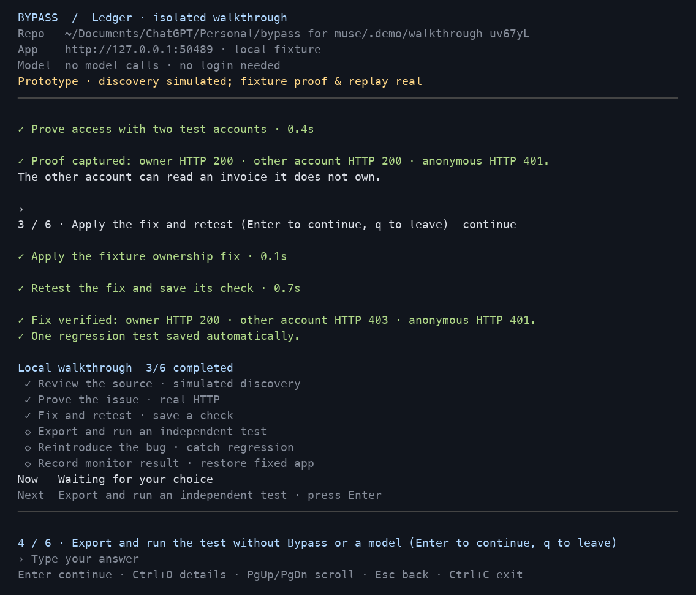

# A workspace in your terminal

Start with `./bypass`, or reopen a connected application with `./bypass --project /path/to/app`. The terminal keeps four things visible: the selected repository/app/model, the activity timeline, the current and next actions, and the command bar.

This image is rendered from a real terminal session, after the local HTTP controls changed from 200/200/401 to 200/403/401. This screenshot shows the older offline walkthrough; discovery in that mode is simulated. Use `bypass poc` for real Docker agents. The screen is not evidence of a vulnerability in a customer application.

| What you want | Interaction |
| --- | --- |
| Discover available actions | Type `/`, filter by name, then arrows + Enter |
| Take the suggested next step | Press Enter at the command bar |
| Understand what just ran | Read the operation row and elapsed time; Ctrl+O expands details |
| Follow setup or the demo | Read the checklist, completed-step count, Now and Next |
| Return to DNS setup | `/app` shows the existing app and its ownership challenge |
| See previous work | PgUp/PgDn for this session; `/history` for saved project events |
| Stop a waiting operation | Esc; Enter also skips a model connection check |
| Exit | `/quit` or Ctrl+C; project state and a session transcript are retained |

Menus accept arrow keys or numbers. The input supports editing, long pasted paths, bracketed multiline paste, and session command history. The layout adapts to narrower windows; the task list becomes compact while the command bar remains visible. Use a terminal at least 40 columns by 15 rows for the full-screen workspace.

`BYPASS_PLAIN=1 ./bypass` preserves a plain scrolling interface, including for screen readers. `TERM=dumb` also uses plain mode. `NO_COLOR=1` removes color. Scripted commands and `--json` keep their original output and exit codes.

The workspace offers defined commands and guided actions. Free-form model conversation remains in Muse. Use `/engine` to select real Docker agents and configure HTTP proof, or `/poc` for the separate real-AI exercise. The header identifies the selected engine. See [the POC walkthrough](REAL_POC.md).

## Interaction references

The command palette follows the discoverable slash-command pattern documented by [OpenCode's TUI](https://opencode.ai/docs/tui/). Transcript expansion, command history, task visibility and interrupt controls draw on [Claude Code's interactive mode](https://code.claude.com/docs/en/interactive-mode).

Bypass reports actual operation timing and completed stages. It does not invent completion percentages or display a fabricated model thought process.
