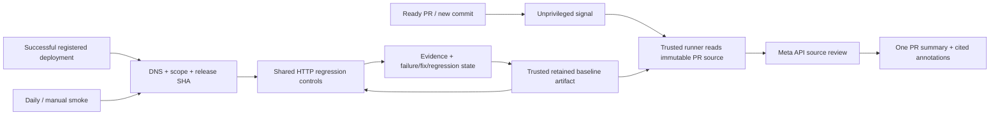

# Bypass in GitHub

**Review PR source with your Meta API key. Replay approved security checks after deployment and on a daily schedule.**

This is the first GitHub runner implementation. It uses GitHub Actions, Bypass's shared source-citation validation and HTTP regression engine. It does not use your Muse subscription, run application code, fix application files, or require Docker. Cloudflare Workers and Workers AI are phase two.

The public installer includes this integration. Update Bypass and start a fresh Muse session before setup. Installed packages pin the Action to their bundled **full Bypass commit SHA** automatically; a source checkout requires an explicit reviewed `--action-ref`. Start with the [README walkthrough](../README.md#github-security-agent) for setup, secret names and everyday use.

## Start in Muse

With this version of the Bypass plugin loaded in your application, ask:

> Set up Bypass's GitHub agent for this repository. Use the Meta Model API, start with report-only PR reviews, and add daily smoke tests if we have approved saved live checks. Generate the files for review; don't deploy them yet.

Muse uses `bypass_ci` with `agent: true`. It should reuse the selected repository, offer **Source review** / **Source + saved live checks**, and offer **Daily (recommended)** / **Every 6 hours** / **After deploy only**. It resolves the reviewed Bypass package commit for `action-ref`; it must not substitute your application's commit. A custom answer remains available. A source checkout can supply an explicit reviewed commit; a released package can use its bundled release identity.

1. **Generate the configuration.** Three files appear in your app: `.github/bypass.json`, `.github/workflows/bypass-pr-signal.yml`, and `.github/workflows/bypass-security.yml`. Existing files are not replaced without an explicit request.
2. **Add your Meta key once.** In your repository's **Settings → Secrets and variables → Actions → New repository secret**, name it `MODEL_API_KEY`. Alternatively use `gh secret set MODEL_API_KEY` from the app repository; the CLI prompts privately. Do not put the key in chat or commit it. The runner uses `https://api.meta.ai/v1` with `muse-spark-1.3` by default.
3. **Review and merge the generated files.** Open **Actions → Bypass Security → Run workflow → auto** for an initial baseline. Open or update a non-draft PR to receive the security review. Workflows must exist on the default branch for the privileged trigger to run. Setup does not change branch protection.

No application URL, DNS setup or app accounts are needed to start source review. Until live checks are connected, source review reports that deployment proof is deferred and no smoke schedule is generated.

## Standalone setup

Run inside an already-connected Bypass application:

```bash
bypass ci init --agent
gh secret set MODEL_API_KEY
```

Review and merge the three generated files, then inspect the baseline under Actions → Bypass Security. When using a source checkout, add `--action-ref <REVIEWED_BYPASS_COMMIT_SHA>` with a full 40-character Bypass SHA. Installed packages infer it from their release identity. `bypass ci init` without `--agent` retains the existing exported-test workflow.

To include an existing DNS-verified target and saved regression checks:

```bash
bypass ci init --agent \
  --target production --every 24h \
  --revision-path /api/version --revision-field sha
```

If setup files already exist, inspect the proposed settings before explicitly adding `--force`. This regenerates all three files, including custom policy settings; it is not a merge operation. `--every 6h` changes the cadence; `--every off` keeps deployment and manual verification without cron.

The equivalent Muse tool accepts the same `agent`, `action-ref`, `target`, `every`, `revision-path` and `revision-field` options. Choosing **After deploy only** maps to `every: "off"`. No workflow is pushed and no secret is configured merely by generating these files.

## Connect deployment verification

Live setup reuses approved checks already saved by Bypass. The generator returns the exact secret names to configure and strips private credential records from the export.

| Requirement | What to configure |
| --- | --- |
| App control | Set the generated `BYPASS_DNS_<TARGET>` secret to your existing `bypass-verification=...` TXT value. Keep that record published. Every live run rechecks the same record; setup does not rotate it. |
| Testing permission | Export the target's existing methods, paths, rate and expiry. `/api/version` or your chosen revision endpoint must be within the approved GET scope. Production authorization is required before export. |
| Deployment identity | Your deployment pipeline must create a GitHub Deployment with the **full source SHA** and matching environment, then a **success** status with the approved app URL. A code push alone is not a successful deployment. |
| Runtime identity | The approved revision endpoint returns JSON such as `{"sha":"<full deployed SHA>"}`. Supply the correct path and JSON field. It is read before and after the checks; a mismatch blocks fix verification. |
| Account checks | Configure the generated dedicated account-secret references. Both login controls and owner access must work. No account creation occurs in this runner. |
| Test resources | Use approved synthetic resources that remain available for replay. Deleted/expired resources are blockers, not passing tests. |

The workflow handles successful `deployment_status` events automatically. Daily/manual smoke looks up the latest active successful GitHub Deployment for each configured environment. Unregistered deployment providers need an adapter in the app's deployment pipeline before live verification can work; the bot does not infer deployment success from `main`.

**Credential lifecycle:** this phase supports CI-provided bearer tokens, cookies and header values. The interactive plugin's private Firebase refresh store is not uploaded. Supply renewable credentials through your own trusted CI broker, or update the named secret before expiry. Scope and ownership expiry are deliberately preserved; renew in Bypass and regenerate/review the target policy. CI does not silently extend an expired grant. To revoke immediately, cancel active runs and remove/disable the target in trusted default-branch policy. Stopping a workflow does not remove its retained evidence.

## What happens on each trigger



**PR review:** source is fetched through GitHub APIs at the immutable head SHA, never checked out or executed. Changed eligible files are reviewed with up to eight deterministic auth/policy context files. Supported extensions are JavaScript/TypeScript, Python, Go, Ruby, Rust, Java and PHP. Removed files and other types are listed as excluded. Full selected files are read in bounded ranges. Every batch continues after earlier findings or model failures; an exhausted budget or unread selected range makes execution incomplete. Source is sent to Meta, so enable this only for repositories permitted by your API/data policy.

The initial limits are 40 files, 256 KB of numbered source, 12 model calls, and 4,096 output tokens per call. Adjust `review.maxFiles`, `maxBytes`, `maxCalls` and `maxOutputTokens` in reviewed default-branch policy. Model requests have a 60-second timeout, a run has a 20-minute cancellation deadline, and the workflow has a 25-minute outer limit. Logs show batches, file completion, found concerns and elapsed waiting time. These are limits, not completion-time promises.

**Baseline:** a default-branch push or manual `auto` run reviews supported default-branch source and retains its concerns. If targets exist, it also replays their registered deployed revisions independently; that deployment can be older than the current source. A failed model call does not prevent independent authorized live replay.

**Deployment / smoke:** replay every configured saved check, even after one fails. There are **zero model calls**. Account-boundary checks require two valid, different identities, valid owner access and exact resource identification, then outsider and anonymous controls. Only a passing unchanged contract with a retained prior observed failure can become `fix_verified`. A previously passing contract that fails becomes `regressed`. A new passing contract is simply `passed`. Revision mismatches, all-403/login failures, missing markers, expired scope and zero coverage cannot verify a fix.

The runtime validates public HTTPS destinations, pins DNS resolutions for HTTP requests, disallows redirects, enforces scope and rate, and bounds response sizes. Rate limiting is per runner; configuring multiple independent workflows for the same target requires a shared limit outside this phase.

## Results and controls

- **One PR summary** is updated on subsequent commits. Checks include cited file/line annotations. A stale head cannot update the newer commit's summary. A tiny race remains possible between the final GitHub head check and comment write; the comment always displays its reviewed SHA.
- **Evidence is separate from conclusions:** source concerns, observed HTTP failures, passing controls and incomplete work are individually listed. A new-to-history concern is not proof that this PR introduced it. Reports include selected/excluded files, model-call counts, timestamps and duration.
- **Report-only is the default.** Findings are visible without blocking a completed run. To enforce the severity threshold, set `review.blocking: true`, optionally set `review.failOn`, then require **Bypass / PR review** in repository rules. This gates all reported concerns at that threshold, including previously seen concerns. Incomplete work fails even in report-only mode. Do not enable a required check for merge queues; `merge_group` is not implemented yet.
- **Run now:** Actions → Bypass Security → Run workflow → `review` with a PR number, or `smoke`. `auto` without a PR creates a default-branch baseline. Manual workflows should run from the default branch. Pausing scheduled smoke means removing its cron or disabling the workflow; `smoke.enabled: false` prevents app testing and reports that the requested run is disabled.
- **Forks default to no AI review.** Set `review.allowForks: true` in trusted policy to permit bounded fork source as data. Fork code, scripts, PR workflow edits and artifacts never execute in the privileged assessment. GitHub may still require approval to run the unprivileged signal for outside contributors. Manual PR review is available to maintainers.
- **Artifacts:** `bypass-report` contains redacted JSON and Markdown for 30 days; `bypass-state` retains baseline concerns and check transitions for 90 days, subject to repository retention limits. Only a bounded `state.json` from this repository's trusted workflow and default-branch runs is restored. PR artifacts cannot become trusted memory. The reader validates provenance, size, member name and an available artifact digest. Baseline lookup examines the most recent 30 workflow runs; if no trusted retained state is found, the report says so and no historic fix claim is made.
- **Notifications:** use GitHub's normal check/workflow notifications. This phase updates PR summaries and Actions checks; it does not create incidents, send email/Slack messages, or automatically change source.

Reports contain code citations and synthetic check metadata, so follow your repository's visibility policy. Full HTTP bodies, auth values and private credential records are not persisted. Known runner credentials are redacted, but source itself can contain secrets; review eligible source and repository access before enabling model processing. No PR text, model result or restored artifact can supply the trusted policy, API endpoint or executable commands.

GitHub cron is best effort: runs can be delayed or dropped and public-repository schedules can be disabled after inactivity. Native concurrency can replace an older pending run; this phase does not provide a durable event queue or a missed-run watchdog. It is an Actions-backed smoke schedule, not an always-on protection SLA. [GitHub scheduling](https://docs.github.com/en/actions/reference/workflows-and-actions/events-that-trigger-workflows#schedule)

## What remains for phase two

Cloudflare-based orchestration/queues, optional Workers AI, a hosted GitHub App with browser onboarding, durable encrypted evidence, cross-runner rate limits, refreshable secret brokering, renewable automation grants, resource provisioning/cleanup, incident deduplication and a schedule watchdog remain separate work. The Action performs source review and approved regression replay; it does not autonomously create new live-test contracts from arbitrary PR code, execute arbitrary generated tests, or synchronize GitHub artifacts into Muse's local memory.

The provider boundary remains explicit: the initial runner uses **your Meta Model API key**. Any Workers AI or other-provider processing would require a later explicit configuration change. [Full product design](GITHUB_AGENT_DESIGN.md), [Meta reference](https://dev.meta.ai/docs/cookbook/github-agent), [Strix CI reference](https://docs.strix.ai/integrations/ci-cd).
