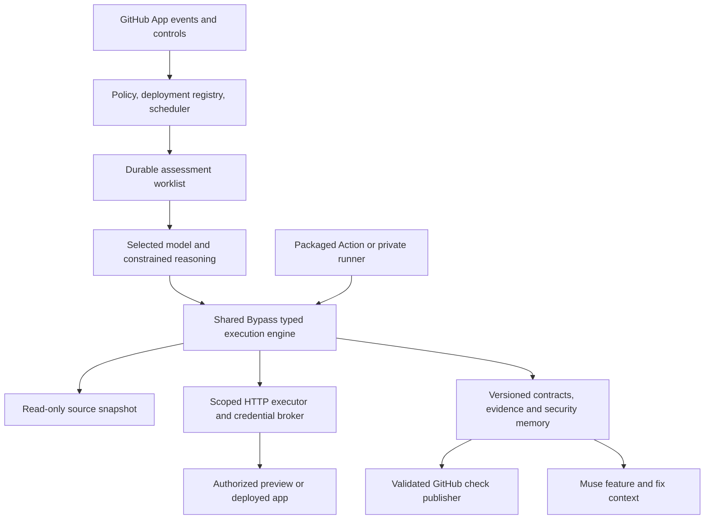

# Bypass GitHub agent — proposed product and execution design

Product design · 29 October 2026. The first implementation is a customer-operated GitHub Action using the customer's Meta Model API key. See [the implemented setup and limits](GITHUB_AGENT.md). The managed GitHub App, Cloudflare Workers / Workers AI, hosted control plane, fixture lifecycle and durable scheduling below remain future design; this document is not a claim that they have shipped. No bot installation or deployment is performed by this change.

The proposed product promise is: **Review security-sensitive changes, verify the deployed behavior, and keep testing the security guarantees you have already established.** A successful review describes its examined scope; it never promises that an application has no vulnerabilities.

The main customer experience should be a GitHub App. Its execution package should also be available as a versioned GitHub Action and customer-operated runner. These are deployment choices for the same policies, checks, evidence and memory, rather than separate products.

## 1. What to take from the reference integrations

Meta's recipe combines GitHub Actions, OpenCode and the Meta Model API. It separates specialist roles and gates code-writing actions behind maintainer requests. Its setup requires runtime configuration, agent files, a workflow and an API secret. We should adopt the role separation and explicit authority boundaries while packaging their configuration for customers. [Meta GitHub agent cookbook](https://dev.meta.ai/docs/cookbook/github-agent)

Avoid copying examples literally: production packaging should pin executable dependencies, handle forks explicitly and separate untrusted repository input from credentials and publishing authority. Disabling one agent tool is not an operating-system network boundary.

## 2. Product entry and setup

Primary CTA: **Connect GitHub**. Choose the GitHub organization and selected repositories using GitHub's installation flow. No local clone, Bypass CLI, Docker installation or editing YAML is required for the managed experience. This convenience requires new hosted components; it is not available in the current product.

GitHub is the daily surface. The Bypass setup page is for configuration, private evidence and exceptions. Existing Muse users can ask “Set up Bypass for this repository's PRs and deployed app”; Muse opens the same authenticated setup with detected values filled in. It must not create an independent second configuration.

**Step 1 — Confirm what to protect.** Detect repository identity from the installation, then source roots, service boundaries and deployment integrations. Do not ask the user to paste the repository URL again. In a monorepo, show detected applications with multi-select and a custom path option.

```text
Protect job-finder

What should Bypass check?
● Code + deployed app (recommended)
○ Code only
○ Deployed app only

Repository     Bypass-Labs/job-finder
Application    https://job-radar.app       [Change]
Environment    Production                 [Change]
```

Every suggested URL has a visible source: deployment integration, existing authorized Bypass project, or repository configuration. Suggestions are not automatically authorized targets. Environment options are Production / Staging / Preview / Local development / Custom. Do not infer production traffic or safety from the domain name.

**Step 2 — Choose where review runs.** Reuse an approved organization configuration when present. Otherwise show Managed runner (recommended for simplest setup) / My GitHub runners / Private runner. Inside model settings offer Meta Model API preset / Existing provider connection / Self-hosted compatible endpoint, with custom configuration available. Validate the selected model's tool and structured-result capabilities before enabling AI review. Display where source is processed, the inference destination and the budget.

For the initial product, require an API connection for unattended AI rather than inventing included inference. A future Bypass-funded model option could remove the key entry after its billing and limits exist. Self-hosted models require a runner that can reach them; a developer's sleeping laptop is not a reliable CI model host.

The interactive Muse plugin can continue using the active Muse session. The autonomous GitHub service uses its separately configured inference connection. Meta explicitly limits the subscription-connected credential to Muse Code; additional API keys use pay-as-you-go billing. Do not export that subscription credential into GitHub or claim that installing the App extends a desktop subscription to unattended jobs. [Meta subscriptions](https://dev.meta.ai/docs/muse-code/subscriptions)

**Step 3 — Connect and authorize the app, only for live coverage.** Review-only activation must not wait for DNS or accounts.

- Reuse a valid organization-owned proof for the same exact origin. A new runner or checkout is not a new domain. Today's local proof is not a portable hosted attestation: accepting editable JSON or a caller-supplied publicly readable TXT value would let another party claim the domain. First hosted enrollment therefore needs a trusted DNS-provider connection or a service-issued organization challenge once. After enrollment, all authorized repositories/runners reuse the origin proof. This migration limitation must be disclosed rather than promising impossible automatic trust transfer.
- If proof is missing, show the exact DNS name and TXT value, copy controls, automatic bounded polling and a **Continue with PR reviews** button. Recheck an existing valid record without routinely rotating its value.
- Ownership establishes control; a separate saved automation grant defines permitted environments, origins, routes, request methods, behaviors, rate limits and expiry/revocation.
- Offer Production-safe checks (recommended), Staging exploration, or Custom. Expand the preset so the user sees the actual permissions before enabling it. Method choices must include GET, HEAD, POST, PUT, PATCH, DELETE, OPTIONS and custom input. A method alone never authorizes every side effect on every route.
- Production-safe checks use approved synthetic resources and accounts. Read-only endpoints that start global jobs or disclose customer data are not automatically safe because they use GET.
- Account choices: **Create dedicated test accounts automatically where supported** / Use existing test accounts / Start without accounts. Account creation is a disclosed bounded permission in the selected preset, not an unannounced side effect. Auto-discover supported public authentication configuration before requesting missing details.
- If signup needs email verification, MFA, a CAPTCHA or a custom flow, finish independent checks and show the specific remaining choice. Do not repeatedly ask for information already available. No accounts means limited anonymous/source coverage, not successful authorization testing.

An automation grant needs an explicit renewable lifecycle. Current short local scope expiry is unsuitable for a silently persistent monitor. Propose revocable standing authorization with short-lived execution leases, periodic control revalidation and advance expiry notices. This is a new service-backed authorization model, not permission to remove the existing local expiry checks.

**Step 4 — Confirm one readable operating policy.** Advanced details remain collapsed but inspectable.

```text
Enable Bypass for job-finder

✓ Review every ready PR and new commit
✓ Verify approved checks after a successful deployment
✓ Replay security smoke tests every 24 hours

Merge policy       Report only initially             [Change]
Testing permission Production-safe synthetic checks  [Review]
Execution          Managed runner · selected API     [Change]
Budget             Organization limit + per-run cap  [Change]
Notifications      New issue, regression, blocked or overdue

[Enable and run baseline]   [Save for later]
```

Recommended defaults should be actual product choices, not a request for a paragraph from the user. Custom notes are always available. Budget limits must be configured and displayed before the first paid invocation; do not invent a universal dollar estimate before measuring the engine/provider combination.

After activation show readiness separately: **PR review active**, **Live verification ready / awaiting DNS**, **Smoke baseline running / unavailable**. Never label all protection enabled solely because installation succeeded. A smoke baseline must run real applicable checks; zero checks is “No smoke coverage configured.”

## 3. The PR experience

For each non-draft PR and new head commit:

1. Capture immutable repository ID, PR number, base SHA, head SHA, policy version and selected services. Compute the correct comparison; unreadable history is a visible blocker, not an empty passing diff.
2. Load relevant approved security knowledge, existing finding IDs and saved regression contracts. Use the diff to prioritize investigation, then read affected authentication, authorization, callers and data-flow context. Do not limit reasoning to changed lines.
3. Replay applicable trusted tests where the tested revision is available. An old production deployment cannot prove a new PR safe. If no preview/local sandbox exists, say which dynamic checks await deployment.
4. Investigate the recorded source and behavior worklist. Record evidence, recommended fixes and candidate regression contracts. Continue after each finding. Every item must finish, be explicitly excluded by policy, or have a concrete blocker.
5. If an authorized preview is ready, bind its deployment identity to the reviewed SHA and execute supported controls. Keep production credentials out of previews. Otherwise source review can complete with the separately visible live-verification gap.
6. Update one PR summary and precise inline annotations. Repeated commits update finding state rather than posting the same issue again. Superseded runs cannot overwrite a newer commit's result.

Illustrative check presentation—not measured performance or current product output:

```text
Bypass · PR #142 · 4ac912f

Reviewing access-control changes                       1m 18s elapsed
Done    5/7 source tasks · 4/4 existing preview checks
Now     Testing owner vs second-account access to analysis results
Next    Finish 2 route investigations and save the report

1 high-risk issue observed so far · review continues
Estimate: about 1–3 minutes remaining; based on completed checks
```

Before enough measurements exist, show “Estimating…” or “Waiting for model, 24s elapsed” rather than fabricated percentages. Account provisioning, model retries, deployment waits and cleanup are distinct stages. The display exposes completed, pending, blocked and excluded work counts. Time/model/request budgets are visible; bounded continuation resumes durable work automatically. Exhaustion reports incomplete work and a resume action, never a fake all-clear.

The final summary separates **Observed security failures**, **Source-supported concerns**, **Checks passed**, **Not tested / blocked**, and **Recommended changes**. Existing debt remains visible in the baseline but does not reappear as newly introduced on every PR. New, worsened and reintroduced issues are distinguished.

Saved controls come from the trusted baseline. Deleting or weakening a regression in the PR cannot remove it from that PR's required verification. Proposed contract changes get their own reviewed diff. An exception records an authorized actor, reason, affected behavior and expiry; it does not erase the underlying finding. A source/model failure must not prevent independent approved deterministic checks from running.

No automatic source fixes, commits, merges or approval reviews. Regression definitions and test artifacts can be generated within the assessment and downloaded without changing the application's branch. Committing them or opening a remediation PR is a separate explicit action. Remediation is not required for the first release.

## 4. Verification after deployment

A PR merge creates **Awaiting deployment**, not **Fixed**. Listen for successful GitHub deployment statuses where supported; otherwise connect an authenticated provider webhook or a small signed/OIDC-authenticated deploy-complete step. Never trigger on a bare push and assume rollout succeeded. GitHub exposes deployment-status events and the associated commit. [GitHub workflow events](https://docs.github.com/en/actions/reference/workflows-and-actions/events-that-trigger-workflows#deployment_status)

For each registered environment, resolve:

```text
Repository → application/service → source revision → artifact/deployment ID
           → authorized origin → observed running release → test results
```

Use deployment-provider evidence plus an approved runtime build identifier or equivalent trusted release metadata. A successful deploy event by itself does not prove every serving instance has switched over. Support squash/rebase mappings and deployments containing multiple PRs. During rolling updates, delay the final verdict until readiness and the required release-consistency conditions hold.

On deployment:

- Verify the origin against the registered environment; never accept a test destination straight from PR text.
- Wait for readiness with a bounded timeout. If release identity cannot be established, report **Behavior checked; deployed revision unverified** and leave the fix unverified.
- Run checks for findings the release intends to fix, affected security boundaries and the standing smoke suite. Include relevant newly added or changed behaviors supported by the engine; do not claim this is an exhaustive new pentest.
- Recreate expired synthetic resources through approved recipes. A missing resource or expired token is a setup failure, not successful denial of access.
- Require valid identity controls, legitimate owner access and negative outsider/anonymous controls with an exact resource assertion. A login page, generic error, stale ID or all-requests-denied result cannot verify a fix.
- Preserve the original failure and append deployment-specific retest evidence. Distinguish “not reproduced” from “previously observed failure now passes its valid regression contract.”

Example final copy: “Fix verified on production deployment deploy-842, commit 91bf02a. Owner access passed; cross-account access denied. Six other selected checks passed. Two new routes were source-reviewed but have no executable contract yet.”

If the behavior fails again, reopen the same finding, link the introducing release if evidence supports attribution, and notify the configured maintainers. Do not automatically roll back production. A post-deployment check cannot retroactively block a merge; pre-merge preview verification and deployment promotion gates are separate optional policies.

Fixture recipes need a durable resource ledger, unique run labels, ownership checks and cleanup results. Refresh renewable account credentials through a dedicated broker. Never repeatedly create new accounts because an access token expired. Retry mutating setup only with a supported idempotency mechanism or a positive check of the prior outcome. On cancellation, finish bounded cleanup or preserve a visible cleanup task; delete only resources the run can prove it created. Long-lived smoke fixtures require an explicit retention policy.

## 5. Smoke tests and controls

Smoke means a small versioned set of security assertions: login/identity validity, selected private endpoints, important account boundaries, and previously verified fixes. It is not merely an HTTP 200 health check. Default daily smoke replays deterministic contracts without model calls. Optional AI exploration is separately enabled, scoped and budgeted.

```text
Production smoke tests

Frequency  ● Every 24 hours  ○ Every 6 hours  ○ After deploy only  ○ Custom
Status     Healthy
Last run   Today 09:17 · 8 passed
Next due   Tomorrow 09:17 · America/Los_Angeles
Checks     8 enabled · 1 awaiting test-account setup

[Run now]  [Pause]  [Edit schedule]
```

“Every 24 hours” means a fixed interval; “daily at 09:00 local time” is a separate calendar option with explicit timezone and DST handling. Execution is best-effort within a declared start window, not exact-to-the-second. Display scheduled time, actual start, completion and next due time.

Managed mode needs a durable scheduler, leases, retry policy and an independent overdue detector. Action-only mode can use GitHub schedules, but GitHub documents delays, dropped jobs under load and disabling inactive public-repository schedules after 60 days. Do not promise an always-on monitor from a cron line alone. [GitHub schedule behavior](https://docs.github.com/en/actions/reference/workflows-and-actions/events-that-trigger-workflows#schedule)

Preserve fixed schedule slots rather than shifting the whole schedule after a slow run. Avoid duplicate catch-up runs and start-of-hour spikes. Deduplicate matching deploy/scheduled runs only when target revision, policy and full selected suite match. Serialize conflicting mutations and enforce a target-wide rate budget across concurrent runners. Retest transient network failures with bounded backoff; never average away a valid security failure.

Notify on a new material issue, regression, recovery, expired authorization, broken identity or overdue run. Keep unchanged healthy runs quiet. A disabled monitor, unavailable runner or zero checks must be visible; “last passed yesterday” alone is not monitoring health. Maintain one incident record per failure and update it rather than opening an issue each day.

GitHub check actions should offer contextually useful operations: **Recheck**, **View evidence**, **Settings**. GitHub permits at most three requested-action buttons, so schedule pickers live on the linked Bypass page; normal PR Markdown cannot host arbitrary dropdowns. [GitHub Checks API](https://docs.github.com/en/rest/checks/runs)

Optional comment shortcuts: `@bypass recheck`, `@bypass verify deployment`, `@bypass smoke now`, `@bypass pause smoke`, `@bypass schedule daily`. These are proposed commands, not implemented syntax. Mutating controls require a fresh repository-role check, are scoped to the referenced repository/environment, and return the resulting setting. A contributor cannot authorize production traffic by putting text in a PR.

## 6. Execution and trust design



The model proposes investigations. Deterministic services decide whether an operation is authorized, validate structured arguments, execute controls and determine observed results. The model cannot turn a concern into an HTTP-confirmed vulnerability or silently widen scope.

Trusted policy comes from the installed organization configuration or protected base branch, not the PR being reviewed. Do not load PR-supplied agent instructions, MCP definitions, plugins, package scripts or test executables into a privileged agent. PR bodies, code, model output, HTTP responses and restored artifacts remain untrusted data. Generated regression contracts are validated data; free-form generated code requires an isolated, credential-free sandbox before any optional execution.

The review worker should not possess a GitHub publication token, production credentials or a general shell. Source fetch, inference, HTTP testing and report publication use separate minimal capabilities. Enforce network destinations at the runtime/broker boundary. A writable scratch area for evidence is separate from read-only source. If building or executing app code is needed, use a disposable isolated worker with no publisher token, production secrets, shared writable cache or broad internal network access. A container alone is not sufficient isolation for hostile code.

Fork support must be deliberate. In managed mode, the App fetches an allowed source snapshot and reviews it as data, with fork quotas and no access to target credentials through the source worker. App testing of a fork preview requires separate approved binding and dedicated credentials. In Action-only mode, untrusted PR workflows run without secrets; authenticated analysis/publication uses trusted code outside the PR's control. Artifact provenance and schemas are validated before consumption. GitHub warns that privileged `pull_request_target` and `workflow_run` processing of untrusted code/artifacts can compromise the repository. Do not solve missing fork secrets by checking out and executing a fork in a privileged workflow. [GitHub secure use](https://docs.github.com/en/actions/reference/security/secure-use)

Default GitHub App permissions: metadata read, contents read, deployments read, checks write and pull requests write for the chosen reporting surface. Request Actions read only if a selected deployment adapter needs it. Issues write, security-events upload and workflow dispatch are optional features. No default contents write, workflow write, repository administration or secrets-management permission. Creating a setup PR or configuring a private runner is a separate maintainer-authorized operation; the review App does not grant itself these powers.

Verify webhook signatures and deduplicate delivery IDs. Authorization and policy versions are rechecked at execution, not just when a job is queued. Dispatch credentials are short-lived and bound to the installation, repository, workflow/ref, environment and allowed job. Uninstall/revocation invalidates queued work. Private targets require an explicitly configured private runner and network allowlist; do not relax the public executor's SSRF protection to reach an internal service.

## 7. Evidence, memory and verdicts

Persist evidence outside ephemeral runners. Namespace it by GitHub installation/tenant, repository ID, application/service, environment and immutable origin. Use an access-controlled metadata store and encrypted evidence objects. Public distribution R2 buckets must never double as private evidence storage. Customer-operated storage is an advanced deployment option. Do not put tokens, session cookies, personal response bodies or secrets into PR comments, artifacts or memory.

Respect repository visibility separately from report permissions. Public repositories should default to a minimal public check summary with sensitive live exploit details restricted to authorized maintainers. Public issue creation or detailed public security annotations require a chosen disclosure policy. Private report access must be checked on every request, including after installation or membership changes.

Minimum durable records:

| Record | Required identity and meaning |
| --- | --- |
| Assessment | Base/head SHA, policy/runtime/model versions, selected scope, worklist, budgets, completion and exclusions |
| Finding | Stable issue ID, behavior, source citations, evidence class, severity, first/last observation, deployment history |
| Regression contract | Assertion, positive/negative controls, supported fixture recipe, version; independent of an ephemeral account or object ID |
| Environment binding | Exact origin, current deployment, identity/secret references, scope lease and ownership proof |
| Execution result | Run/deployment/contract versions, timestamps, redacted control observations and reason for failure/blocking |
| Memory entry | Evidence references, source/deployment applicability, freshness, provenance and trust level |

A trusted publisher promotes evidence into shared memory. Fork/model text cannot become policy or organization-wide fact merely by appearing in a report. Base-branch approved knowledge is the default retrieval corpus; PR-local interpretations stay provisional. Preserve old observations but revalidate stale assertions. Source fixes, accepted-risk decisions and live proofs are distinct record types.

Existing Muse context retrieval should consume the same authorized knowledge: “This resource is tenant-bound; previous failure F-17; regression C-8; latest production result passed.” This makes the history useful before a coding agent writes the next feature. Access, retention, export, deletion and audit controls apply across GitHub and Muse.

Use two independent axes: **execution** (complete, incomplete, blocked, error, cancelled) and **security outcome** (observed failure, source concern, covered checks passed, no applicable checks). An empty result or failed model call never becomes a passing assessment.

Recommended rollout starts report-only; users can later require a stable `Bypass / Security` check. The gate fails for policy-blocking findings and for required work that did not complete. Source-only concerns need an explicit severity/confidence/validation policy and cannot inherit an “observed” label. Optional live work may remain deferred only when the chosen policy allows source-only completion and says so clearly.

Required gates must not report blocked work as `neutral` or `skipped`: GitHub accepts those conclusions as satisfying required status checks. Require the check from the Bypass App identity and support merge-queue revisions. Use a separate deployment check for the deployed SHA and target; daily smoke health is an environment status rather than a misleading update to an old PR. [GitHub protected branches](https://docs.github.com/en/repositories/configuring-branches-and-merges-in-your-repository/managing-protected-branches/about-protected-branches#require-status-checks-before-merging)

## 8. Packaging and implementation sequence

Checked current local source before this design: `service.mjs` exports saved tests into a basic GitHub workflow; `jobs.mjs` supports local workers; `host-review.mjs` records a durable assessment worklist; `checks.mjs` binds/exports concrete regressions; `project-memory.mjs` maintains local cited security context; `ownership-store.mjs` reuses exact-origin proof on the same user installation. This is a useful core, not an already-operating GitHub service.

Important limitations to address explicitly: current regression bindings depend on concrete resources and identities; local mutable state is not a cloud authority or safe cross-run database; deployment revision attestation, remote scheduling, centralized rate limits, fork isolation and GitHub publishing need new integration work. The first shipped coverage should stay honest about supported authentication/account-boundary behaviors rather than advertise a general exhaustive application pentest.

Build in this order:

1. **Shared execution contract.** Typed headless jobs, durable resumable work, normalized results, immutable policy/runtime identity, portable synthetic fixture recipes and remote-safe evidence persistence. Keep standalone and Muse semantics consistent.
2. **Packaged runner and PR review.** Versioned Action/container, official App, installation flow, protected configuration, provider preflight, role checks, fork-safe source review, deduplicated reports and a non-writing default. Package internal orchestration; customers should not maintain a folder of OpenCode agent prompts. OpenCode can be an internal adapter if it passes the same capability boundary tests, but do not add a second competing agent loop by default.
3. **Deployment verification.** One complete deployment adapter, exact revision mapping, app ownership/automation grants, identity refresh, safe setup/cleanup recipes and fix-state transitions. Add provider adapters behind the same deployment contract.
4. **Remote monitoring and shared memory.** Durable daily scheduling, watchdog, incidents, trusted memory synchronization and environment health. This is required before advertising continuous protection; a first source-review release should say source review only.

Action-only customers receive the same engine and report schema with generated, reviewable workflows. Pin actions/images/runtime packages to immutable revisions with verified checksums/provenance; offer reviewed upgrade PRs. Interactive installation can retain its one-line experience, but unattended CI must not download a mutable latest tool on every run.

Do not silently overwrite existing workflows, add required branch checks, create accounts, open remediation PRs or change a selected model/billing destination. Each must follow an existing authorized policy or a clear one-time setup choice. This preserves automation without repeatedly asking the user for routine execution approval.

## 9. Acceptance demo and release gates

Use an authorized controlled app first. Example path: select job-finder; confirm job-radar.app or an approved preview; reuse existing valid DNS proof; choose model and synthetic-account preset; enable PR reviews, deployment verification and daily smoke. Example identifiers and findings in this design are illustrative, not a new scan of either application.

The acceptance demo must show:

1. New installation to first source report without a local CLI, clone or Docker setup. Initial UX target: at most four configuration screens; DNS propagation and unavailable external prerequisites reported separately.
2. A deliberately vulnerable PR yields a cited source concern and, when the matching preview is available, a real failing control. The agent continues through the entire recorded scope after the first finding.
3. A human or separately authorized coding agent fixes it. Bypass verifies valid controls against the correct preview, retains the same issue ID and saves a reusable regression artifact. No silent source edits.
4. Merge shows awaiting deployment. Deploying an older revision does not close the finding. Deploying the right revision with passing controls produces verified production evidence.
5. Reintroducing the behavior without a new PR is detected by scheduled replay. Exactly one incident appears and recovery updates it. CI runners disappear between runs, proving persistence works.
6. Pause/resume, every-24-hours scheduling, Run now, credential refresh, resource expiry and cleanup all work through supported controls.
7. Fault cases: two simultaneous PRs, late deploy events, duplicate webhooks, stale head SHA, fork prompt injection, policy weakening in the PR, model timeout, insufficient budget, zero checks, expired scope, all-403 responses and a missed schedule. None can manufacture a complete passing review.

Measure setup completion, time to first useful evidence, actual model/request cost, false positives requiring dismissal, repeated findings, time to verify a deployed fix and overdue detection. Publish timing/cost targets only as targets until measured. The differentiator is the traceable security guarantee that survives PRs and deployments, supported by a setup users can complete—not an unsupported “10/10” score.
