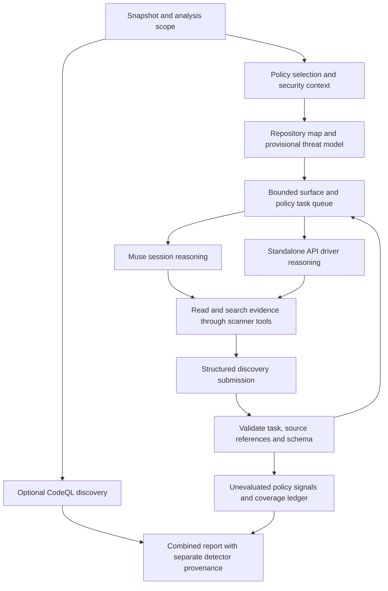

# Policy-based signal discovery — design and MVP

Status: MVP implemented, 2026-10-30. Automated host/API responses exercise the
engine; a real-model quality benchmark has not been established. It extends the design in [VULNERABILITY_DISCOVERY.md](VULNERABILITY_DISCOVERY.md).

The goal is an independent AI discovery path that can identify violations of
security invariants, including authorization mistakes that produce no CodeQL
alert. Outputs remain candidate signals with `evaluation: not_run`. Formal
confirmation/refutation, runtime reproduction, and patching remain separate work.

## Research and implications

### Strix

Reviewed the public source at commit
[`6b7ae2e`](https://github.com/usestrix/strix/tree/6b7ae2ebe4d47037a927aade23265ff4e4f27e84).

- [Prompt assembly](https://github.com/usestrix/strix/blob/6b7ae2ebe4d47037a927aade23265ff4e4f27e84/strix/agents/prompt.py)
  combines shared analysis guidance, scan mode, requested specialist skills,
  white-box guidance, and run-specific scope. The
  [skill tool](https://github.com/usestrix/strix/blob/6b7ae2ebe4d47037a927aade23265ff4e4f27e84/strix/tools/load_skill/tool.py)
  can supply additional reference material during a task. These are reasoning
  playbooks, rather than executable detection rules.
- The [root coordination skill](https://github.com/usestrix/strix/blob/6b7ae2ebe4d47037a927aade23265ff4e4f27e84/strix/skills/coordination/root_agent.md)
  establishes a shared threat model and decomposes work across security surfaces.
  Its model is shared within the run and supports attributed amendments.
- [Source-aware discovery](https://github.com/usestrix/strix/blob/6b7ae2ebe4d47037a927aade23265ff4e4f27e84/strix/skills/analysis/source_aware_discovery.md)
  preserves separately reachable instances and records entrypoints, controls,
  and sinks. Finding one problem does not establish coverage of sibling paths.
- [Counterevidence guidance](https://github.com/usestrix/strix/blob/6b7ae2ebe4d47037a927aade23265ff4e4f27e84/strix/skills/analysis/counterevidence.md)
  distinguishes supported findings, demonstrated controls, and unresolved proof
  gaps. Some white-box/scan-mode instructions emphasize runtime proof; this
  guidance also permits a complete source trace with disclosed runtime gaps.
  We should make our own discovery/evaluation boundary explicit and consistent.
- [Reporting](https://github.com/usestrix/strix/blob/6b7ae2ebe4d47037a927aade23265ff4e4f27e84/strix/tools/reporting/tool.py)
  validates structured evidence/confidence fields.
  [Semantic deduplication](https://github.com/usestrix/strix/blob/6b7ae2ebe4d47037a927aade23265ff4e4f27e84/strix/report/dedupe.py)
  can call a configured model. Bypass must not adopt this as a hidden Python-side
  inference operation.

### Codex Security

These observations come from official documentation, not an implementation audit.

- [Local scans](https://learn.chatgpt.com/docs/security/plugin/scans) accept
  threat-model context and repository `SECURITY.md` guidance, including nested
  policy scope. The guidance describes invariants, finding criteria, exclusions,
  and severity context. It is policy data rather than executable instructions.
- [Cloud threat models](https://learn.chatgpt.com/docs/security/threat-model)
  describe entrypoints, actors, trust boundaries, sensitive actions, and uncertain
  deployment assumptions. A generated draft can be edited and reused for future
  scans. This persistence differs from Strix's documented per-run model.
- The [CLI reference](https://learn.chatgpt.com/docs/security/cli/reference)
  separates knowledge-base documents, scan instructions, and validation
  procedures. It retains findings and coverage artifacts and distinguishes scan
  execution completion from evidence that a surface was reviewed.

The transferable design is contextual, evidence-backed review. Neither source
establishes that a policy name or a vulnerability-class checklist alone is a
detector. We will author Bypass policies and contracts for our execution model.

## MVP decisions

1. Keep CodeQL as the default detector. Add explicit `policy` and combined
   `codeql,policy` selections. Policy discovery must work with zero CodeQL alerts
   and without constructing a CodeQL database.
2. Start with four policies: `authz/object-access`, `authz/privileged-action`,
   `network/destination-boundary`, and `filesystem/path-containment`.
3. Support bundled policies and explicitly selected project policy documents.
   Use a JSON catalog for identifiers, versions, applicability, and Markdown
   references; author each policy body once. Custom policies use the same schema.
4. Supply repository `SECURITY.md` and explicit threat-model documents as context.
   Do not automatically interpret a disclosure policy as executable scan rules.
5. Keep initial reasoning source-only. Evidence tools do not run arbitrary shell
   commands, start applications, make HTTP probes, or edit source.
6. Build the first quality baseline around JS/TS and Python authorization,
   network, and filesystem examples. The format is language-neutral; CodeQL's
   language support does not imply equivalent policy-detector quality.

## Policy and context contract

Each policy declares its stable ID and version, security invariant, applicability,
attacker capabilities, review questions, evidence requirements, examples of valid
controls, and common false-positive conditions. A severity hint is detector
metadata; it does not assign evaluated vulnerability severity.

For example, `authz/object-access` asks whether an actor can read or modify an
object without an ownership, tenant, or explicit sharing check. It requires
tracing the object reference and principal through the relevant handler and
guard/helper. Checking only the handler for a literal authorization call is
insufficient: middleware, service checks, row-level controls, and public-resource
semantics are possible counterevidence.

At run creation, freeze and hash the selected policies and supplied documents
alongside the source revision. Record context provenance as source-observed,
operator-supplied, or inferred. Generate one provisional repository map/threat
model; keep unknown exposure and deployment assumptions explicit. Reuse context
only after checking its revision and policy/document digests.

More specific project guidance can clarify local invariants. It cannot grant
tools, read secrets, expand source scope, or silently disable enabled policies.
Enable/disable decisions come from explicit scan configuration. Conflicts and
uncertain assumptions remain recorded context, rather than invented facts.

## Work and execution flow



The scanner schedules a repository-mapping task followed by focused tasks for a
surface/policy pair: an endpoint, resolver, privileged operation, import path,
or shared boundary helper. It does not blindly run every policy against every
file. Mapping observations and policy applicability must cite source evidence.
Limited follow-up tasks can expand a trace across files; unprocessed surfaces
remain visible when the budget is exhausted.

Tasks use the existing `next_task`, `evidence`, and `submit` interfaces. Python
issues task IDs, allowed evidence operations, input references, instructions,
deadlines, and a result schema. The result contains candidate hypotheses,
supporting paths, observed controls/counterevidence, assumptions, reviewed
surfaces, and proof gaps. Discovery submission cannot set `confirmed` or `refuted`.

The evidence service supplies bounded inventory/read/search/navigation results
from the immutable snapshot. Citations identify a file range, source revision,
content hash, and evidence receipt. A submission must reference evidence actually
issued for its task. Structural validation establishes citation integrity, not
the truth of the model's security conclusion.

### Muse

The active Muse session requests a task, reads evidence, reasons using its current
settings, and submits the discovery result. The plugin command guides that loop.
The scanner persists `awaiting_reasoning` and returns a continuation when host
action is required; it does not start a background model process or poll forever.

No API profile lookup, credential access, independent inference, or fallback is
permitted in this path. This applies to mapping, policy selection that needs
reasoning, discovery, and any future semantic correlation. Python never calls a
model. Bypass cannot attest or measure Muse's subscription usage.

### Direct CLI

When `policy` is selected, validate the standalone API profile before launching
inference or creating an analysis run. The Node API driver runs the same task,
evidence, and submission loop using the configured provider. The driver owns
model requests and transport; it does not duplicate security policies or workflow
transitions. CodeQL-only runs remain independent of API configuration.

Plan output and bundled policy inspection require no Docker, image preparation,
credentials, or inference. Node can display the authored catalog metadata;
Python remains responsible for executing policy semantics and task preparation.

## Contracts, runtime, and ownership

The MVP implements the previously reserved interfaces. Its v3 contract supplies
policy-specific provenance and a discovery work-unit identity; saved v2 SARIF
provenance remains readable. The source evidence and task queue are shared by
Muse and the standalone driver.

One active v3 manifest defines the wire contract: detector-specific
origin variants, discovery work-unit identity, policy/context digests, task
leases/checkpoints, discovery submissions, coverage, and reasoning usage.
Retain a reader/adapter for saved v2 CodeQL reports; do not maintain duplicate
copies of shared wire schemas or pretend policy results came from SARIF.

Report independent API requests separately from host reasoning. A Muse-assisted
scan has zero independent requests but unknown host token/model usage. It must
not be presented as a scan that performed no AI reasoning. Direct CLI usage
records provider requests and returned usage, including unavailable measurements.

| Area | Implementation responsibility |
| --- | --- |
| `scanner/policies/` | One authored catalog and policy bodies; explicit packaging allowlist |
| `scanner/src/bypass_scanner/discovery/` | Policy loading, applicability, context tasks, work preparation, candidate normalization |
| `scanner/src/bypass_scanner/repository/` | Snapshot-backed evidence access and citation receipts |
| `workflow.py`, `service.py`, protocol | Durable task lifecycle, validation, limits, coverage, cancellation/resume, reporting |
| `src/scanner/runtime.mjs`, client/service | Container selection, typed transport, CLI/Muse routing and continuations |
| `src/scanner/api-driver.mjs` | Standalone provider-backed task/tool loop only |
| `plugin/commands/discover.md` and plugin guidance | Active Muse workflow; no duplicated policy text or provider configuration |

Use a lightweight Python scanner image for policy-only runs. Keep the pinned
CodeQL/toolchain image for CodeQL and combined runs, sharing authored scanner
sources through Docker build stages. Policy discovery should not download a
multi-language CodeQL bundle just to serve source evidence. Both runtimes keep
source read-only and analysis networking disabled. Image preparation can still
download its declared dependencies; Node standalone inference uses the selected
provider outside the scanner container.

## Durable limits, scope, and artifacts

Configure finite run/task deadlines, task/evidence request limits, per-request
and total evidence bytes, follow-up depth, and retry limits. Muse limits are
enforced at protocol boundaries; they cannot bound the host's internal token
usage. The standalone driver additionally limits its own model requests and
records available provider usage. No cost estimate is a billing guarantee.

Lease one task at a time initially. Submissions are idempotent; stale task IDs,
wrong revisions, invalid citations, oversized results, and conflicting duplicate
submissions are rejected. Resume checks source, runtime, policy, and context
identity. Cancellation retains accepted results and deferred work.

Reuse current default source exclusions and explicit inclusion flags. The
evidence tool must enforce scope itself, including secret and symlink exclusions;
the model cannot expand it. If an excluded dependency/control prevents a trace,
record the gap instead of assuming the control is absent.

Persist policy selection/digests, security context, task/checkpoint events,
evidence receipts, accepted discovery submissions, signals, and coverage under
the run directory. Coverage distinguishes pending, reviewed without a candidate,
candidate found, not applicable with rationale, proof gap, failed, and deferred.
A file inventory and an empty candidate list do not establish reviewed coverage.

Use deterministic fingerprints for exact repeated submissions. Preserve distinct
reachable call sites and both CodeQL/policy origins. Cross-detector relationships
can group candidates for later evaluation without discarding evidence. Defer
semantic LLM deduplication to an explicit reasoning task.

## Public interfaces

```text
bypass scanner policies
bypass scanner doctor --detector policy
bypass scanner prepare --detector policy
bypass discover --detector policy --plan
bypass discover --detector policy --policy authz/object-access
bypass discover --detector policy --exclude-policy network/destination-boundary
bypass discover --detector codeql,policy --config scanner.json
```

Policy selectors use exact catalog IDs; exclusions win. Keep CodeQL rule flags
separate from policy selectors. Project configuration supplies custom catalog
paths and explicit threat-model documents. Existing status, resume, cancel,
signals, report, and artifact interfaces continue with matching typed Muse tools.

## Implementation milestones and acceptance

1. **Functional Muse slice:** policy catalog, v3 contracts, lightweight runtime,
   bounded evidence service, durable task queue, and one object-authorization
   policy working end to end in Muse. Keep existing CodeQL tests green.
2. **Standalone and policy breadth:** implement the API task loop and the other
   three policies. Test identical tasks/contracts and the strict execution-mode
   boundary. Missing API settings fail clearly; Muse never consults them.
3. **Combined discovery and quality:** combine detector outputs with retained
   provenance, complete coverage/reporting/resume tests, document interfaces,
   and establish a real-model quality baseline.

Fixtures must include vulnerable and safe variants, indirect middleware/service
guards, public resources, cross-tenant paths, excluded files, deceptive policy
text, changed revisions, forged citations, timeouts, cancellation, and interrupted
task recovery. Include at least one real authorization defect with no CodeQL
signal. Mock-host and mocked-provider tests verify engine behavior and isolation;
they do not establish that an LLM detects the vulnerability.

Run opt-in quality reviews over withheld positive/negative fixtures using the
actual Muse or API settings. Record detection rate, false positives, proof gaps,
evidence quality, latency, and available usage over repeated runs. Explicitly
record which findings/context were supplied to the model. Formal evaluation,
dynamic probes, patching, and autonomous specialist-agent trees are deferred.
