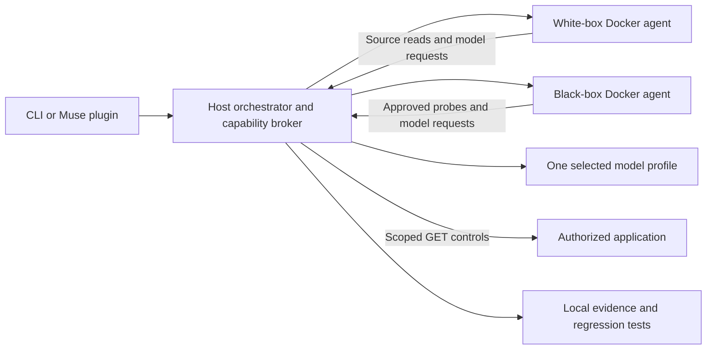

# Real AI POC: source → HTTP proof → regression

Version 0.2 adds two separate Docker agent services. They use the same Bypass model profile as the orchestrator. Source hypotheses come from actual files; confirmed findings come from actual HTTP responses. There is no simulated fallback when Docker, inference or a request fails.

The first supported scope is **missing authentication and cross-account access to JSON resources**. This is a bounded POC, not a general-purpose production scanner. Browser login, arbitrary exploit execution, SSRF testing, deployment attestation and broad framework coverage are not implemented.

## Primary demo: inside Muse

Install and approve the plugin using the [README](../README.md), start a new Muse session, and type **`/bypass:demo`**. A separate local app and two public accounts are prepared for you. The plugin reuses the selected Bypass model profile, or the Muse default when no profile is selected. All three roles use that profile; this is not automatic inheritance of the chat model.

Stay in the conversation. Muse calls the tools to review, follow progress, inspect proof, change the generated fixture's policy, retest, export/replay a regression, deliberately bring the fixture bug back, and record one monitor tick. It restores the fix, shows feature security context, stops the fixture and restores the prior application selection. **`/bypass:status`** shows Done / Now / Next and actual worker health. **`/bypass:help`** finds any operation, including reports, CI, bindings, model settings and monitor controls.

Docker and a working provider are required for real review. A failure remains an incomplete review with saved evidence. An explicit offline-preview request selects seeded discovery; no automatic fallback occurs. Official Muse login and capability approval remain host actions. [All CLI-to-plugin equivalents](PLUGIN_COMMANDS.md).

## Alternative: standalone CLI

Requires Node 22+, Git, a running Docker engine, and a working model connection. Docker Desktop or Colima works. For Muse subscription inference, install Muse and sign in with `muse login`.

```bash
./bypass poc
```

This creates a separate local app and opens the terminal workspace with the Docker engine selected. Its two public test accounts, authorized local URL and owner-owned invoice are already configured. Your customer repository is untouched. With no existing project profile, the POC uses your Muse subscription's default model; `/models` lets you select local or self-hosted inference instead. When started from an initialized Bypass project, its active profile is copied without credential values.

1. **Press Enter to review.** First-run Docker image preparation may take a minute. The transcript shows orchestrator, white-box and black-box progress and model-call counts. Each review model response is bounded to 60 seconds; the automatic connection preflight has a 30-second limit.
2. **Open the finding.** Expect an exact source citation in `policy.mjs` and five real controls: owner identity 200, outsider identity 200, owner resource access 200, outsider resource access 200, anonymous access 401. A model hypothesis alone cannot confirm a bug.
3. **Fix the application.** Open the displayed project folder and change `policy.mjs` to:

   ```js
   export function mayReadInvoice(account, invoice) {
     return account === invoice.ownerId;
   }
   ```

   The local app reloads the policy automatically. The agents do not edit or execute customer source.
4. **Choose `/results` → Retest a fix.** Owner access remains 200; the outsider becomes 403. Both account login controls must remain valid. A deterministic check is saved after the previously confirmed finding passes these controls.
5. **Choose `/tests` → Export standalone Node tests.** Run the printed `node --test` command. The exported suite needs no Bypass runtime or model.
6. **Change the policy back to `return Boolean(account);`.** `/tests` replay and the exported Node suite must both fail. Restore the ownership comparison and retest to finish fixed.
7. **Type `poc stop` inside the workspace** when finished. The app stops; evidence and generated tests remain in its `.bypass/` and `tests/security/bypass/` directories. The Docker agents are removed after each phase. Your Docker VM remains running.

For scripts, use `./bypass poc start --json`, then `./bypass --project <returned-root> scan --mode combined`. Review exit codes: **1** means a confirmed exposure or failed regression; **3** means incomplete/blocked or no confirmed issue in a bounded review. Neither is a claim of full coverage.

The older `./bypass demo` is still available as an offline, seeded walkthrough. `poc` performs real inference and discovery against a deliberately vulnerable example application.

## Review your own app

```bash
./bypass onboard
```

Connect the app repository and choose the model. Add your running local or HTTPS deployed app. For deployed apps, publish the generated DNS TXT record, verify ownership, and authorize the testing paths. Pending DNS still permits source-only review.

New onboarding selects real agents automatically. In the workspace, type **`/engine`** to configure account-boundary proof (or to switch an older offline project to **Real AI agents**). It walks through Docker readiness, shared model, account references and one resource probe. The account and resource paths must be within your approved scope.

Supply two test accounts, a signed-in JSON endpoint such as `/api/me`, and a known resource owned by the first account. Store credentials in environment variables **before starting Bypass or Muse**, using their names in setup. Supported credential types are bearer, cookie and custom header. The identity endpoint must return a scalar account ID that differs for the two accounts; configure its field name if it is not `id`.

Equivalent automation commands, after repository/model/app setup:

```bash
./bypass --project /path/to/app engine use docker
./bypass --project /path/to/app engine doctor
./bypass --project /path/to/app identity add owner --type bearer --secret-env BYPASS_OWNER_TOKEN --check-path /api/me
./bypass --project /path/to/app identity add outsider --type bearer --secret-env BYPASS_OUTSIDER_TOKEN --check-path /api/me
./bypass --project /path/to/app probe add invoice --path /api/invoices/123 --resource-id 123 --owner owner --outsider outsider
./bypass --project /path/to/app scan --mode combined
```

The server must return the configured resource identifier as a scalar JSON value. Use `--id-field id` for a top-level field, `--id-field run.id` for a nested field, or a JSON Pointer such as `/run/id`. Set the login account selector with `--identity-field` (for Job Radar, `/api/profile` returns `owner_uid`). Selectors only read JSON data; they do not evaluate expressions. Up to six resources per target are supported. The agent cannot invent or widen the allowed resource paths.

Source-only: `scan --mode code`. HTTP-only: `scan --mode live`. Use `/results` or `finding show <id>` to inspect evidence, and `retest <id>` after a fix. Saved checks run before investigation; only exact, valid, passing checks are excluded from repeat HTTP probes. Stale, failed and blocked checks return to investigation.

## Muse plugin

Update the plugin and start a new Muse session. Paste:

> Use Bypass's real Docker agents to review this repository and its staging app. Use the same model as this session, guide any missing setup, prove findings with HTTP controls, and help me keep verified fixes as regression tests.

The plugin shows its version and a setup checklist, then asks one question at a time. It performs the tools itself and reuses saved choices. The expected conversation is:

| Step | What you provide | What Bypass does |
| --- | --- | --- |
| Repository | Use this application folder, another path, or a Git URL | Connects it and remembers your explicit choice for this Muse workspace |
| Model | Muse subscription, local model, or self-hosted endpoint | Selects one shared profile; checks Docker without making a paid model test |
| App | App URL and local/staging/production environment | Connects the app; offers source-only review if you prefer |
| Ownership | Publish the displayed DNS TXT record, or acknowledge local ownership | Verifies the selected app; source review can proceed while DNS is pending |
| Scope | Authorized path prefixes; explicit acknowledgment for production | Records GET/HEAD permission, 2 requests/second, expiring in seven days |
| Accounts | Two credential environment-variable names, credential type and login endpoint | Reuses or repairs references without reading secrets into chat |
| Resource | Owner's exact JSON resource path and expected ID | Binds the owner/other-account/anonymous controls |
| Review | The review request already supplied | Shows the plan, runs the real agents and reports source hypotheses and HTTP proof separately |

The plugin polls a durable run so you can see progress and stop it. Source editing stays in Muse; tests and evidence stay in the selected application. A later `/bypass:context` resumes that application's readiness and current checks. It labels old monitor failures superseded by a later passing retest, and does not search example projects for evidence.

**Model inheritance is explicit.** The MCP interface does not expose the host Muse model automatically. When its provider and model ID are known, configure those exact values. Otherwise the plugin asks which shared profile to use. All three Bypass roles use that one profile. It never claims a different provider is the same model, extracts subscription tokens or silently falls back to cloud inference.

## What runs where



Each worker is a separate short-lived container with no direct network, source mounts, credentials or Docker socket. The broker supplies bounded source reads and performs scoped network requests. Containers run without root, with a read-only filesystem, dropped capabilities, no privilege escalation, and CPU/memory/process limits. They are removed on completion, error or cancellation. Docker run controls follow [Docker's container runtime documentation](https://docs.docker.com/engine/containers/run/).

The host calls the selected model: compatible local inference stays local; self-hosted inference goes to your endpoint; Muse subscription inference uses the installed native CLI in an empty temporary workspace. Source excerpts are sent only for real analysis. Environment-referenced secrets are redacted from source excerpts; `.env`, keys, ignored files and symlinks outside the project are excluded. Inspect your eligible source before using a remote model: this is not a comprehensive secret scanner.

A run permits at most 18 model calls (including an optional connection preflight) across the three roles, eight turns per worker, 192 KB of source excerpts and six resource probes. Source files up to 1 MB are read in pages of at most 400 lines / 64 KB; findings can cite only lines actually delivered to the agent. Route locations help it select the relevant pages. Each probe uses five GET requests. Requests honor existing exact-origin, authorization, expiry, path, DNS-pinning and rate-limit controls. Raw HTTP bodies and credential values are not persisted or sent to the model. Findings, citations, control statuses, container identities, selected model and call counts are saved locally.

## Troubleshooting

- **Plugin shows the old mocked-only instructions:** update the plugin, inspect/approve changed native capabilities, and start a new Muse session. The setup tool and session hook report the loaded version. Updating the checkout does not reload an already-running Muse session.
- **Muse pauses between setup steps:** the setup checklist itself makes no model request, but Muse still needs a host-model response to choose and present its next action. During validation, some conversations hit their 3–5 minute test bounds between successful tools. The selected application and its configuration survived restart. A separate fresh-session check completed with `muse --reasoning-effort minimal`; this is an optional setting for onboarding, not a change to your saved model profile. This remains a host-conversation latency limitation; successful tool checks do not establish a consistently fast conversational experience. See the [plugin validation record](evidence/plugin-onboarding-2026-10-26.json), including the timed-out attempts.

- **Docker unavailable:** start Docker Desktop or Colima; `docker version` must show a server. `engine doctor` checks availability. The first review builds the shared image; `engine prepare` prepares it in advance. An image tag is derived from worker source and Dockerfile; runs use its resolved image ID.
- **Model timeout / invalid JSON:** the run is incomplete and retains partial evidence. New/stale connections get a 30-second synthetic preflight; review responses have a 60-second bound. The adapter streams transport progress and defaults to minimal reasoning. Test the connection before retrying; check `muse usage` for allowance and use `muse login` only for an authentication error. No fake result is substituted. A successful preflight does not guarantee later model responses.
- **Identity control blocked:** refresh both credentials, verify `/api/me`, and select the correct account identifier field. An invalid outsider login never counts as proof of a fixed authorization check.
- **No source citation accepted:** the model must cite an exact line from a file it actually read. Unsupported or fabricated evidence is rejected.
- **No issue confirmed:** this only describes the bounded resource probes and selected source files, not the whole application.
