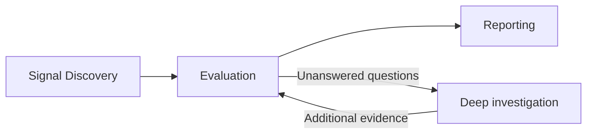

# Vulnerability discovery service

Discover potential vulnerabilities, evaluate the evidence, and produce actionable
reports. The MVP has three stages: **Signal Discovery → Evaluation → Reporting**.



## 1. Signal Discovery

Plugins identify potential security issues:

- **SAST:** CodeQL and other static analysis tools.
- **AI policy detection:** inspect code and workflows for violations of security
  policies, such as missing tenant isolation or authorization checks.
- **Future plugins:** dependency analysis, configuration checks, fuzzing, and
  dynamic testing.

Each plugin produces signals in a common format: the suspected issue, affected
code or workflow, supporting evidence, and unresolved assumptions. It also records
what it checked and any coverage gaps or failures.

AI discovery can find issues independently of SAST alerts. Signals are candidates
for evaluation, not confirmed vulnerabilities. Related signals can share an
investigation while retaining their original evidence.

## 2. Evaluation

Determine whether each candidate is a vulnerability and assess its severity.

1. Apply deterministic checks and filters where available.
2. Inspect the relevant code, controls, attacker prerequisites, and impact.
3. Investigate unresolved questions when additional analysis can answer them.

| Outcome | Meaning |
| --- | --- |
| `confirmed` | Evidence supports the vulnerability and its required conditions. |
| `refuted` | Evidence disproves the suspected issue. |
| `needs_review` | Evidence is insufficient; record the unanswered questions and next action. |

Missing information does not establish safety. Severity reflects the supported
impact and exposure rather than simply inheriting a detector's default score.

### Deep investigation

Deep investigation is an optional part of Evaluation, rather than a separate
pipeline stage. It follows specific questions through callers, data flow, shared
controls, configuration, or other relevant evidence.

For example: “Can one user access another user’s private data?”

If available analysis cannot answer a question, retain `needs_review` and identify
what is needed, such as deployment information or a runtime test. Stop when the
case is resolved, blocked, or reaches its investigation budget.

## 3. Reporting

Generate JSON and Markdown reports containing:

- Confirmed findings with severity, evidence, prerequisites, and affected locations.
- Unresolved cases with questions and suggested next actions.
- Scan scope, coverage gaps, and failures.

Keep refuted cases available for review. Reports reflect recorded evaluation
results.

## Future capabilities

### Reproduction and patching

Runtime validation can answer unresolved evaluation questions or demonstrate a
confirmed finding. Preserve reproduction steps, example payloads, observations,
and limitations. Generating a reproducer does not mean it ran successfully.

Patching produces a proposed fix and regression test for an accepted finding.
Verify both that the vulnerability is addressed and legitimate behavior still
works. Track source-based conclusions, successful reproductions, and verified
patches separately.

### Self-improvement

Use reviewed findings, false positives, known misses, and analysis costs to improve
detectors, filters, policies, and investigation methods. Where possible, turn
repeated LLM analysis into deterministic checks.

Run improvement separately from scans. Test changes against vulnerable and safe
examples before releasing a new version. Measure detection accuracy, coverage,
latency, and cost; fewer alerts alone does not demonstrate improvement.

## MVP scope

Start with SAST and AI policy discovery, evaluation with optional deep
investigation, and reporting. Preserve evidence and progress so interrupted work
can resume. Add runtime reproduction, patching, and self-improvement later.

## Implemented: CodeQL discovery

The Python scanner and Node adapter now execute deterministic SAST discovery.
The evaluation pipeline above remains the intended design; AI policy discovery,
evaluation, reproduction, patching, and self-improvement are not implemented.

| Responsibility | Owner |
| --- | --- |
| Snapshot policy, languages, rules, extraction, SARIF, checkpoints, reports | Python scanner |
| Image preparation, container lifecycle, MCP client, CLI/Muse routing | Node adapter |
| Future reasoning inside Muse | Active Muse session and its settings |
| Future standalone reasoning | Reserved API driver with explicit provider settings |

CodeQL discovery and SARIF import require **no LLM configuration in either
interface** and make zero model calls. The deterministic path never consults
an API profile or loads the API driver. Muse must not configure independent
inference or read host credentials. Future Muse evaluation will use its active
session; future direct CLI evaluation will require explicit API settings.
Reserved task/evidence/submission operations return `not_implemented`.

### Scan, select rules, inspect evidence

```sh
bypass discover --plan
bypass scanner doctor
bypass scanner prepare
bypass scanner rules --language javascript --query injection
bypass discover --languages javascript --rule js/command-line-injection
bypass discover --exclude-rule js/command-line-injection
bypass discover --config scanner.json
bypass discover --sarif findings.sarif
bypass discover status <run>
bypass discover signals <run> --limit 20
bypass discover artifact <run> --path languages/javascript/raw.sarif
bypass discover resume <run>
bypass discover cancel <run>
bypass discover report <run> --format md
```

Use an explicitly selected source-only or code+app Bypass project. Planning
works without initialization or Docker. Exact, case-sensitive CodeQL `@id`
values identify rules. Comma-separated inclusion replaces the upstream
`security-extended` default; exclusions apply afterward and win. Unknown IDs,
incompatible inclusions, or an empty final selection fail before extraction.
There are no wildcard, CWE, filename, or shorthand selectors.

Analysis excludes tests/fixtures, examples/demos/benchmarks, and generated/vendor
copies (including `plugin/runtime/`) by default. Use `--include-tests`,
`--include-examples`, or `--include-generated`, or the corresponding JSON config
booleans, to include them. Build inputs remain available; no-build extraction
uses path filters and candidate alerts are filtered by primary location in every
mode. Reports retain scope counts, `analysis-scope.json`, filtered-alert audit
artifacts, and raw SARIF. [Exact scope behavior](../scanner/README.md#analysis-scope).

The pinned Linux image supports C/C++, C#, Go, Java/Kotlin, JavaScript/TypeScript,
Python, Ruby, Rust, and GitHub Actions. Swift and custom Scratch queries are
deferred. Build modes/resources and explicit dependency-download networking are
configured per family. Builds operate on writable snapshot copies; original
source is mounted read-only. The offline controller performs query analysis.
Only explicitly enabled extraction uses a separate network-enabled container.

### Installation and execution

The installed plugin includes scanner source, protocol, lock file, and Docker
recipe via an explicit allowlist. Installation does not build an image. First
scan/rule listing prepares the pinned local image automatically; `scanner prepare`
prewarms it. Users need Docker installed/running, with enough memory/disk, but no
repository clone, host Python, host CodeQL, or API key. Image preparation downloads
the bundle/toolchains even when scan networking is off. Local/internal builds are
supported; publishing a redistributed CodeQL image is outside this implementation.

Muse exposes matching typed tools and `/bypass:discover`. Start/resume returns
promptly; the active session polls status and pages signals/evidence. The direct
CLI waits and emits phase progress. Neither interface runs a nested AI worker.

Both consume `scanner/protocol/v2.json`: shared self-contained schemas and
operation inputs/responses. Repeated shapes use local references that Python and
Node expand into self-contained schemas. Only the active v2 contract ships; v1
is available in Git history. Node validates bounded MCP responses and cleans
up containers; Python owns durable source/catalog/image identity and transitions.

### Results, recovery, and limitations

Artifacts stay under `.bypass/scanner/<run>/`, separately from assessment findings.
Per-language results retain raw SARIF, diagnostics, logs, selected rules, source
hashes, normalized unevaluated signals, and JSON/Markdown reports. Pages refer
back to full artifacts. Invalid/unmapped source ranges are not exposed as valid
citations; raw alerts remain available.

A failed language does not erase other languages' work. Explicitly requested
languages without files report `no_files`. Partial failures are visible and
produce a nonzero CLI exit. Successful query execution does not establish complete
extraction: coverage remains unknown unless evidenced, and no clean-security
claim is made. Detector severity is preserved as metadata, not an evaluated
vulnerability severity.

Cancellation terminates active process groups and retains artifacts. Lost
workers become interrupted; resume verifies source/snapshot and image/catalog
identity, reuses completed extraction, and skips completed queries. Changed
source/image requires a new run. The external Scratch repository is untouched;
old Scratch runs and custom queries are not migrated.

See [scanner usage, configuration, file ownership, and tests](../scanner/README.md).
