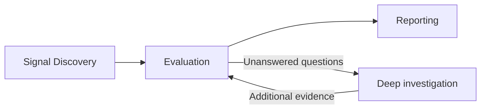

# Vulnerability discovery service

Discover potential vulnerabilities, evaluate the evidence, and produce actionable
reports. The MVP has three stages: **Signal Discovery → Evaluation → Reporting**.



## 1. Signal Discovery

Plugins identify potential security issues:

- **SAST:** CodeQL and other static analysis tools.
- **AI policy detection:** inspect code and workflows for violations of security
  policies, such as missing tenant isolation or authorization checks.
- **Future plugins:** dependency analysis, configuration checks, fuzzing, and
  dynamic testing.

Each plugin produces signals in a common format: the suspected issue, affected
code or workflow, supporting evidence, and unresolved assumptions. It also records
what it checked and any coverage gaps or failures.

AI discovery can find issues independently of SAST alerts. Signals are candidates
for evaluation, not confirmed vulnerabilities. Related signals can share an
investigation while retaining their original evidence.

## 2. Evaluation

Determine whether each candidate is a vulnerability and assess its severity.

1. Apply deterministic checks and filters where available.
2. Inspect the relevant code, controls, attacker prerequisites, and impact.
3. Investigate unresolved questions when additional analysis can answer them.

| Outcome | Meaning |
| --- | --- |
| `confirmed` | Evidence supports the vulnerability and its required conditions. |
| `refuted` | Evidence disproves the suspected issue. |
| `needs_review` | Evidence is insufficient; record the unanswered questions and next action. |

Missing information does not establish safety. Severity reflects the supported
impact and exposure rather than simply inheriting a detector's default score.

### Deep investigation

Deep investigation is an optional part of Evaluation, rather than a separate
pipeline stage. It follows specific questions through callers, data flow, shared
controls, configuration, or other relevant evidence.

For example: “Can one user access another user’s private data?”

If available analysis cannot answer a question, retain `needs_review` and identify
what is needed, such as deployment information or a runtime test. Stop when the
case is resolved, blocked, or reaches its investigation budget.

## 3. Reporting

Generate JSON and Markdown reports containing:

- Confirmed findings with severity, evidence, prerequisites, and affected locations.
- Unresolved cases with questions and suggested next actions.
- Scan scope, coverage gaps, and failures.

Keep refuted cases available for review. Reports reflect recorded evaluation
results.

## Future capabilities

### Reproduction and patching

Runtime validation can answer unresolved evaluation questions or demonstrate a
confirmed finding. Preserve reproduction steps, example payloads, observations,
and limitations. Generating a reproducer does not mean it ran successfully.

Patching produces a proposed fix and regression test for an accepted finding.
Verify both that the vulnerability is addressed and legitimate behavior still
works. Track source-based conclusions, successful reproductions, and verified
patches separately.

### Self-improvement

Use reviewed findings, false positives, known misses, and analysis costs to improve
detectors, filters, policies, and investigation methods. Where possible, turn
repeated LLM analysis into deterministic checks.

Run improvement separately from scans. Test changes against vulnerable and safe
examples before releasing a new version. Measure detection accuracy, coverage,
latency, and cost; fewer alerts alone does not demonstrate improvement.

## MVP scope

Start with SAST and AI policy discovery, evaluation with optional deep
investigation, and reporting. Preserve evidence and progress so interrupted work
can resume. Add runtime reproduction, patching, and self-improvement later.

## Implemented skeleton

The `scanner/` Python package and `src/scanner/` Node adapter establish the
protocol and integration boundaries. This is a scaffold: detector execution,
source investigation, durable analysis state, the API task loop, and report
generation are not implemented. Unsupported operations return
`code: not_implemented`, exit code 3, and zero model calls/source reads. They
create no findings or runs. An unsupported operation is not an empty clean scan.

| Responsibility | Owner |
| --- | --- |
| Policies, task instructions, workflow stages, evidence, reports | Python scanner |
| Container lifecycle, MCP client, shared application routing | Node adapter |
| Reasoning inside Muse | Active Muse session and its settings |
| Standalone reasoning | Future Node API task driver with explicit provider settings |

Muse mode never consults an LLM API profile or makes independent model calls.
It requires no extra LLM configuration. Subscription billing depends on the
active Muse configuration; MCP does not attest it. Direct CLI analysis requires
an explicitly configured standalone API profile and credential environment
variable. The scaffold validates that configuration and then returns
`not_implemented` without contacting the provider. No Muse credential extraction
or automatic billing fallback is provided.

```sh
bypass discover --plan
bypass scanner doctor
bypass scanner prepare
bypass discover --sarif findings.sarif
bypass discover status <run>
bypass discover resume <run>
bypass discover cancel <run>
bypass discover report <run> --format md
```

Planning works before project initialization and without Docker or model setup.
Doctor only checks Docker/image availability. Prepare explicitly builds a local
Python-only scaffold image; it does not install CodeQL or enable analysis. The
SARIF/config paths are contract inputs and are not read yet. Status, cancellation,
and reports require no API profile; starting/resuming standalone AI does.

Inside Muse use `/bypass:discover` or `bypass_discover` with `plan: true`.
Matching typed tools expose lifecycle and the future next-task/evidence/submission
interfaces. The intended task loop is next task → scoped evidence tools → typed
submission. Python will validate and persist results and schedule fast/deep work;
Muse or the CLI API driver will supply reasoning. The current command explains
the scaffold limitation and stops rather than launching a nested agent.

The shared wire schemas and operation inputs live in `scanner/protocol/v1.json`.
Python and Node load that same manifest. The container exposes stdio MCP
initialization, tool discovery, and capability inspection. All analysis tools are
declared but explicitly unavailable. Tests cover both transports, execution-mode
guards, malformed responses, cancellation/cleanup, and no-side-effect behavior.

The scanner ships in the same repository and plugin package. Packaging uses an
explicit allowlist that excludes tests, Python caches, and local artifacts. The
external Scratch repository is unchanged; its implementation will be ported in
later changes. Existing Bypass assessment flows remain separate. Future scanner
artifacts belong under `.bypass/scanner/`.

See [scanner development and transport instructions](../scanner/README.md).
